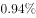

# 文字综合分析·选非题（年均增长量+两期比重差逆推增长率+结构倒减）

考点：[[20-考点/资料分析/综合/文字综合分析·选非题（年均增长量+两期比重差逆推增长率+结构倒减）|综合 / 文字综合分析·选非题（年均增长量+两期比重差逆推增长率+结构倒减）]]
材料：[[15-材料/资料分析/186402 2015年11月1日零时全国人口抽样|186402 2015年11月1日零时全国人口抽样]]

**问法模型**：题干问'下列说法不正确的是'→对四项分别套用'年均增量=总增量÷年数''基期部分量=基期总量×基期比重（比重差逆推）''两期比重升降判增长率方向''部分和=总体−其余各部分'，找出错误项

## 推理链
1. 第1步：材料第一段给出2015年11月1日零时江苏常住人口7973万人、较2010年六普增加107万人、间隔5年，A项年平均增加=107÷5≈21.4万≈21万人，A正确
2. 第2步：B项需跨段回推：2015年15~64岁5910万人，比重=5910/7973≈74.1%；2010年该比重=74.1%+1.97%≈76.1%，基期总人口=7973−107=7866万人
3. 第3步：2010年15~64岁人口=7866×76.1%≈5986万人，实际下降率=(5986−5910)/5986≈76/5986≈1.27%，选项把比重下降的'1.97个百分点'当作人口下降率，与实际约1.27%不符，B错误
4. 第4步：C项用两期比重结论：总人口增长率=107/7866≈1.36%，比重上升的组增长率高于1.36%、比重下降的组低于1.36%，故只需比较0~14岁与65岁及以上两组
5. 第5步：0~14岁基期比重=1064/7973−0.34%≈13.0%，基期量≈7866×13.0%≈1023万，增长率≈(1064−1023)/1023≈4.0%；65+基期比重=999/7973−1.64%≈10.9%，基期量≈857万，增长率≈142/857≈16.6%，65+增长率最大，C正确
6. 第6步：D项小学文化程度以下（不含小学）=7973−(1230+1356+2741+1744)=7973−7071=902万人，D正确
7. 第7步：四项中仅B不正确，本题为选非题，锁定B，与官方答案一致

**最快解法**：⚡ 识陷阱+口算排除：A项107/5≈21直接排除；B项抓核心'百分点≠增长率'——基期量7866×(5910/7973+1.97%)≈5986万＞现期5910万，实际仅降约1.3%，选项按1.97个百分点报下降率必错，秒锁B；C项65+比重升幅1.64个百分点远大于0~14岁的0.34且基期占比更小，增长率必最大；D项倒减7973−7071=902口算验证

## 易错点
- ⚠ 把'比重下降1.97个百分点'直接当成15~64岁人口下降1.97%——百分点只能与比重做加减，人口下降率必须先回推基期比重76.1%和基期量5986万，实际约1.27%
- ⚠ 跨段拼数据陷阱：基期总人口(7973−107=7866万)在第1段、比重变化百分点在第2段，漏读'同第六次全国人口普查相比'引导的数据则B、C无法求解
- ⚠ 选非题要看清'不正确的是'；D项'小学以下（不含小学）'材料未直接给出，须用总人口倒减四档学历之和得902万，且'大专及以上'已含本科、研究生，各档不重叠

## 母题抽象
> 🧩 当综合'选非'题出现'某组比重上升/下降X个百分点'时，用两期比重差逆推模板：基期比重=现期比重∓百分点变化、基期总量=现期总量−增长量，再求真实增长率与选项百分点数对照——百分点变化≠增长率，命题必在此设陷

**同类特征**：下列说法不正确的是（选非题）、年平均增加、比重下降1.97个百分点、65岁及以上人口的增长率高于其他年龄段、小学文化程度以下（不含小学）、纯文字材料跨段拼基期数据

## 相关题
- [[10-真题/资料分析/综合/4651883 综合判断选非题：增速差单位辨析（百分点vs百分数）+两期比重升降判断+增长量计算与比较|4651883]]（深圳市考 2022，相关度1）
- [[10-真题/资料分析/综合/2042812 综合判断（选非题）——比重、排序一致性、求和、平均数混合验证|2042812]]（江苏 2017，相关度1）
- [[10-真题/资料分析/增长/2042848 年均增长量计算|2042848]]（江苏 2017，相关度1）

---

### 题干
下列说法不正确的是：

### 选项
- A. 
两次调查的5年间，江苏常住人口年平均增加21万人

- B. 
两次调查的5年间，江苏常住人口中15~64岁人口下降了
　✅
- C. 
两次调查的5年间，江苏常住人口中65岁及以上人口的增长率高于其他年龄段

- D. 
2015年11月1日零时江苏常住人口中，小学文化程度以下（不含小学）人口为902万人

### 官方解析
A项：定位材料第一段，两次调查的5年间，江苏常住人口增加107万人，平均增加：万人，正确；
B项：定位材料第一、二段，2015年11月1日零时江苏常住人口为7973万人，同第六次全国人口普查比增加107万人，其中15~64岁人口有5910万人，占比为，同第六次全国人口普查比重下降1.97百分点。故2010年11月1日零时江苏常住人口中15~64岁人口为：万人，下降率为：，错误；
C项：定位材料第二段，2015年11月1日零时0～14岁人口占，同第六次全国人口普查相比，比重上升0.34个百分点；15～64岁人口占，比重下降1.97个百分点；65岁及以上人口占，比重上升1.64个百分点。根据两期比重比较结论：岁和65岁及以上人口的比重上升，则增长率大于常住人口增长率；岁人口的比重下降，则增长率小于常住人口增长率，故65岁及以上人口的增长率高于15～64岁人口的增长率。
定位材料第一段，江苏常住人口增长率为，代入两期比重差公式：
岁人口：，解得；
65岁及以上人口：，解得，故65岁及以上人口的增长率最大，高于其他年龄段,正确；
D项：定位材料第一段和第三段，2015年11月1日零时江苏常住人口为7973万人，全省常住人口中，大专及以上文化程度人口为1230万人，高中（含中专）文化程度人口为1356万人；初中文化程度人口为2741万人；小学文化程度人口为1744万人。则小学文化程度以下（不含小学）人口为：万人，正确。
本题为选非题，故正确答案为B。

### 给定材料

        在以2015年11月1日零时为标准时点进行的全国人口抽样调查中。江苏最终样本量占全省常住人口总数的。调查显示：2015年11月1日零时江苏常住人口为7973万人。同以2010年11月1日零时为标准时点进行的第六次全国人口普查相比，增加107万人，增长。

        全省常住人口中，0~14岁人口为1064万人，占；15~64岁人口为5910万人，占；65岁及以上人口为999万人，占。同第六次全国人口普查相比，0~14岁人口的比重上升0.34个百分点，15~64岁人口的比重下降1.97个百分点，65岁及以上人口的比重上升1.64个百分点。

        全省常住人口中，大专及以上文化程度人口为1230万人，高中（含中专）文化程度人口为1356万人；初中文化程度人口为2741万人；小学文化程度人口为1744万人。

