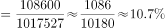
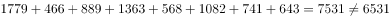
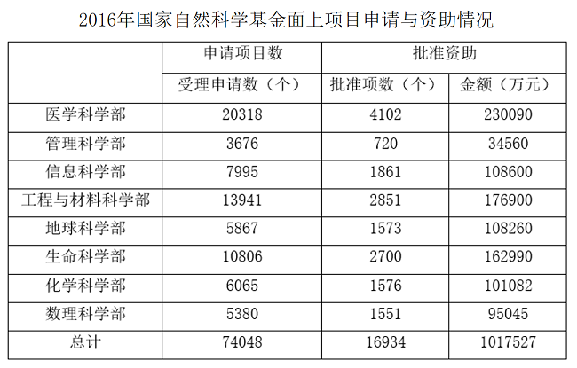
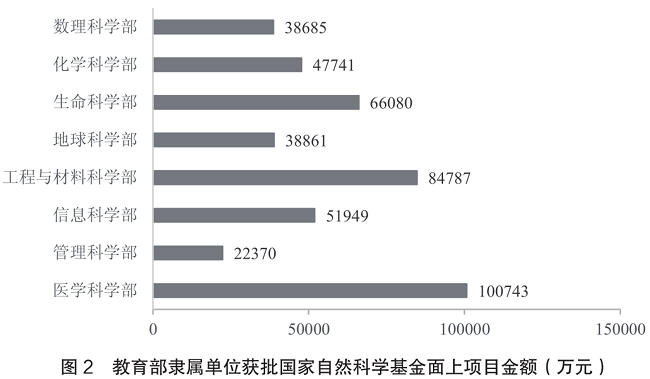

# 综合判断（选非题）——比重、排序一致性、求和、平均数混合验证

考点：[[20-考点/资料分析/综合/综合判断（选非题）——比重、排序一致性、求和、平均数混合验证|综合 / 综合判断（选非题）——比重、排序一致性、求和、平均数混合验证]]
材料：[[15-材料/资料分析/186506 2016年国家自然科学基金面上项目在|186506 2016年国家自然科学基金面上项目在]]

**问法模型**：“下列说法不正确的是”→选非题模型：对四个说法按“查找比对类先行、计算类殿后”逐项验证，锁定唯一错误项

## 推理链
1. 第1步：题干为选非题，A考比重、B考两列排序是否同序、C考图1八部求和、D考平均资助金额，需逐项验证
2. 第2步：A项——表格中信息科学部批准资助金额108600万元、资助总金额1017527万元，108600÷1017527≈10.7%，与选项表述一致，A正确
3. 第3步：B项——受理申请数排序为医学20318＞工程与材料13941＞生命10806＞信息7995＞化学6065＞地球5867＞数理5380＞管理3676，对应批准项数4102＞2851＞2700＞1861＞1576＞1573＞1551＞720，两列完全同序，B正确
4. 第4步：C项——图1教育部隶属单位获批项数求和：643+741+1082+568+1363+889+466+1779=7531个，并非6531个，相差整整1000，C错误
5. 第5步：D项——平均资助金额=总金额÷总批准项数=1017527÷16934≈60.09万元≈60万元，D正确
6. 第6步：选非题选错误项，四个选项中仅C错误，故答案为C

**最快解法**：⚡ 凑整分组加和法验证C：图1八个数分组（1779+1363≈3142；1082+889≈1971；741+643≈1384；568+466≈1034），合计≈7531，与选项6531差1000，直接锁定C；B项只需目测表格两列排序是否同序，D项用1017527÷16934≈60估算，均无需精算

## 易错点
- ⚠ 选非题方向陷阱：问“不正确的是”，A/B/D均为正确说法，惯性按“选正确”作答会误选失分
- ⚠ 口径混淆：C项求和必须用图1“教育部隶属单位”子口径的8个数，绝不能用表格总计16934个（全口径），两套同名指标数值完全不同
- ⚠ 求和与行序陷阱：7531与6531仅差1000，漏加某部或抄错数可能误判C正确；图1自上而下为数理→医学，与表格首行医学的行序相反，读图取数易串行
- ⚠ 单位陷阱：金额均为万元，D项结果为60万元/项；C、D计算时勿把万元当亿元，也勿误用受理申请数74048作分母

## 母题抽象
> 🧩 当题干出现“下列说法（不）正确的是”特征时，按“查找比对类（排序一致性、直接求和）→计算类（比重、平均数）”顺序逐项验证，查找类可快速排除多项，计算类用截位估算即可锁定唯一错误项

**同类特征**：下列说法不正确的是（选非题）、综合判断四个选项、跨图表取数（图1+表格）、八部数据求和验证、平均资助金额=总金额÷总批准项数、两列指标排序一致性比对

## 相关题
- [[10-真题/资料分析/综合/4651883 综合判断选非题：增速差单位辨析（百分点vs百分数）+两期比重升降判断+增长量计算与比较|4651883]]（深圳市考 2022，相关度1）
- [[10-真题/资料分析/综合/13504445 综合判断选非题（基期增长量计算+混合增长率比重比较+两期平均数比较+总量构成差）|13504445]]（河北 2025，相关度1）
- [[10-真题/资料分析/综合/16070148 综合判断题（柱状图多期加总比较＋表格基期量计算＋数据可得性判断＋比重比较）|16070148]]（贵州 2026，相关度1）
- [[10-真题/资料分析/综合/2042106 文字综合分析·选非题（年均增长量+两期比重差逆推增长率+结构倒减）|2042106]]（江苏 2017，相关度1）
- [[10-真题/资料分析/综合/2062846 综合判断题（选非）——增长量贡献比较+比重估算|2062846]]（广州市考 2016，相关度1）

---

### 题干
下列说法不正确的是：

### 选项
- A. 
2016年国家自然科学基金面上项目中，信息科学部的批准资助金额占资助总金额的

- B. 
2016年国家自然科学基金面上项目受理申请项数较多的科学部批准项数也较多

- C. 
2016年教育部隶属单位获批国家自然科学基金面上项目的总项数是6531个
　✅
- D. 
2016年国家自然科学基金面上项目的平均资助金额是60万元

### 官方解析

A项：定位表格可得，2016年国家自然科学基金面上项目中，信息科学部批准资助金额占资助总金额的比重，正确；

B项：直接查找表格可知，2016年国家自然科学基金面上项目，受理申请项数越多的科学部，批准项数也越多，正确；

C项：定位柱状图一可得，2016年教育部隶属单位获批基金面上项目总数为个，错误；

D项：定位表格，2016年国家自然科学基金面上项目的平均资助金额万元，正确。

本题为选非题，故正确答案为C。

### 给定材料

> [!warning] 疑点（官方解析可能有误，待人工复核）
> 官方解析C项数值处留空（正确值应为7531个，即图1八部之和），A项公式图片不可读无法核读具体百分数，但均不影响结论判定：C项7531≠6531为唯一错误项，答案C无误

<!-- CODEX-ANSWER-REVIEW:BEGIN -->
### 本次独立复核

**复核状态：** `resolved`（答案与解析已核定）

**计分答案：** C（可计分）

**复核解析：**

图1教育部隶属单位八个科学部获批面上项目数相加为7531项，不是选项所称6531，故C错误。其余项：表中受理数排序与批准数排序一致；信息科学部资助金额占比及总平均资助额均与选项相符。题问不正确，唯一为C。

**相关信息：**

平均资助金额=资助总额/批准项目数；排序比较同一统计口径。

**题源依据：** [固定版本原题](https://github.com/Mentat-Uran/kaogongzhentizhengliu/blob/84ab93d4b64b61d897bece8a1c0a5bab06b4feb2/10-%E7%9C%9F%E9%A2%98/%E8%B5%84%E6%96%99%E5%88%86%E6%9E%90/%E7%BB%BC%E5%90%88/2042812%20%E7%BB%BC%E5%90%88%E5%88%A4%E6%96%AD%EF%BC%88%E9%80%89%E9%9D%9E%E9%A2%98%EF%BC%89%E2%80%94%E2%80%94%E6%AF%94%E9%87%8D%E3%80%81%E6%8E%92%E5%BA%8F%E4%B8%80%E8%87%B4%E6%80%A7%E3%80%81%E6%B1%82%E5%92%8C%E3%80%81%E5%B9%B3%E5%9D%87%E6%95%B0%E6%B7%B7%E5%90%88%E9%AA%8C%E8%AF%81.md)；固定内容 commit `84ab93d4b64b61d897bece8a1c0a5bab06b4feb2`，Markdown blob `f1b90791077be92f5806554d6159d12f65bf3682`。
<!-- CODEX-ANSWER-REVIEW:END -->
