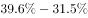
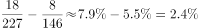

# 综合判断题（选非）——比重差比较＋总量×比重＋两期末比重差多考点混合验证

考点：[[20-考点/资料分析/综合/综合判断题（选非）——比重差比较＋总量×比重＋两期末比重差多考点混合验证|综合 / 综合判断题（选非）——比重差比较＋总量×比重＋两期末比重差多考点混合验证]]
材料：[[15-材料/资料分析/186512 J省S市2015年（对比2010年-|186512 J省S市2015年（对比2010年-]]

**问法模型**：'下列判断不正确的是'→选非题，对四个陈述逐项代入对应模型（部分=总量×比重、'X%以上'反向、相邻年份比重百分点差、两期末时点比重差）验证，锁定唯一错误项

## 推理链
1. 第1步：题干为选非题，需逐项验证；提取数据：表格中发明专利申请量占全省比重2011-2015年为21.3%、22.9%、31.5%、39.6%、43.8%，2015年万人发明专利拥有量27.4件；文字段：人才总数146万→227万、高层次人才8万→18万（均为年末数），企业占发明专利拥有量的90%
2. 第2步：A项用'部分=总量×比重'模型：27.4×90%=24.66≈24.7件，与选项'24.7件'一致，A正确
3. 第3步：B项用反向表述规则：大型企业'××%以上'建有独立研发机构，则没有独立研发机构的占比＜（100−××）%，与选项'不到××%'一致，B正确
4. 第4步：C项用'相邻年份比重差（百分点）'模型：2015年增幅=43.8−39.6=4.2个百分点，2014年增幅=39.6−31.5=8.1个百分点（进一步算2013年增幅=31.5−22.9=8.6个百分点更大）
5. 第5步：因8.1＞4.2（且2013年8.6为最大），'十二五'期间申请量占全省比重年增幅最大的年份是2013年而非2015年，C表述错误
6. 第6步：D项两期末比重差：2015年末18/227≈7.9%，2010年末8/146≈5.5%，提高约2.4≈2个百分点，D正确；本题为选非题，故答案为C

**最快解法**：⚡ 选非题先做最能秒杀的一项：C项直接查表相减——43.8−39.6=4.2个百分点 vs 39.6−31.5=8.1个百分点，2014年增幅明显大于2015年，一步锁定C，A/B/D无需再精算

## 易错点
- ⚠ 选非题漏看'不正确'三个字，误把正确项A/B/D当作答案
- ⚠ C项'年增幅'是相邻两年比重的百分点之差而非增长率；易被'2015年比重43.8%为历年最高'误导成'增幅最大'，实际最大增幅出现在2013年（8.6个百分点）
- ⚠ D项时间口径：'十二五'末=2015年末、'十一五'末=2010年末，均为年末时点数直接作比；146/227、8/18是存量不是期间增量，且结果为百分点差不是百分比

## 母题抽象
> 🧩 当题干出现'下列判断不正确的是'且选项跨段落跨表格时，逐项匹配模型（总量×比重、'X%以上'取反、相邻年份查表相减、两期末时点比重差），优先做查表相减类选项秒杀锁定错误项

**同类特征**：选非题·判断不正确、综合判断·多考点混合、申请量占全省比重逐年表格、年增幅=相邻年份百分点差、十二五/十一五期末时点对比、总量×比重求部分

## 相关题
- [[10-真题/资料分析/综合/2172282 综合判断选非题（差额逐年变化比较+倍数估算+基期发生率还原）|2172282]]（江苏 2018，相关度1）

---

### 题干
下列判断不正确的是：

### 选项
- A. 
2015年该市万人发明专利拥有量中有24.7件来自企业

- B. 
2015年，该市大型企业中，没有独立研发机构的不到

- C. 
“十二五”时期，该市发明专利申请量占全省的比重年增幅最大的年份是2015年
　✅
- D. 
“十二五”时期末，该市高层次人才数占人才总数的比重比“十一五”时期末提高了2个百分点

### 官方解析

A项：定位文字材料第三段可得“2015年该市发明专利拥有量的90%来自于企业”，定位表格可得，2015年万人拥有量为27.4件，则万人发明专利拥有量中来自企业的为件，正确；

B项：定位文字材料第一段可得“以上的大型企业建有独立研发结构”，则没有独立研发机构的占比少于，正确；

C项：定位表格可得，2015年该市发明专利申请量占全省的比重为，2014年比重为，2013年比重为，则2015年增长个百分点，2014年增长个百分点，2014年比重增幅超过2015年，错误；

D项：定位文字材料第二段可得“人才总数由2010年末的146万人增加到2015年末的227万人。其中，高层次人才由2010年末的8万人增加到2015年末的18万人”，则“ 十二五” 时期末，高层次人才数占人才总数的比重比“十一五” 时期末提高，正确。

本题为选非题，故正确答案为C。 

### 给定材料

        2015年J省S市全社会研发经费投入占地区生产总值的比重为，比2010年提高0.3个百分点。其中，规模以上工业企业研发经费投入占全社会研发经费投入的。规模以上工业企业中，建有独立研发机构的占，以上的大型企业建有独立研发机构。

        2015年末该市拥有技术企业3478家，人才总数由2010年末的146万人增加到2015年末的227万人。其中，高层次人才由2010年末的8万人增加到2015年末的18万人。每万名劳动者中研发人员由158人增加到175人。

        2015年该市发明专利拥有量的90%来自于企业，2010-2015年S市发明专利申请量、授权量占全省专利申请量、授权量的比重，以及万人发明专利拥有量情况见下表。

> [!warning] 疑点（官方解析可能有误，待人工复核）
> D项按所给数据精确计算：18/227−8/146≈7.93%−5.48%≈2.45个百分点，与选项'提高2个百分点'存在取整口径偏差（官方解析数值因转写缺失，判D正确）；该分歧不影响本题答案——C项2014年增幅8.1＞2015年4.2的错误判定明确，正确答案仍为C
