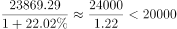
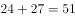
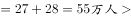
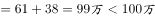

# 综合推论题（逐项验证：基期不可推判定＋加总比较排名＋全称命题找反例＋逐行两列大小比较）

考点：[[20-考点/资料分析/综合/综合推论题（逐项验证：基期不可推判定＋加总比较排名＋全称命题找反例＋逐行两列大小比较）|综合 / 综合推论题（逐项验证：基期不可推判定＋加总比较排名＋全称命题找反例＋逐行两列大小比较）]]
材料：[[15-材料/资料分析/186642 2011—2015年全国教育经费总投|186642 2011—2015年全国教育经费总投]]

**问法模型**：“以下推论准确的是”→对四个选项逐一独立验证：A为基期回推（增速缺失判“无法推出”）、B/C为两列加总后与阈值或他省比较、D为逐行比较“本科院校在校>专科院校在校”，排除三项得唯一正确项

## 推理链
1. 第1步：A项验证——材料仅给2011年全国教育经费总投入23869.29亿元，2011年“比上年增长”的增速数值缺失，无法回推2010年数值，“超过20000亿元”无从推出，A错误
2. 第2步：B项验证——招生总数=本科院校+专科院校：河南24+27=51万人，广东27+28=55万人，55>51，河南在已列省份中即非第一（且材料只给部分省（市），全国排名更无从判定），B错误
3. 第3步：C项验证——在校总数=本科院校+专科院校：浙江61+38=99万人<100万人，出现反例，“除北京外均超过100万”不成立，C错误（北京51+10=61万已被选项自身排除在外）
4. 第4步：D项验证——逐省比较“本科院校在校”与“专科院校在校”两列：安徽62>51、北京51>10、广东104>82、河北68>50、河南100>77、湖南68>50、江苏103>68、山东98>92、四川78>60、浙江61>38
5. 第5步：10个省（市）全部满足本科院校在校人数大于专科院校在校人数，D项“均大于”的全称判断成立
6. 第6步：A、B、C均被排除，D为唯一可推出的准确结论，故正确答案为D

**最快解法**：⚡ 排除法＋两列口算扫描：A项增速缺失直接判“无法推出”排除；B项口算加总55（广东）>51（河南）排除；C项只需找反例，扫到浙江61+38=99<100即排除；D项扫“在校”两列大小，仅山东98>92差距较小需细看，其余各省差距明显一眼可判，约1分钟锁定D

## 易错点
- ⚠ 推论题中“无法推出”也判错误：A项2011年增速缺失，不是计算后不满足，而是条件不足无法判定，同样不能选
- ⚠ B项易只看本科单一列取数：河南本科招生24万虽是已列省份最高，但必须本（24）+专（27）加总后与广东27+28=55万比较，串列/漏加即误判
- ⚠ C项“均超过100万”是全称命题，只需找到一个反例（浙江99万）即可推翻，不必逐省全算；注意“除北京市外”已把北京51+10=61万排除，反例须另找
- ⚠ D项最接近的一组山东98>92易看错方向（误认为专科反超），其余差距大可快速扫描，全称判断须10省全查不可抽查

## 母题抽象
> 🧩 当题干出现“以下推论准确的是”时，按三招逐项排雷：条件不足的选项判“无法推出”直接排除、全称命题（“均”“都”）只需找一个反例、排名比较须先加总再比，余下逐行验证的唯一成立项即答案

**同类特征**：以下推论准确的是、综合分析/逐项判断题、无法推出也算错误、全称命题找反例（均超过/均大于）、两列加总后比较排名、表格逐行大小比较

## 相关题
（暂无）

---

### 题干
根据上述资料，以下推论准确的是（  ）。

### 选项
- A. 2010年，全国教育经费总投入超过20000亿元
- B. 2015年，河南省普通本专科院校招生总人数位列全国第一
- C. 除北京市外，其他省（市）普通本专科院校在校总人数均超过100万
- D. 上表所列省（市），普通本科院校在校人数均大于该省（市）普通专科院校在校人数　✅

### 官方解析

A项：定位文字材料第一段，2010年全国教育经费总投入亿元，错误；

B项：定位数据表中第二、三列，2015年河南普通本专科院校招生总人数，2015年广东普通本专科院校招生总人数2015年河南普通本专科院校招生总人数，且材料只给出部分省市的招生人数，其他省份情况未知不能判断，错误；

C项：定位数据表中第四列和第五列,浙江省本专科院校在校人数，且材料只给出部分省（市）的在校人数，其他省份情况未知不能判断，错误；

D项：定位数据表中第四列和第五列，所有省（市）需满足第四列第五列，通过比较，所有省（市）均满足该条件，正确。

故正确答案为D。

### 给定材料

        2011年，全国教育经费总投入为23869.29亿元，比上年增长。2012年，全国教育经费总投入比上年增加3826.68亿元。2013年，全国教育经费总投入比上年增长，比2009年翻了一番。2014年，全国教育经费总投入32806.46亿元。2015年1-9月，全国财政教育支出累计同比增长。

        2015年，全国普通本专科院校招生人数约为737万人，其中普通本科院校招生人数389万人，比普通专科院校多41万人；在校人数约为2626万人，其中普通本科院校约1577万人，普通专科院校约1049万人；毕业人数约为1000万人，其中普通本科院校约占，普通专科院校约占。

> [!warning] 疑点（官方解析可能有误，待人工复核）
> 给定材料文本中2011年增速、2013年增速、2015年1-9月增速等百分数位置缺失，A项2010年数值在给定文本下严格只能判“无法推出”；官方解析判A错误的结论可保留，具体2010年数值须以原卷完整增速数据为准。

<!-- CODEX-ANSWER-REVIEW:BEGIN -->
### 本次独立复核

**复核状态：** `resolved`（答案与解析已核定）

**计分答案：** D（可计分）

**复核解析：**

1. A项：原公式图给出2011年教育经费总投入同比增长22.02%，回推2010年为23869.29/1.2202≈19561.8亿元，低于20000亿元，A错误。
2. B项：河南普通本专科招生总数=24+27=51万人；广东=27+28=55万人，已列数据中广东更多，且材料只列部分省市，不能推出河南全国第一，B错误。
3. C项：浙江在校总人数=本科61+专科38=99万人，小于100万，已构成反例，C错误。
4. D项：逐一比较表列10个省（市）的普通本科与普通专科在校人数，安徽62＞51、北京51＞10、广东104＞82、河北68＞50、河南100＞77、湖南68＞50、江苏103＞68、山东98＞92、四川78＞60、浙江61＞38，均满足本科人数更多。
故唯一准确项为D。

**相关信息：**

考點：综合推论题（逐项验证：基期不可推判定＋加总比较排名＋全称命题找反例＋逐行两列大小比较）。來源：2017年广州市公务员录用考试《行测》题（单考区卷）；2017年。> 🧩 当题干出现“以下推论准确的是”时，按三招逐项排雷：条件不足的选项判“无法推出”直接排除、全称命题（“均”“都”）只需找一个反例、排名比较须先加总再比，余下逐行验证的唯一成立项即答案

**同类特征**：以下推论准确的是、综合分析/逐项判断题、无法推出也算错误、全称命题找反例（均超过/均大于）、两列加总后比较排名、表格逐行大小比较

**题源依据：** [固定版本原题](https://github.com/Mentat-Uran/kaogongzhentizhengliu/blob/84ab93d4b64b61d897bece8a1c0a5bab06b4feb2/10-%E7%9C%9F%E9%A2%98/%E8%B5%84%E6%96%99%E5%88%86%E6%9E%90/%E7%BB%BC%E5%90%88/2045752%20%E7%BB%BC%E5%90%88%E6%8E%A8%E8%AE%BA%E9%A2%98%EF%BC%88%E9%80%90%E9%A1%B9%E9%AA%8C%E8%AF%81%EF%BC%9A%E5%9F%BA%E6%9C%9F%E4%B8%8D%E5%8F%AF%E6%8E%A8%E5%88%A4%E5%AE%9A%EF%BC%8B%E5%8A%A0%E6%80%BB%E6%AF%94%E8%BE%83%E6%8E%92%E5%90%8D%EF%BC%8B%E5%85%A8%E7%A7%B0%E5%91%BD%E9%A2%98%E6%89%BE%E5%8F%8D%E4%BE%8B%EF%BC%8B%E9%80%90%E8%A1%8C%E4%B8%A4%E5%88%97%E5%A4%A7%E5%B0%8F%E6%AF%94%E8%BE%83%EF%BC%89.md)；固定内容 commit `84ab93d4b64b61d897bece8a1c0a5bab06b4feb2`，Markdown blob `68645ffbcdbb03e8cbdd6be8545a535b559d035f`。
<!-- CODEX-ANSWER-REVIEW:END -->
