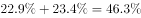
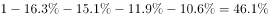
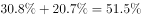

# 综合判断题（跨档占比加和与50%判断＋群体排序定位＋数据可得性判断，数正确个数）

考点：[[20-考点/资料分析/综合/综合判断题（跨档占比加和与50%判断＋群体排序定位＋数据可得性判断，数正确个数）|综合 / 综合判断题（跨档占比加和与50%判断＋群体排序定位＋数据可得性判断，数正确个数）]]
材料：[[15-材料/资料分析/186648 某次社会调查（样本1328人）的受访|186648 某次社会调查（样本1328人）的受访]]

**问法模型**：题干出现'以下说法推论正确的有几个'的打包判断问法 → 对每条表述分别定性：跨档占比相加后与50%比较、排位需全部群体数据可得、缺数据的直接判'无法判定'，最后数出正确条数对照选项

## 推理链
1. 第1步：从题干拆解四条表述的口径：(1)'4000元以上'需将材料第五段'4001-6000元'与'6000元以上'两档占比相加；(2)'第三大受访群体是学生'需对全部受访群体重新排序；(3)'20-44岁'需将材料第二段'30-44岁'与'20-29岁'两档占比相加；(4)涉及'离退休人员中无收入'的交叉数据。
2. 第2步：验(1)：材料第五段中4001-6000元与6000元以上（该档比去年仅增4.2个百分点）两档占比相加后不足总人数1328人的50%，不满足'占大部分'（占比>50%），(1)错误。
3. 第3步：验(2)：材料第四段只明确专业技术人员居首位、商业服务人员次之两个排位，其余受访群体占比未完整给出，无法确认学生是第三大群体，(2)无法判定，错误。
4. 第4步：验(3)：30-44岁占比与20-29岁占比之和（占比较大）达到总体的一半，即20-44岁受访者占'半壁江山'成立，(3)正确。
5. 第5步：验(4)：材料第四段仅给出离退休人员的占比，全文未涉及离退休人员的收入分布，'离退休人员中有人没有收入'无数据支撑，(4)无法判定，错误。
6. 第6步：四条中只有(3)正确，正确个数=1个，对照选项A（1个）当选。

**最快解法**：⚡ 定性排除法＋跨档加和：(2)(4)属'材料未涉及、数据不可得'，直接判'无法判定'划掉，无需任何计算；剩余(1)(3)只需比较'两档占比之和与50%'——(1)4001-6000元＋6000元以上之和不足一半、(3)20-29岁＋30-44岁之和过半，故仅(3)正确，数出1个选A。

## 易错点
- ⚠ 跨档拼接口径：(1)'4000元以上'=4001-6000元＋6000元以上两档相加（注意4000元整的边界措辞），漏加一档会误判；且'占大部分'的标准是占比>50%，不是'占比最高'或'接近一半'。
- ⚠ '第三大群体'的排序范围是全部受访群体（含职业、年龄等各维度所有档位），材料只明确前两名，误把'学生占比较高'当成排第三会错判；此类选项是'数据不可得'定性题，硬算反而掉坑。
- ⚠ (3)'半壁江山'指约占一半，须将20-29岁与30-44岁两档相加后再判断，单独看30-44岁一档会错；(4)混淆'离退休人员占比'与'其中无收入者比例'两个口径，后者材料完全未给，属无中生有。

## 母题抽象
> 🧩 当题干出现'以下说法正确的有几个'且各条混有区间拼接、排位、过半判断时，先用'数据可得性'排除（材料没给的直接判无法判定），再对可算项做'两档占比相加后与50%比较'，数出正确个数即得答案。

**同类特征**：推论正确的有（几个）、占大部分、第三大受访群体、半壁江山、跨档加和（20-44岁/4000元以上）、无法判定/材料未涉及

## 相关题
（暂无）

---

### 题干

以下关于这次调查的说法，推论正确的有（  ）。

（1）月收入在4000元以上的受访者占大部分；

（2）在所有受访者中，第三大受访群体是学生；

（3）20-44岁的受访者占了受访者总体的半壁江山；

（4）离退休人员中有的人没有收入。

### 选项
- A. 1个　✅
- B. 2个
- C. 3个
- D. 4个

### 官方解析

（1）定位材料第五段，月收入在4000元以上者包括收入4001-6000元、6000元以上者，占比为，占比不足总人数一半，非大部分，错误；

（2）定位材料第四段，只明确给出第一、二大受访群体，还有受访群体数据未知，不能确定学生一定是第三大受访群体，所以无法判定，错误；

（3）定位材料第二段，30-44岁、20-29岁占比分别为、，则20-44岁占比，正确；

（4）材料没有涉及离退休人员收入的数据，无法判定，错误。

正确的只有（3）1个。

故正确答案为A。

### 给定材料

        在我国某次调查中，受访者人数为1328人，其中男性受访者共673人，略高于女性受访者的655人。

        从年龄结构看，30-44岁的受访者居多，占；其次是45-59岁的受访者，占；20-29岁的受访者占；60-74岁的受访者占；20岁以下（不含20岁）和75岁以上的受访者占比比较低，分别是和。

        就受教育程度而言，大学本科的受访者居多，占；其次是中专和大专的受访者，分别占和；高中、初中的受访者分别占和；小学及以下的受访者占；研究生及以上的受访者较少，仅占。

        从职业来看，本次调查涵盖了各类职业人群。其中，专业技术人员占，位居首位，紧跟其后的是商业、服务人员，占；受访者中有较多的学生和离退休人员，分别占和。

        就月收入情况而言，无收入的受访者占；收入在2000元以内的受访者占；收入在2001-3000元的受访者占。的受访者收入在3001-4000元，收入在4001-6000元的受访者占；收入在6000元以上的受访者占，其比重比去年增加了4.2个百分点。

        从婚姻状况来看，的受访者已婚，的受访者未婚，离婚和丧偶的受访者分别占和。

