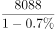

# 数据可得性判断（基期量可求性验证）

考点：[[20-考点/资料分析/综合/数据可得性判断（基期量可求性验证）|综合 / 数据可得性判断（基期量可求性验证）]]
材料：[[15-材料/资料分析/186742 2012年我国农业种植面积与主要农产|186742 2012年我国农业种植面积与主要农产]]

**问法模型**：'能够从上述资料推出的是'→ 逐项核对每项所需指标的'现期值+同比增速'是否在材料中齐备，齐备者即可用基期=现期/(1+g)倒推

## 推理链
1. 第1步：A项需2009年粮食种植面积，材料仅给2012年面积11127万公顷及比上年增加69万公顷，最多倒推2011年11058万公顷，缺2009年数据链，排除
2. 第2步：B项需2010年水产品产量，材料仅给2012年5906万吨及同比+5.4%，只能倒推2011年（5906/1.054≈5601.5万吨），无法再上推一年，排除
3. 第3步：C项需2011年木材产量，材料明示'2012年木材产量8088万立方米，比上年下降0.7%'，现期值与同比增速（负增长）齐备，满足倒推条件
4. 第4步：代入基期公式：2011年木材产量=8088/(1-0.7%)=8088/0.993≈8145万立方米，且基期(8145)>现期(8088)符合下降逻辑，可求
5. 第5步：D项需2011年猪肉产量，材料只给肉类整体8384万吨（+5.4%），无任何猪肉单项数据，排除
6. 第6步：对照四个选项，仅C项数据齐备可推出，锁定答案C

**最快解法**：⚡ 数据齐备性快筛：在材料中找'现期值+同比增长率'同时给出的指标——只有木材（8088万立方米、-0.7%）同时具备两要素，直接8088/(1-0.7%)≈8145万立方米锁定C，其余三项缺数据链或缺指标，无需精算即可排除

## 易错点
- ⚠ 负增长代入公式符号出错：下降0.7%应除以(1-0.7%)=0.993而非(1+0.7%)，且基期8145应大于现期8088，算出小于8088即符号反了
- ⚠ 误以为A、B可求：面积增量/产量增速均只能倒推一年（2012→2011），不能连续两年倒推到2009或2010，注意'推到基期'与'再往前推'的区别
- ⚠ 把'肉类产量8384万吨'误当猪肉数据，或凭常识按猪肉占肉类比例估算——材料未给猪肉任何信息，引入外部常识即错

## 母题抽象
> 🧩 当题干出现'能够/不能从上述资料推出的是'时，逐项核对'现期值+同比增速'是否齐备：两者齐备即可用基期=现期/(1+g)倒推（负增长除以1-|g|），缺现期、缺增速或需跨两年倒推的均不可推，验证基期量大于/小于现期量与增减方向一致即可锁定

**同类特征**：能够从上述资料推出的是、逐项验证数据可得性、基期量可求性、现期值与同比增速是否齐备、负增长倒推基期、缺数据链排除项

## 相关题
- [[10-真题/资料分析/综合/13319330 综合分析（可推出判断），涉及增长n倍求基期量、年均增速时间口径、'四成以上'方向词甄别、增长倍数比较|13319330]]（江苏 2025，相关度1）
- [[10-真题/资料分析/综合/2051138 综合判断（顺差比较+基期回推+单价计算混合验证）|2051138]]（黑龙江 2017，相关度1）
- [[10-真题/资料分析/综合/2578808 综合分析题·逐项验证（核心为同比增长率比较，辅以计数-比重判断与排名对应）|2578808]]（四川 2020，相关度1）
- [[10-真题/资料分析/综合/2021916 综合分析判断（混合增长率居中+两期比重变化+平均数计算+基期量估算）|2021916]]（吉林 2016，相关度1）
- [[10-真题/资料分析/综合/2051204 综合判断题（两期比重比较＋增速计数＋区间求和比较＋涨幅比较）|2051204]]（黑龙江 2017，相关度1）

---

### 题干
能够从上述资料推出的是（    ）。

### 选项
- A. 2009年我国粮食的种植面积
- B. 2010年我国水产品的产量
- C. 2011年我国木材产量　✅
- D. 2011年我国猪肉产量

### 官方解析

第一步：分析问题

根据材料，找出能算出结果的一项即可。

第二步：计算过程

A项：错误，材料中只给了2012年我国粮食种植面积及增长量，得不出2009年粮食种植面积；

B项：错误，材料中给出2012年我国水产品的产量及2012年相对2011年的增长率，无法求出2010年的我国水产品产量；

C项：正确，根据材料“全年木材产量8088万立方米，比上年下降0.7%”，故可得2011年木材产量为：，是可以得出的；

D项：错误，材料中只给出肉类整体的产量及增长率，并未涉及到猪肉的信息，因此无法得出2011年猪肉的产量。

第三步：再次标注答案

故正确答案为C。

### 给定材料

        2012年我国粮食种植面积11127万公顷，比上年增加69万公顷；棉花种植面积470万公顷，减少34万公顷，油科种植面积1398万公顷，增加12万公顷；糖料种植面积203万公顷，增加9万公顷。

        全年粮食产量58957万吨，比上年增加1836万吨，增产3.2%。全年棉花产量684万吨，比上年增产3.8%，油料产量3476万吨，比上年增产5.1%，糖料产量13493万吨，比上年增产7.8%，烤烟产量320万吨，比上年增产11.5%；茶叶产量180万吨，比上年增产11.2%。

        全年肉类产量8384万吨，比上年增产5.4%；禽蛋产量2861万吨，比上年增产1.8%，牛奶产量3744万吨，比上年增产2.3%；水产品产量5906万吨，比上年增产5.4%；全年木材产量8088万立方米，比上年下降0.7%；全年新增产效灌溉面积172万公顷，新增节水灌溉面积235万公顷。

