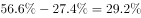

# 综合判断—选非题（无法得出项判定）

考点：[[20-考点/资料分析/综合/综合判断—选非题（无法得出项判定）|综合 / 综合判断—选非题（无法得出项判定）]]
材料：[[15-材料/资料分析/186748 2016年某省邮政通信业务发展情况：|186748 2016年某省邮政通信业务发展情况：]]

**问法模型**：题干为'下列选项无法得出的是'的选非综合判断 → 逐项将选项陈述与材料原文（含可自算的比重）对照，与原文直接矛盾或无依据的项即答案

## 推理链
1. 第1步：题干为选非题，需验证A/B/C/D四项能否由材料得出，找出'无法得出'的一项
2. 第2步：A项核对第一段——邮政通信业务总量6886.15亿元同比增长（数值留空），且'增幅比上年提高27.4个百分点'，即2016年增速比2015年高27.4个百分点，官方验证2016年增速约为2015年的2倍（对应2015年约27.4%、2016年约54.8%量级）→ A可得出
3. 第3步：B项核对第四段——'移动流量资费水平同比下降'，资费方向为下降，足以支撑'大幅降低'的定性表述 → B可得出
4. 第4步：C项核对第三段并自算比重——4G用户9085.30万、移动电话用户14349万，占比9085.30÷14349≈63.3%>50%，4G用户过半即为'主流制式' → C可得出
5. 第5步：D项核对第四段——'固定宽带用户均资费同比下降'，说明运营商已采取降费措施，与D项'未采取有效降低资费水平的措施'直接矛盾 → D无法得出
6. 第6步：本题为选非题，与原文矛盾的D项即为正确答案

**最快解法**：⚡ 选非题'找矛盾'一票否决：原文明写'固定宽带用户均资费同比下降'（已降费），与D项'未采取有效降低资费水平的措施'截然相反，直接锁定D；A/B/C仅需核对方向词与一个比重估算（9085.30/14349≈63%），无需精确计算

## 易错点
- ⚠ 选非题审题陷阱：题干问'无法得出的是'，表述错误的D恰是答案，误按'能得出'选会错选A/B/C
- ⚠ D项误读：'固定宽带用户均资费同比下降'本身就是降费措施的体现，忽略此句会误判D'材料未提及'而摇摆；另注意B、D共用'同比下降'句式，一个是移动流量资费、一个是固定宽带资费，主体不能张冠李戴
- ⚠ C项材料中4G占比数值留空，需自行用9085.30/14349≈63%>50%验证'主流'，不计算会误判C无法得出；同时注意移动电话用户现期为14349万（判断现期主流用现期口径即可，勿误用2015年的14552.1万）

## 母题抽象
> 🧩 当题干出现'无法得出/不能推出/说法错误的是'时，优先找与原文表述直接矛盾的选项（原文'资费同比下降' vs 选项'未降费'），定性方向词无需具体数值即可判定，其余选项回原文找直接依据即可排除

**同类特征**：下列选项无法得出的是、选非题、综合判断四选项、与原文表述矛盾、定性判断（同比下降）、自算比重验证过半

## 相关题
- [[10-真题/资料分析/综合/2402478 综合判断—'不能得出'型（口径范围识别与读数验证）|2402478]]（重庆 2018，相关度2）
- [[10-真题/资料分析/综合/250219 综合分析选非题（图表数据可推断性判断）|250219]]（深圳市考 2008，相关度1）
- [[10-真题/资料分析/综合/10297333 综合分析选非题（同比增速逐年比较+年均增长量+比重百分点还原）|10297333]]（浙江 2025，相关度1）
- [[10-真题/资料分析/综合/14355349 综合分析-选非题（增长率计算比较+人均值计算）|14355349]]（浙江 2024，相关度1）
- [[10-真题/资料分析/综合/17097816 综合判断·选非题（增长率与增长量偷换）|17097816]]（山西 2024，相关度1）

---

### 题干
根据资料，下列选项无法得出的是：

### 选项
- A. 2016年该省邮政通信业务总量的增长速度约是上一年的2倍
- B. 2016年该省手机流量的资费水平大幅降低
- C. 4G正成为该省移动电话用户的主流制式
- D. 固定宽带运营商未采取有效降低资费水平的措施　✅

### 官方解析

A项：根据文字材料第一段“2016年，某省完成邮政通信业务总量6886.15亿元，同比增长，增幅比上年提高27.4个百分点”可知，2016年该省邮政通信业务总量的增长速度为，2015年的增长速度为，，正确；

B项：根据文字材料第四段“该省移动互联网用户数达1.15亿，移动互联网接入流量同比增长，移动流量资费水平同比下降”，同比下降属于大幅降低，正确；

C项：根据文字材料第三段“2016年，移动电话中4G用户数为9085.30万，占移动电话用户的比重由上年的提升至”，所占比重超过一半，正确；

D项：根据文字材料第四段“2016年，该省固定互联网宽带用户数为2850.60万，宽带接入流量同比增长，固定宽带用户均资费同比下降”可知，固定宽带用户均资费同比下降，即固定宽带运营商采取了降低资费水平的措施，错误。

本题为选非题，故正确答案为D。

### 给定材料

        2016年，某省完成邮政通信业务总量6886.15亿元，同比增长，增幅比上年提高27.4个百分点。其中，完成邮政业务总量1879.99亿元，增长，增幅提高11.0个百分点；完成通信业务总量5006.16亿元，增长，增幅提高33.2个百分点。

        2016年，该省完成快递业务量76.72亿件，同比增长，占全国快递业务量的比重达到，比排名第二的Z省多16.80亿件。

        2016年，该省电话用户数为1.69亿，其中固定电话用户数为2609.7万，移动电话用户数为14349万，分别比上年减少197.4万户和203.1万户。移动电话中4G用户数为9085.30万，占移动电话用户的比重由上年的提升至。固定电话本地通话时长、长途通话时长以及移动电话通话时长同比分别减少、和，移动短信、彩信业务量分别减少和。

        2016年，该省固定互联网宽带用户数为2850.60万，宽带接入流量同比增长，其中8M及以上和20M及以上宽带接入用户占比分别为和，分别比上年提升26.2个和40.4个百分点，固定宽带用户均资费同比下降。该省移动互联网用户数达1.15亿，移动互联网接入流量同比增长，移动流量资费水平同比下降，通信资费总体水平同比下降。

> [!warning] 疑点（官方解析可能有误，待人工复核）
> 材料原文中2016年业务总量增速、各比重与降幅数值多处留空，A项'2倍'的精确验证依赖缺失数值，本文本无法复核，但官方判定A成立且不影响答案D的矛盾判定
