# 综合分析选非题（信息可求性判断＋倍数-基期换算综合验证）

考点：[[20-考点/资料分析/综合/综合分析选非题（信息可求性判断＋倍数-基期换算综合验证）|综合 / 综合分析选非题（信息可求性判断＋倍数/基期换算综合验证）]]
材料：[[15-材料/资料分析/186834 我国年轻人2016年在收入、存款、贷|186834 我国年轻人2016年在收入、存款、贷]]

**问法模型**：“下列关于年轻人的说法错误的是”为选非型综合判断题 → 逐项对照材料验证四项，凡无法从材料推出（缺数据）或与材料矛盾者即为答案；含“重合率”的选项先查材料是否给出两类人群的交集信息

## 推理链
1. 第1步：A项需“贷款年龄26-45岁人群”与“办理信用卡且月收入4000元以上人群”的重合率，材料只分别给出年龄段占比和月收入4000元以上办卡比例（数值在文本中缺失），完全未给两类人群的交集或并集信息
2. 第2步：重合率=交集/并集（相对全集的占比），缺交集数据则该比例不可求，故A项说法无法从材料得出，属错误说法
3. 第3步：B项，材料“年轻人每月平均记账次数约为41笔”，41笔＞任何月份天数（2016年最短的2月也有29天），41÷30≈1.37笔/天＞1笔，按平均天天都记账，B正确
4. 第4步：C项，全年人均食品支出=45.9×366=16799.4元（闰年用366）；KTV+旅游交通+书本+雾霾=814.6+4985+168+998.7=6966.3元；16799.4÷6966.3≈2.4倍，即高出总额约1.4倍，C正确
5. 第5步：D项，由“2015较2014”与“2016较2015”两个同比增速合成2016较2014的隔年增长率r=r₁+r₂+r₁r₂，则2014年人均月存款=2340÷(1+r)，年新增存款=2340×12÷(1+r)＜2万元，D正确
6. 第6步：本题为选非题，仅A项不可求，故选A

**最快解法**：⚡ 选项特征秒杀＋排除法：A项“重合率”需两类人群交集，纯文字材料只给各分类独立占比、无交集并集数据，直接判“不可求→错误”（选非即选A）；B项41笔/月＞31天秒判正确；C项截位口算：45.9×366≈1.68万，四项和≈0.70万，1.68÷0.70≈2.4倍→“高出1.4倍”正确；D项用隔年增长率合成回推2014基期后×12验证不足2万。考场策略：先攻“重合率”这类必缺交集数据的选项，最快锁定答案

## 易错点
- ⚠ 把两个不同维度的占比（26-45岁年龄段占比、月收入4000元以上办卡比例）误当可相乘或相加求“重合率”——材料未给交集/并集信息，重合率根本不可求，这正是A项设错点
- ⚠ “高出约1.4倍”≠“是约1.4倍”：16799.4÷6966.3≈2.4倍、高出1.4倍，若拿1.4去对照2.4会误判C错误
- ⚠ 时间口径陷阱：日均×全年必须×366（2016闰年）而非365；“月存款2340元”即月新增存款，判断2014年“新增存款”须先用隔年增长率回推2014基期再×12，不能拿2016年2340×12=28080元直接比较

## 母题抽象
> 🧩 综合选非题中，凡出现“两类人群重合率/交集比例”表述而材料只给各自独立占比的，该项必为“无法推出”的错误项；其余选项按“月×12、日×366（闰年）、隔年增长率合成回推基期、增长量=现期−基期”逐项速算排除

**同类特征**：选非题/找错误说法、重合率（交集不可求）、天天记账（月41笔＞月天数）、高出约1.4倍（倍数表述陷阱）、隔年基期回推2014、日均×366闰年换算

## 相关题
（暂无）

---

### 题干
下列关于年轻人的说法错误的是：

### 选项
- A. 
2016年，贷款年龄在26-45岁的人群和办理信用卡且月收入在4000元以上的人群重合率达到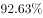
　✅
- B. 
在2016年，按平均来算，他们天天都记账

- C. 
在2016年，人均食品支出高出当年KTV、旅游交通、书本、雾霾支出总额约1.4倍

- D. 
2014年人均新增存款不足2万元

### 官方解析

A项：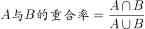，由材料无法求得2016年贷款年龄在26-45岁人群与办理信用卡且月收入在4000元以上人群的交集和并集，故重合率无法求出，错误；

B项：定位材料“年轻人每月平均记账次数约为41笔”，每月记账次数大于天数，可知按平均计算，年轻人“天天都记账”，正确；

C项：定位材料“每日人均食品消费45.9元”，可知全年食品消费为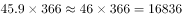。KTV、旅游交通、书本、雾霾支出总额为：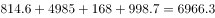，则它们的倍数关系为：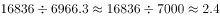，所以人均食品支出高出KTV、旅游交通、书本、雾霾支出总额约：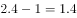倍，正确；

D项：定位材料“2016年年轻人的人均月存款为2340元，较2015年同比增加，而2015年的人均月存款较2014年增加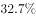”，可知2016年相对于2014年人均存款的增长率为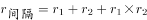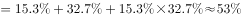。则2014年人均存款约为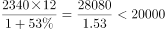元，2014年人均存款不足2万元，则2014年人均新增存款不足2万元，正确。

本题为选非题，故正确答案为A。

### 给定材料

下面是关于我国年轻人2016年各项消费的数据统计：

        2016年（全年366天），全国年轻人人均月收入为6726元。同时，存款额度也在增加，2016年年轻人的人均月存款为2340元，较2015年同比增加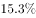，而2015年的人均月存款较2014年增加。在贷款方面，月收入4000元以上的办理信用卡比例超过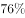，而贷款年龄段比例则为：18-25岁占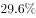、26-35岁占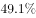、36-45岁占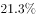。年轻人每月平均记账次数约为41笔，其中上海以1.672笔的人均日记账次数居榜首。在消费方面，KTV的年人均消费由2014年的699.9元增加到2016年的814.6元；在旅游方面，人均年度交通支出达4985元。年轻人2016年在书本上的人均支出达到168元，相对于2015年的155元，同比增长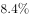。2016年，年轻人与雾霾相关的支出较2015年多出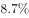，人均支出达到998.7元；每日人均食品消费45.9元，比去年增加8.8元，早餐平均花费4.5元。

