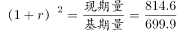
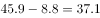
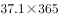
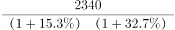
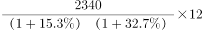

# 综合分析·选非题（可推出性判断）

考点：[[20-考点/资料分析/综合/综合分析·选非题（可推出性判断）|综合 / 综合分析·选非题（可推出性判断）]]
材料：[[15-材料/资料分析/186834 我国年轻人2016年在收入、存款、贷|186834 我国年轻人2016年在收入、存款、贷]]

**问法模型**：题干出现'下列不能从所给资料得出的是'→ 选非题模型：逐项核对每个选项所需数据与公式是否在材料中齐备、口径是否一致，选出条件不足不可求的一项

## 推理链
1. 第1步：选非题，逐项验证。A项需要'2016年18-35岁人员办理信用卡比例'这一复合比重。
2. 第2步：材料关于信用卡/贷款只有两条信息——'月收入4000元以上的办理信用卡比例超过某值'（带收入前提）与18-25岁/26-35岁/36-45岁的贷款年龄段占比；办卡比例≠贷款占比，且无各年龄段的办卡率数据，18-35岁（18-25+26-35）的办卡比例无法合成。
3. 第3步：B项——材料给出KTV年人均消费端点值2014年699.9元→2016年814.6元，设年均增长率r，(1+r)²=814.6/699.9≈1.164，r≈7.9%，首末两年齐备即可求，中间缺2015年不影响。
4. 第4步：C项——2016年每日人均食品消费45.9元、'比去年增加8.8元'为增长量，2015年每日人均=45.9-8.8=37.1元，2015年人均食品消费支出=37.1×365（2015非闰年）=13541.5元，可求。
5. 第5步：D项——2016年人均月存款2340元，按材料中2016较2015、2015较2014两个同比增速（原卷材料有具体百分数）连续倒推得2014年人均月存款，再×12即2014年人均存款额度，可求。
6. 第6步：对照四项，仅A项因'前提限定+部分结构不能推出总体比重'而条件不足，故选A。

**最快解法**：⚡ 条件完备性扫描（选非速判）：优先扫带前提限定的比重项——A项信用卡比例以'月收入4000元以上'为前提且各年龄段办卡率未知，条件不足直接锁定；再用三个可求性公式快速验证其余项：B用年均增长率公式(1+r)²=814.6/699.9，C用基期=现期-增长量（45.9-8.8=37.1元/天）×365，D用2340÷(1+r₁)÷(1+r₂)×12，均齐备，确认A。

## 易错点
- ⚠ A项最大陷阱：把材料给的'贷款年龄段占比'（18-25/26-35/36-45）与'办理信用卡比例'混为一谈，误以为两段占比相加即得18-35岁办卡比例；实际贷款占比≠办卡比例，且办卡比例有'月收入4000元以上'前提，部分结构无法推出总体（或跨人群）比重。
- ⚠ B项错觉陷阱：KTV缺2015年数据，易误判'缺中间年无法算年均增长率'而错选B；年均增长率只需首末端点值(1+r)²=814.6/699.9。
- ⚠ C项口径陷阱：'增加8.8元'是增长量不是增长率，须先减出基期37.1元/天；且45.9元是'每日'口径，2015年全年化用365天（366天只适用于2016闰年），月×12、日×365/366勿混用。

## 母题抽象
> 🧩 当题干出现'不能从所给资料得出/无法推出'的选非特征时，用条件完备性扫描逐项核对'数据是否齐备+口径是否一致+时间是否对应'；凡比例带前提限定（如'月收入4000元以上办卡'）或需由分项占比合成总体比重的选项，通常即不可求项；而端点值齐备的年均增长率、现期-增长量的基期、按增速倒推的隔年基期均可求。

**同类特征**：'不能从所给资料得出的是'（选非/不可推出）、办理信用卡比例（带'月收入4000元以上'前提限定）、年均增长率（2014-2016，KTV首末端点值）、基期=现期-增长量（45.9-8.8=37.1元）、隔年基期倒推（2340元按两年增速连除再×12）、贷款年龄段占比与办卡比例的概念混淆

## 相关题
（暂无）

---

### 题干
下列不能从所给资料得出的是：

### 选项
- A. 2016年18-35岁人员办理信用卡比例　✅
- B. 2014-2016年年轻人人均KTV消费年均增长率
- C. 2015年年轻人人均食品消费支出
- D. 2014年年轻人人均存款额度

### 官方解析

A项，材料虽然给出18-35岁的贷款比例，但办理信用卡的比例有前提“月收入4000元以上”，而且各年龄层次贷款人员办理信用卡的比例也未必一样，不能求出；

B项，定位材料“KTV的年人均消费由2014年的699.9元增加到2016年的814.6元”，根据年均增长率公式：，，可求出；

C项，定位材料“每日人均食品消费45.9元，比去年增加8.8元”，可知2015年年轻人每日人均食品消费支出为：元，2015年年轻人人均食品消费支出为：元，可求出；

D项，定位材料“2016年年轻人的人均月存款为2340元，较2015年同比增加，而2015年的人均存款较2014年增加”，2014年年轻人人均月存款额度为元，2014年年轻人人均存款额度为元，可求出。

本题为选非题，故正确答案为A。

### 给定材料

下面是关于我国年轻人2016年各项消费的数据统计：

        2016年（全年366天），全国年轻人人均月收入为6726元。同时，存款额度也在增加，2016年年轻人的人均月存款为2340元，较2015年同比增加，而2015年的人均月存款较2014年增加。在贷款方面，月收入4000元以上的办理信用卡比例超过，而贷款年龄段比例则为：18-25岁占、26-35岁占、36-45岁占。年轻人每月平均记账次数约为41笔，其中上海以1.672笔的人均日记账次数居榜首。在消费方面，KTV的年人均消费由2014年的699.9元增加到2016年的814.6元；在旅游方面，人均年度交通支出达4985元。年轻人2016年在书本上的人均支出达到168元，相对于2015年的155元，同比增长。2016年，年轻人与雾霾相关的支出较2015年多出，人均支出达到998.7元；每日人均食品消费45.9元，比去年增加8.8元，早餐平均花费4.5元。

> [!warning] 疑点（官方解析可能有误，待人工复核）
> 所提供文本中'较2015年同比增加__%''2015年较2014年增加__%'及信用卡比例、三个年龄段占比、书本/雾霾增速等百分数均为空缺（原卷应含具体数值），官方解析D项'可求出'依赖原材料的完整百分数；若严格按本文本口径，D项数据亦不全，但A项属于'前提限定+复合比重不可合成'的原理性缺失，仍为唯一不可求项，答案A不受影响。

<!-- CODEX-ANSWER-REVIEW:BEGIN -->
### 本次独立复核

**复核状态：** `confirmed`（独立复算确认答案）

**计分答案：** A（可计分）

**复核解析：**

题目问“不能从资料得出”的是A。B可由KTV人均消费699.9元升至814.6元，按两年复合年均增速(814.6/699.9)^(1/2)−1≈7.9%求出。C：2016年日均食品消费45.9元，比2015年多8.8元，2015年年人均食品支出=(45.9−8.8)×365=13541.5元。D：月人均存款2016年2340元、较2015年增长15.3%，2015年又较2014年增长32.7%，故2014年月人均存款=2340/(1.153×1.327)≈1530元。A给出的“月收入4000元以上者办卡比例”与“各年龄段借款人占比”不是同一交叉统计，不能推出18—35岁办理信用卡比例。因此答案唯一为A。

**相关信息：**

资料分析—可推出性与统计口径；不同分组的边际比例不能相乘或互换来推交叉比例；年均增长率用复合增长，年度月均值和年度总额须区分。

**题源依据：** [固定版本原题](https://github.com/Mentat-Uran/kaogongzhentizhengliu/blob/84ab93d4b64b61d897bece8a1c0a5bab06b4feb2/10-%E7%9C%9F%E9%A2%98/%E8%B5%84%E6%96%99%E5%88%86%E6%9E%90/%E7%BB%BC%E5%90%88/2049298%20%E7%BB%BC%E5%90%88%E5%88%86%E6%9E%90%C2%B7%E9%80%89%E9%9D%9E%E9%A2%98%EF%BC%88%E5%8F%AF%E6%8E%A8%E5%87%BA%E6%80%A7%E5%88%A4%E6%96%AD%EF%BC%89.md)；固定内容 commit `84ab93d4b64b61d897bece8a1c0a5bab06b4feb2`，Markdown blob `18a42c98ace70726bc96be1eb4f42259801957c7`。
<!-- CODEX-ANSWER-REVIEW:END -->
