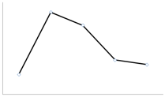
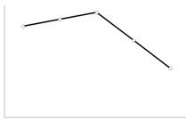
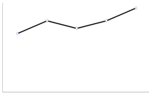

# 数据再现-图形趋势判断（跨图表拼接五年序列）

考点：[[20-考点/资料分析/综合/数据再现-图形趋势判断（跨图表拼接五年序列）|综合 / 数据再现/图形趋势判断（跨图表拼接五年序列）]]
材料：[[15-材料/资料分析/186842 2015年全国社会捐助与慈善服务情况|186842 2015年全国社会捐助与慈善服务情况]]

**问法模型**：题干问'哪张图能正确反映2011～2015年某指标变化'→将表格四年数据与文字段现期值拼接成五年序列，按峰谷位置与升降形态与选项图形逐点对照，无需精算增速

## 推理链
1. 第1步：从统计表提取2011-2014年民政部门接收捐赠衣被：2918.5、12538.2、10405.0、5244.5万件
2. 第2步：从文字段提取2015年数据4537.0万件，与表格拼成五年序列2918.5→12538.2→10405.0→5244.5→4537.0（万件）
3. 第3步：识别走势特征：第2个点（2012年）为五年最高峰，约1.26亿件；2013-2015连续三年递减；2011年（2918.5万件）为最低点
4. 第4步：将走势与选项图形对照：只有A图呈现'第二个点最高、之后逐点下降'的形态，B/C/D峰位或降势不符
5. 第5步：锁定正确答案为A

**最快解法**：⚡ 图形特征定位法：不做任何计算，只抓两个特征点——①第二个点（2012年12538.2万件）必须是最高峰；②后三个点须逐年下降（10405.0→5244.5→4537.0），与选项图直接比对即秒选A

## 易错点
- ⚠ 跨图表拼数据：2015年数据（4537.0万件）只在文字段，漏读文字段会把五年序列错做成四年，导致图形尾点缺失
- ⚠ 同名指标混淆：须取'民政部门接收捐赠衣被（万件）'列，不能错拿'民政部门接收社会捐赠款（亿元）'或其他列
- ⚠ 数量级与单位陷阱：衣被单位为'万件'，2012年12538.2万件≈1.26亿件是显著峰值，看图对照时勿在数量级或峰位上误判；且2015年4537.0万件低于2014年5244.5万件，末点须继续下降而非回升

## 母题抽象
> 🧩 当题干出现'哪张图能正确反映某指标连续五年变化'特征时，先从表格+文字段拼接完整年度序列，再只验证峰谷位置（哪年最高/最低）与升降形态，与选项图形直接对照即可，无需计算增长率

**同类特征**：哪一张图能正确反映、2011～2015年、民政部门接收捐赠衣被、变化趋势、跨图表拼接五年序列、图形对照判断

## 相关题
- [[10-真题/资料分析/增长/15833691 环比增速计算与折线趋势匹配（累计值连环相减化当期值）|15833691]]（黑龙江 2026，相关度1）
- [[10-真题/资料分析/增长/12882030 累计转当期+环比增长率计算与趋势匹配|12882030]]（内蒙古 2025，相关度1）
- [[10-真题/资料分析/增长/15833698 环比增速计算与折线趋势图匹配|15833698]]（黑龙江 2026，相关度1）
- [[10-真题/资料分析/倍数/2050544 比值（城乡收入比）逐年计算与趋势判断|2050544]]（吉林 2017，相关度1）
- [[10-真题/资料分析/增长/2051184 增长量比较（同比增长量趋势折线图判断）|2051184]]（黑龙江 2017，相关度1）

---

### 题干
下面哪一张图能正确反映2011～2015年民政部门接收捐赠衣被数量的变化？

### 选项
- A. 

　✅
- B. 

- C. 

- D. 

### 官方解析
定位文字材料和表中数据，2011~2015年全国民政部门接收捐赠衣被数量分别为2918.5万件、12538.2万件、10405.0万件、5244.5万件、4537.0万件，所以2012年即第二个点最高，只有选项A满足条件。
故正确答案为A。

### 给定材料

        2015年全国共建立社会捐助工作站、点和慈善超市3.0万个，比上一年减少0.2万个，其中：慈善超市9654个，同比下降。全年共接收社会捐赠款654.5亿元，其中：民政部门接收社会各界捐款44.2亿元，各类社会组织接收捐款610.3亿元。全年民政部门接收捐赠衣被4537.0万件，捐赠物资价值折合人民币5.2亿元。全年有1838.4万人次困难群众受益，同比增长，增长率较上一年下降27.5个百分点。全年有934.6万人次在社会服务领域提供了2700.7万小时的志愿服务，同比减少10.4万小时。 

> [!note] 复核校正
> 原图15b950317abd938.png清楚显示2012年捐赠衣被为12538.2万件；此前疑点把图表值误读为12588.2。现已按题图将材料摘要更正，官方解析和答案A成立。

<!-- CODEX-ANSWER-REVIEW:BEGIN -->
### 本次独立复核

**复核状态：** `confirmed`（独立复算确认答案）

**计分答案：** A（可计分）

**复核解析：**

原始序列2011—2015为2918.5、12538.2、10405.0、5244.5、4537.0万件。独立检查走势：第二年为峰值；之后连续下降；2014至2015下降幅度较小。因此图应呈先跃升至第二点最高、再逐年回落，且末段较平缓；本地A图形符合，答案A。

**相关信息：**

独立复核：资料分析综合判断；检查题干问法、统计口径、基期/现期及单位。无法从现存题源独立取回必要数值的项目暂不确认。

**题源依据：** [固定版本原题](https://github.com/Mentat-Uran/kaogongzhentizhengliu/blob/84ab93d4b64b61d897bece8a1c0a5bab06b4feb2/10-%E7%9C%9F%E9%A2%98/%E8%B5%84%E6%96%99%E5%88%86%E6%9E%90/%E7%BB%BC%E5%90%88/2049568%20%E6%95%B0%E6%8D%AE%E5%86%8D%E7%8E%B0-%E5%9B%BE%E5%BD%A2%E8%B6%8B%E5%8A%BF%E5%88%A4%E6%96%AD%EF%BC%88%E8%B7%A8%E5%9B%BE%E8%A1%A8%E6%8B%BC%E6%8E%A5%E4%BA%94%E5%B9%B4%E5%BA%8F%E5%88%97%EF%BC%89.md)；固定内容 commit `84ab93d4b64b61d897bece8a1c0a5bab06b4feb2`，Markdown blob `17fbe53eeb6f9e88da4218600150c9302280adba`。
<!-- CODEX-ANSWER-REVIEW:END -->
