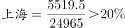
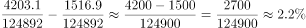

# 综合判断题（两期比重变化判断＋现期比值-占比比较）

考点：[[20-考点/资料分析/综合/综合判断题（两期比重变化判断＋现期比值-占比比较）|综合 / 综合判断题（两期比重变化判断＋现期比值/占比比较）]]
材料：[[15-材料/资料分析/186840 2015年全国及上海、江苏、浙江、安|186840 2015年全国及上海、江苏、浙江、安]]

**问法模型**：选非题'下列说法错误的是'→逐项验证：A/B/C为现期做商与数值比大小，D用两期比重变化法则（部分增速vs整体增速）定性判定

## 推理链
1. 第1步：从表中提取数据：全国一般公共预算收入152217亿元（同比8.4%）、GDP 676708亿元（同比6.9%）、税收124892亿元；江苏三项为8028.6/6610.1/70116.4；上海5519.5与24965；山东税收4203.1、江西税收1516.9
2. 第2步：验证A（现期比值比较）：上海5519.5÷24965≈22.1%，江苏≈11.4%、浙江≈11.2%、安徽≈11.2%、福建≈9.8%、江西≈12.9%、山东≈8.8%，7省（市）中上海最高，A正确
3. 第3步：验证B（数值比大小）：7省（市）中江苏一般公共预算收入8028.6、税收6610.1、GDP 70116.4均居首位，B正确
4. 第4步：验证C（占全国比重的差值）：山东4203.1÷124892≈3.4%，江西1516.9÷124892≈1.2%，两者相差2686.2÷124892≈2.15个百分点，高出选项阈值以上，C正确
5. 第5步：验证D（两期比重变化法则）：部分（一般公共预算收入）增速8.4%＞整体（GDP）增速6.9%，2015年全国一般公共预算收入占GDP比重应较2014年上升，'有所减少'说法错误
6. 第6步：本题为选非题，错误项为D，与官方答案一致

**最快解法**：⚡ 两期比重变化方向判定（公式法·定性比较）：直奔D项，只需比较部分增速8.4%与整体增速6.9%，8.4%＞6.9%→比重上升→'减少'错误，直接锁定D，无需计算基期比重，A/B/C可粗略复核即可

## 易错点
- ⚠ 选非题惯性思维去找'正确项'，忘了目的是挑出错误说法
- ⚠ 两期比重方向法则记反：部分增速＞整体增速时比重上升（不是减少），勿凭'收入在增长'想当然判断
- ⚠ A项'比值最高'默认在7省（市）范围内比较，须剔除全国汇总行（全国152217÷676708≈22.5%＞上海22.1%，误纳入会误判A错）；C项是两地'占全国税收比重'的百分点之差（约2.15个百分点），不是税收数值之差（4203.1-1516.9=2686.2亿元），两种口径结果相差悬殊

## 母题抽象
> 🧩 当综合判断题出现'A占B的比重较上年上升/减少'类表述时，直接用两期比重法则：只比较部分增速与整体增速大小即可定性（部分快→比重升、部分慢→比重降），不必计算基期比重；'最高/均最高'类说法则逐项做商或比大小验证

**同类特征**：选非题·说法错误的是、占GDP的比值最高、占全国税收收入的比重、较2014年有所减少、部分增速与整体增速比较、一表多指标综合判断

## 相关题
- [[10-真题/资料分析/比重/1746802 两期比重变化比较（增速比较法，连续两年判断）|1746802]]（国考 2016，相关度1）
- [[10-真题/资料分析/比重/1797640 两期比重变化（比重差定量计算）|1797640]]（山东 2016，相关度1）
- [[10-真题/资料分析/比重/3523610 两期比重比较（比重升降判断+计数）|3523610]]（四川 2021，相关度1）
- [[10-真题/资料分析/比重/18643861 两期比重差（比重升降判断+变化幅度估算）|18643861]]（四川 2026，相关度1）
- [[10-真题/资料分析/比重/5102448 两期比重变化判断（部分增速与整体增速比较）|5102448]]（浙江 2022，相关度1）

---

### 题干
关于一般公共预算收入、税收收入、GDP等指标，下列说法错误的是：

### 选项
- A. 
2015年上海一般公共预算收入占GDP的比值最高

- B. 
2015年江苏一般公共预算收入、税收收入、GDP均最高

- C. 
2015年山东税收收入占全国税收收入的比重较江西高出以上

- D. 
2015年全国一般公共预算收入占GDP的比重较2014年有所减少
　✅

### 官方解析

A项，2015年各省市一般公共预算收入占GDP的比值：；；；；；；，故上海的比值是最高的，正确；

B项，定位表格，对比可知江苏一般公共预算收入、税收收入、GDP数值均为各省市中最高，正确；

C项，定位表格第四列，山东2015年税收为4203.1亿元，江西为1516.9亿元，全国为124892亿元，，高出以上，正确；

D项：根据两期比重原理，部分增长率（一般公共预算收入增长率8.4%）大于总体增长率（GDP增长率6.9%），比重上升，错误。

本题为选非题，故正确答案为D。

### 给定材料

