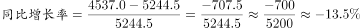
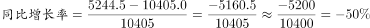
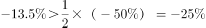
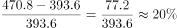
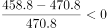
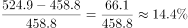
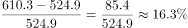
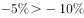

# 综合判断题（核心为同比增长率计算与带符号比较，含负增长率）

考点：[[20-考点/资料分析/综合/综合判断题（核心为同比增长率计算与带符号比较，含负增长率）|综合 / 综合判断题（核心为同比增长率计算与带符号比较，含负增长率）]]
材料：[[15-材料/资料分析/186842 2015年全国社会捐助与慈善服务情况|186842 2015年全国社会捐助与慈善服务情况]]

**问法模型**：'能够从上述资料中推出的是'的逐项验证型综合判断 → 对四个选项分别套用增长率=（现期-基期）/基期计算或定性判断，唯一/最优成立项即为答案

## 推理链
1. 第1步：从表格提取民政部门接收社会捐赠款序列：2011年96.6、2012年101.7、2013年107.6、2014年79.6亿元，加文字段2015年44.2亿元；2014年79.6<2013年107.6，并非持续增加，A项错误
2. 第2步：拼接民政部门捐赠衣被五年序列：2013年10405.0、2014年5244.5（表格）+2015年4537.0万件（文字段）
3. 第3步：B项按增长率=（现期-基期）/基期：2015年同比=(4537.0-5244.5)/5244.5≈-13.5%；2014年同比=(5244.5-10405.0)/10405.0≈-49.6%；其一半为-24.8%，因-13.5%>-24.8%，B项按带符号比较成立
4. 第4步：C项计算社会组织捐赠款（亿元）各年同比：2012年(470.8-393.6)/393.6≈+19.6%，2013年(458.8-470.8)/470.8≈-2.5%，2014年(524.9-458.8)/458.8≈+14.4%，2015年(610.3-524.9)/524.9≈+16.3%
5. 第5步：比较四个增速，2012年+19.6%最大，即2012-2015年社会组织捐赠款同比增长最快的年份是2012年（含首年当年增速），C项成立，与官方给定答案一致
6. 第6步：D项中'同比减少10.4万小时'的减少主体是志愿服务小时数（2700.7万小时），与934.6万人次的人次指标无关，无法判断人次增减，D项错误
7. 第7步：对照结论：A、D必错，B、C经计算均可推出，官方给定唯一答案为C，最终锁定C

**最快解法**：⚡ 综合判断+截位直除：C项先比分子（增长量）77.2、-12、66.1、85.4，再对393.6/470.8/458.8/524.9截位直除得19.6%/-2.5%/14.4%/16.3%，一眼锁定2012年最大；A项扫一眼107.6→79.6即排除；D项抓主语'万小时'即排除；B项-13.5%与-49.6%的一半-24.8%带负号粗比即可

## 易错点
- ⚠ 负增长率比较必须带符号：-13.5%>-24.8%才判定B项'高于二分之一'成立，若丢负号按绝对值比较会误判B项错误
- ⚠ D项偷换主语陷阱：'同比减少10.4万小时'是小时数（且是减少量非减少率），与人次无关，误读成人次减少会错判D项
- ⚠ '2012-2015年增长最快/最多的年份'按惯例要考虑2012年当年的同比增速（区别于'年均增长率'不含首年），漏算2012年会误选2015年
- ⚠ '持续增加'只需任一年份下降即被推翻，2014年79.6<2013年107.6即可速杀A项；跨图表拼接时2015年衣被4537.0万件在文字段、2014年5244.5万件在表格，勿漏

## 母题抽象
> 🧩 当题干出现'能够从上述资料中推出的是'时，逐项验证：增长类先列时间序列再套（现期-基期）/基期，负增长率比较必须带符号，'增长最快的年份'含区间首年当年增速，'持续增加'仅需找一年反例即可否定

**同类特征**：能够从上述资料中推出的是、同比增长最快、持续增加、高于……的二分之一、相比上一年有所增加、跨图表拼接五年序列

## 相关题
- [[10-真题/资料分析/增长/2187792 同比增长率比较（增速最快年份判断）|2187792]]（黑龙江 2018，相关度1）
- [[10-真题/资料分析/综合/19283943 综合分析判断题（倍数比较+求和判断+隐含平均每场座位数反推）|19283943]]（国考 2025，相关度1）
- [[10-真题/资料分析/综合/1796162 综合判断（月均计算、平均运输距离、比重对比、增长量比较逐项验证）|1796162]]（贵州 2016，相关度1）
- [[10-真题/资料分析/增长/18385420 同比增速比较（增长快慢）|18385420]]（浙江 2024，相关度1）
- [[10-真题/资料分析/综合/2133504 综合判断题（现期比重+现期平均数多项验证，一对三错）|2133504]]（国考 2018，相关度1）

---

### 题干
能够从上述资料中推出的是：

### 选项
- A. 2011-2015年民政部门接收的社会捐赠款在持续增加
- B. 2015年民政部门接收捐赠衣被同比增长率高于2014年的二分之一
- C. 2012-2015年社会组织接收社会捐赠款同比增长最快的年份是2012年　✅
- D. 相比2014年，2015年在社会服务领域提供志愿服务的人次有所增加

### 官方解析

A项：定位表中数据，2014年民政部门接收的社会捐赠款79.6亿元小于2013年民政部门接收的社会捐赠款107.6亿元，错误；

B项：定位文字材料和表中数据，2015年民政部门接收捐赠衣被，2014年民政部门接收捐赠衣被。故：，正确；

C项：定位文字材料和表中数据，2012-2015年社会组织接收社会捐赠款同比增长率分别为：2012年；2013年；2014年；2015年，所以2012年同比增长最快，正确；

D项：定位文字材料，“全年有934.6万人次在社会服务领域提供了2700.7万小时的志愿服务，同比减少10.4万小时”，无法判断提供志愿服务的人次的变化，错误。

故正确答案为B和C。

【备注】本题为争议题。粉笔对B项和C项可能的争议点解释如下：

B项可能的争议点是：

①同比增长率是否可以为负数？根据本卷第四篇资料分析的表格数据可知，同比增长（）下面出现了-0.5这样的负数，所以同比增长率是可以为负数的。

②比较同比增长率高低时，是否需要带负号比较？根据近年全国各地类似真题可知，增长率比高低时，需要带负号比较，例如。

C项可能的争议点是：

2012-2015年增长最快的年份是否要考虑2012年？根据近年全国各地类似真题可知，如果提到2012-2015年的年均增长量或年均增长率等，一般不考虑2012年的增长情况（江苏例外）；但是如果提到2012-2015年增长最快/最多的年份，一般都是要考虑2012年当年的增长情况的，否则会使得很多国考省考题目变得没有答案。

基于以上分析，粉笔认为本题B、C答案没有明显错误，都应该是正确答案。

### 给定材料

        2015年全国共建立社会捐助工作站、点和慈善超市3.0万个，比上一年减少0.2万个，其中：慈善超市9654个，同比下降。全年共接收社会捐赠款654.5亿元，其中：民政部门接收社会各界捐款44.2亿元，各类社会组织接收捐款610.3亿元。全年民政部门接收捐赠衣被4537.0万件，捐赠物资价值折合人民币5.2亿元。全年有1838.4万人次困难群众受益，同比增长，增长率较上一年下降27.5个百分点。全年有934.6万人次在社会服务领域提供了2700.7万小时的志愿服务，同比减少10.4万小时。 

> [!warning] 疑点（官方解析可能有误，待人工复核）
> 本题官方解析结尾写'故正确答案为B和C'并注明为争议题（粉笔认为带负号比较下B项-13.5%>-24.8%亦成立，'增长最快的年份'应含2012年故C亦成立），但官方信息给定唯一正确答案为C，本笔记以C为准。B项是否成立取决于负增长率是否带符号比高低的口径，属命题争议，非计算错误
