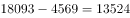
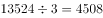
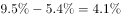

# 综合判断题（混合增长率定性比较＋月均差值计算＋增速差回推基期增速＋排名与区域判断）

考点：[[20-考点/资料分析/综合/综合判断题（混合增长率定性比较＋月均差值计算＋增速差回推基期增速＋排名与区域判断）|综合 / 综合判断题（混合增长率定性比较＋月均差值计算＋增速差回推基期增速＋排名与区域判断）]]
材料：[[15-材料/资料分析/186848 纯文字型材料：2016年4月（当期值|186848 纯文字型材料：2016年4月（当期值]]

**问法模型**：'能够从上述资料中推出的是'→综合判断题逐项验证：A用'累计−当期再÷3'求月均与4月比较；B用混合增长率居中原理定性判方向；C用'现期增速−提高的百分点数'回推基期增速；D用前十排名＋区域常识排除。

## 推理链
1. 第1步：A项——第一季度全社会用电量=1～4月累计18093−4月当期4569=13524亿千瓦时，月均=13524÷3≈4508亿千瓦时，低于4月的4569亿千瓦时，A错误
2. 第2步：B项——1～4月增速是1～3月（一季度）与4月两段增速的加权混合，由混合增长率'居中'原理，1～4月增速必介于4月增速与一季度增速之间
3. 第3步：依官方解析不等式链'4月增速<1～4月增速<1～3月增速'（原文两处增速数值缺失，不等式方向以官方解析为准），故一季度增速>1～4月增速，即超过B选项所给阈值，B正确
4. 第4步：C项——'城乡居民生活用电……增速比上年同期提高5.4个百分点'是增速差，回推2015年1～4月增速=2016年1～4月增速−5.4个百分点，该回推值与选项所给数值不符（增速数值缺失，按官方解析判定不符），C错误
5. 第5步：D项——增速前5位依次为西藏、新疆、江西、陕西、安徽，其中江西（中部）、安徽（非西部）不属西部地区，D错误
6. 第6步：综合判定，只有B能推出，正确答案为B

**最快解法**：⚡ 混合增长率定性判断（居中原理）＋排除法：A项口算18093−4569=13524，÷3≈4508<4569秒排除；B项不需任何具体增速值——只要4月增速<1～4月增速，混合居中即知1～3月增速>1～4月增速，直接锁定B；C项用'现期增速−5.4个百分点'回推对数排除，D项查前十排名看区域（江西、安徽非西部）排除。

## 易错点
- ⚠ 双口径混排：'第一季度'=1～4月累计18093−4月当期4569=13524，再÷3得月均；易误用18093÷4或直接拿4月数据比较
- ⚠ 混合增长率方向搞反：整体（1～4月）增速居两段之间，若4月增速<1～4月增速，则一季度（1～3月）增速>1～4月增速；方向颠倒会把B判错
- ⚠ '提高5.4个百分点'是增速差，回推2015年增速须用减法（现期增速−5.4个百分点），不能误当现期增速或用加法；'个百分点'与'%'口径不同；D项勿凭'排名靠前'想当然认为都是西部（江西、安徽非西部）

## 母题抽象
> 🧩 当综合判断题中'单月增速'与'累计增速'并存、选项问'前期增速是否超过某值'时，用混合增长率居中原理定性判方向（整体居两段之间，一期低于整体则另一期必高于整体）；选项问基期增速时用'现期增速−提高的百分点数'回推验证。

**同类特征**：能够从上述资料中推出的是（综合判断）、第一季度月均=（累计−当期）÷3、混合增长率居中原理、增速比上年同期提高N个百分点（回推基期增速）、增速前十省份排名＋西部地区判断、当月值与累计值双口径混排

## 相关题
- [[10-真题/资料分析/综合/5102154 综合判断题——逐项验证（核心为跨图现期比重计算：TOP5之和÷全国总量，辅以增速比较、数据计数与可得性判断）|5102154]]（湖北 2022，相关度1）
- [[10-真题/资料分析/综合/2030136 综合分析判断题（倍数判定＋比重结构商＋百分点还原＋年均增量比较）|2030136]]（四川 2016，相关度1）
- [[10-真题/资料分析/综合/16592992 综合判断题（基期比值+平均价格比较+链式现期+整体推算多模型混合验证）|16592992]]（河北 2024，相关度1）
- [[10-真题/资料分析/综合/17764866 综合判断题（产销差值的基期比较为正确项，环比增速走势-销量比值走势-两年基期总量为干扰项）|17764866]]（湖北 2024，相关度1）
- [[10-真题/资料分析/综合/19526375 综合分析判断（累计值做差求当期+基期倒推+比重计算与比重差比较）|19526375]]（国考 2026，相关度1）

---

### 题干
能够从上述资料中推出的是：

### 选项
- A. 
2016年第一季度全社会月均用电量高于4月水平

- B. 
2016年一季度我国全社会用电量同比增速超过
　✅
- C. 
2015年1～4月城乡居民生活用电量同比增长接近

- D. 
2016年1～4月份全社会用电量增速前5位的省份均来自西部地区

### 官方解析

A项，定位材料第一、二段，2016年第一季度全社会用电量为亿千瓦时，则第一季度月均用电量为亿千瓦时，而4月全社会用电量为4569亿千瓦时，所以第一季度全社会月均用电量是低于4月水平，错误；

B项，定位材料第一、二段，2016年1～4月全社会用电量增速为，而4月份增速为，根据混合增长率原理（混合之后增长率居中），4月增速（）1~4月增速（）1~3月增速，因此可以判断第一季度（1～3月）增速必定超过，正确；

C项，定位材料第二段，“城乡居民生活用电……同比增长，增速比上年同期提高5.4个百分点”，则2015年1～4月增速为，错误；

D项，定位材料第三段，2016年1～4月份全社会用电量增速第3位的是江西省，第5位是安徽省，江西省和安徽省并不属于西部地区，错误。

故正确答案为B。

### 给定材料

        2016年4月份我国全社会用电量4569亿千瓦时，同比增长。其中，第一产业用电量86亿千瓦时，同比增长；第二产业用电量3316亿千瓦时，同比增长；第三产业用电量569亿千瓦时，同比增长；城乡居民生活用电量598亿千瓦时，同比增长。 

        1～4月份，我国全社会用电量18093亿千瓦时，同比增长。从不同产业看，第一产业用电量270亿千瓦时，同比增长；第二产业用电量12595亿千瓦时，同比增长；第三产业用电量2516亿千瓦时，同比增长，增速比上年同期提高2.1个百分点；城乡居民生活用电量2711亿千瓦时，同比增长，增速比上年同期提高5.4个百分点。

        从不同省份看，1～4月份全社会用电量增速前十位的省份依次为：西藏（）、新疆（）、江西（）、陕西（）、安徽（）、北京（）、浙江（）、广东（）、海南（）、湖北（）。

> [!warning] 疑点（官方解析可能有误，待人工复核）
> 给定材料文本中所有同比增速数值（含前十省份括号内数值）均为空白，B、C两项所需的具体增速数字无法从文本直接读取复核；官方解析中'4月增速<1～4月增速<1～3月增速'的不等式方向及B、C的数值结论以官方解析为准，本笔记如实标注数值缺失；此外两个选项中的LaTeX公式图片无法读取，无法核实B选项阈值与C选项数值的具体内容。官方判定B正确，予以保留。

<!-- CODEX-ANSWER-REVIEW:BEGIN -->
### 本次独立复核

**复核状态：** `resolved`（答案与解析已核定）

**计分答案：** B（可计分）

**复核解析：**

1. A项：一季度用电量=18093−4569=13524亿千瓦时，月均13524/3=4508亿千瓦时，低于4月4569亿千瓦时，A错误。
2. B项：原公式图给出4月同比增速1.9%、1—4月累计增速2.9%。累计增速是前三月与4月增速的基期用电量加权平均；由于4月1.9%低于累计2.9%，前三月增速必高于2.9%，符合B。
3. C项：2016年居民用电1—4月增速扣除“比上年同期提高5.4个百分点”后，回推的2015年增速不满足选项阈值，C错误。
4. D项：前五位中江西列第3、安徽列第5，均不属于西部地区，D错误。
故只有B可推出。

**相关信息：**

考点：综合判断题（混合增长率定性比较＋月均差值计算＋增速差回推基期增速＋排名与区域判断）。来源：2017年422联考《行测》题（山东卷）；2017年。> 🧩 当综合判断题中'单月增速'与'累计增速'并存、选项问'前期增速是否超过某值'时，用混合增长率居中原理定性判方向（整体居两段之间，一期低于整体则另一期必高于整体）；选项问基期增速时用'现期增速−提高的百分点数'回推验证。

**同类特征**：能够从上述资料中推出的是（综合判断）、第一季度月均=（累计−当期）÷3、混合增长率居中原理、增速比上年同期提高N个百分点（回推基期增速）、增速前十省份排名＋西部地区判断、当月值与累计值双口径混排

**题源依据：** [固定版本原题](https://github.com/Mentat-Uran/kaogongzhentizhengliu/blob/84ab93d4b64b61d897bece8a1c0a5bab06b4feb2/10-%E7%9C%9F%E9%A2%98/%E8%B5%84%E6%96%99%E5%88%86%E6%9E%90/%E7%BB%BC%E5%90%88/2049628%20%E7%BB%BC%E5%90%88%E5%88%A4%E6%96%AD%E9%A2%98%EF%BC%88%E6%B7%B7%E5%90%88%E5%A2%9E%E9%95%BF%E7%8E%87%E5%AE%9A%E6%80%A7%E6%AF%94%E8%BE%83%EF%BC%8B%E6%9C%88%E5%9D%87%E5%B7%AE%E5%80%BC%E8%AE%A1%E7%AE%97%EF%BC%8B%E5%A2%9E%E9%80%9F%E5%B7%AE%E5%9B%9E%E6%8E%A8%E5%9F%BA%E6%9C%9F%E5%A2%9E%E9%80%9F%EF%BC%8B%E6%8E%92%E5%90%8D%E4%B8%8E%E5%8C%BA%E5%9F%9F%E5%88%A4%E6%96%AD%EF%BC%89.md)；固定内容 commit `84ab93d4b64b61d897bece8a1c0a5bab06b4feb2`，Markdown blob `635916954e6fda12878afbda8794f6ad79d417d7`。
<!-- CODEX-ANSWER-REVIEW:END -->
