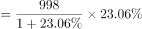
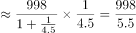

# 综合分析-逐项验证（核心为平均数之累计拆分求月均，兼查倍数、增长量、均价降幅比较）

考点：[[20-考点/资料分析/综合/综合分析-逐项验证（核心为平均数之累计拆分求月均，兼查倍数、增长量、均价降幅比较）|综合 / 综合分析-逐项验证（核心为平均数之累计拆分求月均，兼查倍数、增长量、均价降幅比较）]]
材料：[[15-材料/资料分析/186850 2016年一季度（重点3月单月）我国|186850 2016年一季度（重点3月单月）我国]]

**问法模型**：'能够从上述材料中推出的是'→综合分析题，逐项代入各自模型（倍数、增长量公式、降幅直比、'累计−当月'拆月均），优先算数据最完整、路径最短的选项锁定唯一正确项。

## 推理链
1. 第1步：D项从材料提取'2016年1~3月累计进口钢材313万吨、3月当月进口钢材127万吨'，两口径相减无单位问题。
2. 第2步：规则：1~2月合计=1~3月累计−3月当月，月均=合计÷月数。
3. 第3步：代入：1~2月合计=313−127=186万吨，月均=186÷2=93万吨<100万吨，D项'不到100万吨'成立。
4. 第4步：A项验证：一季度原油进口9110万吨、铜143万吨，9110÷143≈63.7倍（143×6=858，9110远大于858），远超6倍而非'是铜的6倍'，A错误。
5. 第5步：B项验证：3月钢材出口998万吨，环比增长量=998×r/(1+r)（r为原文环比增速，所给文本中数值空缺，按官方代入原卷完整数值），计算结果不足200万吨，B错误。
6. 第6步：C项验证：按原文铁矿石与原油进口均价同比跌幅数值（所给文本空缺，依官方解析）直比，铁矿石跌幅低于原油跌幅，'高于原油'不成立，C错误。
7. 第7步：结论：仅D项可由材料直接推出，与官方答案一致。

**最快解法**：⚡ 先攻D用'累计拆分+口算'：313−127=186，186÷2=93<100，直接锁定D；再快速排除：A项用截位估倍9110÷143≈63.7≠6倍；B项套增长量公式现期×r/(1+r)验证不足200万吨；C项将原文两个跌幅数值直接比较即可。

## 易错点
- ⚠ D项拆分陷阱：必须用'1~3月累计313−3月当月127'先拼出1~2月合计186再除以2；若直接用313÷3≈104万吨会误判'不到100'不成立。
- ⚠ A项口径陷阱：'是6倍'与'大于6倍'不同，9110÷143≈63.7倍远超6倍，把'远超6倍'误当成'就是6倍'会错选A；另外倍数题需精确而非仅判大小方向。
- ⚠ B、C项依赖的环比增速与均价跌幅数值在所给文本中空缺（只剩方向词），验证须以原卷完整数值为准，不得凭空补数；且注意'3月进口钢材127万吨'与'3月出口煤及褐煤127万吨'同值易混、表格'额'单位为万元（万元÷万吨=元/吨）勿按亿元处理。

## 母题抽象
> 🧩 当题干出现'能够从材料中推出的是'且四个选项横跨倍数、增长量、降幅比较、月均时，优先验证'累计−当月再÷月数'这类只需纯表格数据、计算最短的选项，其余选项用估倍（基期×n与现期比大小）、增长量公式、数值直比快速排除。

**同类特征**：能够从上述材料中推出的是、月均进口量不到100万吨、是铜的6倍、环比增长超过200万吨、均价降幅高于、1~3月累计与3月当月混排需拆分

## 相关题
- [[10-真题/资料分析/综合/4652204 综合判断题（核心验证点：两期比重升降判定；辅助：增长率比较、逐年数据核对、消费总量加总）|4652204]]（北京 2022，相关度1）
- [[10-真题/资料分析/综合/2033372 综合分析：增长量比较（大大则大）＋基期比重回推＋比重升降定性判断|2033372]]（河南 2016，相关度1）
- [[10-真题/资料分析/综合/2033414 综合判断题（倍数验证+增长率大小比较）|2033414]]（河南 2016，相关度1）
- [[10-真题/资料分析/综合/2049612 综合判断题（倍数比较＋当月比重与分数门槛比较＋比重变化方向＋增长率比较）|2049612]]（山东 2017，相关度1）
- [[10-真题/资料分析/综合/2741712 综合判断题（比重变化+增长量计算+增量与增速最大值比较）|2741712]]（山东 2021，相关度1）

---

### 题干
能够从上述材料中推出的是：

### 选项
- A. 2016年一季度原油进口量是铜的6倍
- B. 2016年3月份钢材出口量环比增长超过200万吨
- C. 2016年第一季度铁矿石进口均价降幅高于原油
- D. 2016年1~2月钢材月均进口量不到100万吨　✅

### 官方解析

A项：定位材料第四段数据，2016年一季度原油进口量为9110万吨，2016年一季度铜进口量为143万吨，则所求，即2016年一季度原油进口量大于铜的6倍，错误；

B项：定位材料第三段数据，“2016年3月全国钢材出口量998万吨，环比增长”。代入增长量计算公式，万吨，错误；

C项：定位材料第四段，“2016年一季度，铁矿石进口均价同比下跌，原油下跌”，降幅分别为和，故2016年第一季度铁矿石进口均价降幅低于原油，错误；

D项：定位材料第三段，“2016年3月份进口钢材127万吨；1~3月累计进口钢材313万吨”，则2016年1-2月月均钢材进口量万吨，正确。

故正确答案为D。

### 给定材料

        2016年3月我国煤及褐煤进口量为1969万吨，环比增长，同比增长。3月我国出口煤及褐煤127万吨，环比增长36万吨，同比增长。

        3月焦炭出口量112万吨，环比增长24万吨，增长，同比增长；1~3月累计出口焦炭274万吨，累计同比增长。

        3月全国钢材出口量998万吨，环比增长，同比增长；1~3月累计出口钢材2783万吨，累计同比增长。3月份进口钢材127万吨，环比增长，同比增长；1~3月累计进口钢材313万吨，累计同比下降。

        铁矿石、原油、铜等大宗商品主要进口商品价格持续低位。2016年一季度，我国进口铁矿石2.42亿吨，增长；原油9110万吨，增长；铜143万吨，增长。同期，进口煤及褐煤4846万吨，下降；成品油775万吨，下降；钢材313万吨，下降。同期，我国进口价格总体下跌。其中，铁矿石进口均价同比下跌，原油下跌，成品油下跌，煤及褐煤下跌，铜下跌，钢材下跌。

> [!warning] 疑点（官方解析可能有误，待人工复核）
> 官方解析中B、C项引用的环比增速与均价跌幅数值在所给材料文本及解析引文中均被空缺（如'代入增长量计算公式，万吨'、'降幅分别为和'），导致B、C的排除过程无法在给定文本内完整复算；但该问题不影响答案——D项仅由表内/文字可查数据（313、127）即可推出，与官方答案D无矛盾。
