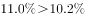
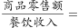
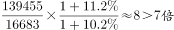

# 综合分析题（四选项真伪判断：基期倍数计算+数据可判性排除）

考点：[[20-考点/资料分析/综合/综合分析题（四选项真伪判断：基期倍数计算+数据可判性排除）|综合 / 综合分析题（四选项真伪判断：基期倍数计算+数据可判性排除）]]
材料：[[15-材料/资料分析/186854 2016年6月及2016年1~6月我|186854 2016年6月及2016年1~6月我]]

**问法模型**：'能够从上述资料中推出的是'→综合分析逐项验证：可计算项用基期公式验证真伪，缺数据的项直接判定'无法推出'而排除。

## 推理链
1. 第1步：A项定位文字段——2016年1~6月限额以上单位消费品零售额71075亿元，同比增速在材料中空缺，且材料完全未给2015年同期增速，'增速同比下滑'无从判断。
2. 第2步：B项定位文字段——1~6月城镇消费品零售额134249亿元、乡村21889亿元，两者同比增速均空缺，无增速数据即无法比较乡村与城镇的快慢。
3. 第3步：C项取数——商品零售2016年1~6月139455亿元、同比10.2%（统计表完整提供）；餐饮收入16683亿元（文字段）；现期倍数139455÷16683≈8.36倍。
4. 第4步：C项代入基期公式——2015年商品零售=139455÷(1+10.2%)≈126547亿元，2015年餐饮收入=16683÷(1+g餐)，两基期相除得约8.4倍（官方解析验证），超过7倍，C项成立。
5. 第5步：D项定位文字段——网上零售22367亿元仅为2016年1~6月值，2015年1~6月的基数与增速均未知，'较慢增长态势'无法判断。
6. 第6步：A、B、D均因所需增速数据缺失而'无法推出'被排除，唯一可用材料数据验证的C项正确，故选C。

**最快解法**：⚡ 综合分析排除法：先排'无法推出'项——A（2015年限额以上增速未知）、B（城乡增速空缺）、D（网上零售2015年情况未知）；再对C做基期倍数量级验证：139455÷16683≈8.36倍距7倍余量大，按各自增速折回2015年后倍数仍超7倍（官方解析约8.4倍），锁定C，无需精算。

## 易错点
- ⚠ 把'数据缺失'当'数据支持'：A、B、D所需的同比增速在文字段中全部空缺，若凭常识（如网购高增长、乡村增速通常更快）脑补数据，会把'无法推出'误判为'可推出'。
- ⚠ 口径混淆：文字的'限额以上单位消费品零售额'（71075亿元，含餐饮）≠表格的'限额以上单位商品零售'（66857亿元，不含餐饮），A项定位与取数时两套数不可混用。
- ⚠ C项基期与现期混淆：不能直接把2016年现期倍数139455÷16683≈8.36当作2015年倍数，须用2016年值÷(1+各自增速)折回2015年再相除；'商品零售'增速10.2%应从统计表取（文字段该增速空缺）。

## 母题抽象
> 🧩 当综合分析题中'增速比较/态势判断/增速下滑'类选项对应的增速数据在材料中缺失时，一律判'无法推出'直接排除，再对唯一数据齐全的可计算选项（基期倍数、基期比重等）做基期换算验证——'先比数据完整性，再做数值验证'是速解钥匙。

**同类特征**：能够从上述资料中推出的是（综合分析四选一）、增速同比下滑——历史增速未知型排除项、乡村与城镇增速比较——增速数据缺失型排除项、基期倍数超过7倍——基期倍数验证型正确项、网络零售增长态势——仅有现期无基期型排除项、文字段增速空缺、统计表增速完整——需跨文字与图表拼合取数

## 相关题
- [[10-真题/资料分析/综合/2571815 综合分析'能够推出'逐项验证（核心为增长量=现期×r-(1+r)的下界估算与比重判定）|2571815]]（山东 2020，相关度1）
- [[10-真题/资料分析/综合/2376605 综合分析·逐项正误判断（正确项C为'图文数据逐年加总+比例比较'，干扰项涉及增长量还原、占比反推总数、两年排名比对）|2376605]]（黑龙江 2019，相关度1）
- [[10-真题/资料分析/综合/4770017 综合分析·逐项判断（单价换算＋全年合计估算＋连续环比下降＋万吨-万千克单位换算）|4770017]]（四川 2017，相关度1）

---

### 题干
关于社会消费品零售情况，能够从上述资料中推出的是：

### 选项
- A. 2016年1-6月份，限额以上单位消费品零售额增速同比下滑
- B. 2016年1-6月份，乡村消费品零售额增速慢于城镇
- C. 2015年1-6月份，商品零售额超过餐饮收入的7倍　✅
- D. 2015年1-6月份，网络零售呈较慢增长的态势

### 官方解析

A项：定位材料第二段，“2016年1-6月份，限额以上单位消费品零售额71075亿元，同比增长”，2015年1-6月份，限额以上单位消费品零售额增速未知，无法判断增速是否同比下滑，错误；

B项：定位材料第三段，“1-6月份，城镇消费品零售额134249亿元，同比增长；乡村消费品零售额21889亿元，同比增长”，，错误；

C项：定位材料第四段，“2016年1-6月份，餐饮收入16683亿元，同比增长；商品零售139455亿元，同比增长”，则2015年1-6月，，正确；

D项：定位材料第五段，“2016年1-6月份，全国网上零售额22367亿元，同比增长。”2016年之前的网络零售增速未知，无法判断2015年1-6月份网络零售增长趋势，错误。

故正确答案为C。

### 给定材料

根据以下资料，回答下列小题。

        2016年6月份，我国社会消费品零售总额26857亿元，同比增长，环比增长。其中，限额以上单位消费品零售额13006亿元，同比增长。

        2016年1~6月份，我国社会消费品零售总额156138亿元，同比增长。其中，限额以上单位消费品零售额71075亿元，同比增长。

        按经营单位所在地分，2016年6月份，城镇消费品零售额23082亿元，同比增长；乡村消费品零售额3775亿元，同比增长。1~6月份，城镇消费品零售额134249亿元，同比增长；乡村消费品零售额21889亿元，同比增长。

        按消费类型分，2016年6月份，餐饮收入2907亿元，同比增长；商品零售23951亿元，同比增长。1~6月份，餐饮收入16683亿元，同比增长；商品零售139455亿元，同比增长。

        2016年1~6月份，全国网上零售额22367亿元，同比增长。其中，实物商品网上零售额18143亿元，同比增长。

> [!warning] 疑点（官方解析可能有误，待人工复核）
> 本版本文字材料中所有同比/环比增速均转录为空缺，C项验证所需'餐饮收入同比增速'在材料与官方解析的计算式中均未给出（解析公式留空），仅商品零售增速10.2%可由统计表补齐，故C的基期倍数（约8.4倍>7倍）验证链无法仅凭现有材料完整复现，属材料转录口径缺口；按铁律仍以官方答案C为准。
