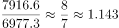
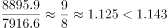
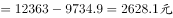
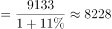
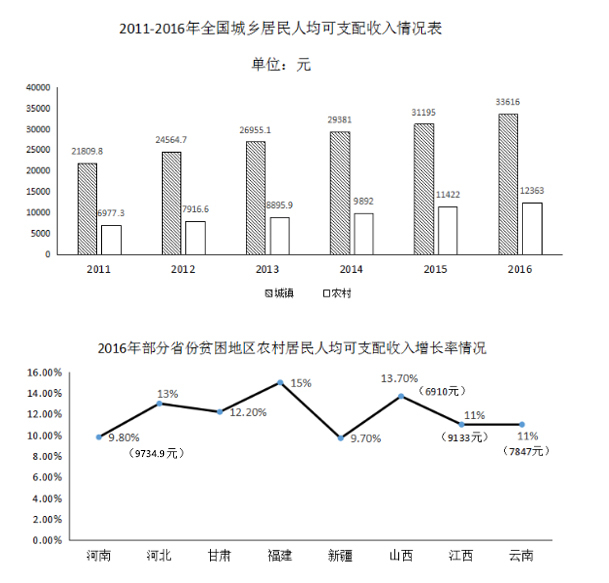

# 综合分析（基期计算＋增速趋势判断＋口径辨析）

考点：[[20-考点/资料分析/综合/综合分析（基期计算＋增速趋势判断＋口径辨析）|综合 / 综合分析（基期计算＋增速趋势判断＋口径辨析）]]
材料：[[15-材料/资料分析/186960 2016年中国脱贫攻坚成效综述，配以|186960 2016年中国脱贫攻坚成效综述，配以]]

**问法模型**：『从上述资料中可以推出的是』→ 四选一综合分析，逐项验证：A查文字表述口径、B逐年作差算增速看趋势、C做现期差值、D用基期公式现期/(1+r)

## 推理链
1. 第1步：A项对照原文——原文为『普遍高于当地农民人均可支配收入增速』，选项偷换为『当地居民』增速，农民≠居民，口径不符，排除
2. 第2步：B项用图1农村列逐年作差算增速：2012年(7916.6-6977.3)/6977.3≈13.5%，2013年(8895.9-7916.6)/7916.6≈12.4%，2012年快于2013年，增速并非逐年上涨，排除
3. 第3步：C项从图1取2016年全国农村居民收入12363元，从文字段/图2取河南贫困地区9734.9元，差额=12363-9734.9=2628.1元≠3500元，排除
4. 第4步：D项从图2取江西2016年收入9133元、增速11%，基期=9133/(1+11%)=9133/1.11≈8228≈8230元，与选项一致
5. 第5步：综上仅D项可推出，选D

**最快解法**：⚡ 综合分析『先易后难、定性优先』：A项纯文字逐字比对即排除（农民vs居民一词之差）；B项只需比较2012与2013两年增速（13.5%＞12.4%）即排除，不必算全六年；C项直减12363-9734.9≈2600元排除；D项基期公式9133/1.11，截位直除（9133/111≈82.3）得约8230元确认

## 易错点
- ⚠ A项『农民』与『居民』一词之差的表述偷换，须逐字回原文比对，不能凭语感认为表述合理
- ⚠ B项误把『收入逐年增加』当成『增速逐年上涨』——收入每年都增，但增速有升有降，判断增速趋势必须逐年作差而非看柱子是否变高
- ⚠ C项图2中9734.9元括号位置紧邻河北一侧，易误配给河北；且差额是12363-9734.9≈2628元而非3500元，方向与数值都需核实
- ⚠ D项基期计算用『现期/(1+r)』，勿误用『现期×(1-r)』导致数值偏差

## 母题抽象
> 🧩 当综合分析题问『可以推出的是』时，按『文字表述偷换→增速趋势逐年作差→现期差值直减→基期=现期/(1+r)』的顺序逐项排查，收入递增≠增速递增是最高频陷阱

**同类特征**：可以推出的是、四选一综合分析、农民与居民口径辨析、增速逐年上涨趋势、现期差额计算、基期量=现期/(1+增长率)

## 相关题
- [[10-真题/资料分析/综合/20701 综合分析判断（波动幅度比较＋增长快慢＋逐月增长验证＋比重计算）|20701]]（湖北 2010，相关度1）
- [[10-真题/资料分析/综合/1752654 综合分析判断（增长量计算+比重逆推总量+口径定性排除）|1752654]]（北京 2016，相关度1）
- [[10-真题/资料分析/综合/2021916 综合分析判断（混合增长率居中+两期比重变化+平均数计算+基期量估算）|2021916]]（吉林 2016，相关度1）
- [[10-真题/资料分析/综合/12019694 综合分析选非题（基期量+人均反推人口+比重临界判断）|12019694]]（广东 2026，相关度1）
- [[10-真题/资料分析/综合/2434318 综合分析·逐项判断（平均数计算+最值口径+增长率比较+比重验证）|2434318]]（新疆 2019，相关度1）

---

### 题干
从上述资料中可以推出的是：

### 选项
- A. 河南、甘肃、河北等地2016年贫困地区农民人均可支配收入增长速度普遍高于当地居民人均可支配收入增速
- B. 全国农村居民人均可支配收入增速呈逐年上涨趋势
- C. 2016年河南省贫困地区农村居民人均可支配收入与全国农村居民人均可支配收入的差额为3500元
- D. 2015年江西省贫困地区农村居民人均可支配收入约为8230元　✅

### 官方解析

A项：定位文字材料，河南、甘肃、河北等地2016年贫困地区农民人均可支配收入增长速度普遍高于当地农民人均可支配收入增速，是当地农民而不是当地居民，错误；

B项：增长率的比较可用进行比较，定位数据图一中数据，2012年：；2013年：，所以2012年全国农村居民人均可支配收入增速快于2013年，错误；

C项：定位数据图一和二中数据，可得2016年河南省贫困地区农村居民人均可支配收入与全国农村居民人均可支配收入的差额，错误；

D项：定位数据图二中数据，可得2015年江西省贫困地区农村居民人均可支配收入元，约为8230元，正确。

故正确答案为D。

### 给定材料

        2016年是中国脱贫攻坚首战之年，全年超过1000万人告别贫困；中央和省级财政扶贫资金首次超过1000亿元；各类金融机构累计发放扶贫小额贷款2772亿元；产业扶贫为脱贫不断“换血”，其中2016年旅游扶贫覆盖到2.26万个贫困村，据不完全统计，河南、甘肃、河北等地2016年贫困地区农民人均可支配收入增长速度普遍高于当地农民人均可支配收入增速。其中，河南省贫困地区人均可支配收入可达9734.9元，处于中部地区领先水平；福建贫困地区人均可支配收入增长高达，高于全国农民人均可支配收入增长的平均水平。

