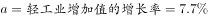
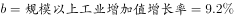

# 综合判断题（两期比重升降比较＋增长量要素齐备性＋指标口径核对）

考点：[[20-考点/资料分析/综合/综合判断题（两期比重升降比较＋增长量要素齐备性＋指标口径核对）|综合 / 综合判断题（两期比重升降比较＋增长量要素齐备性＋指标口径核对）]]
材料：[[15-材料/资料分析/186992 2015年江西省规模以上工业经济运行|186992 2015年江西省规模以上工业经济运行]]

**问法模型**：题干'下列表述正确的是'→逐项验证排除法：比重项比部分增速a与总体增速b、增量项查'现期量×增速'双要素、'首位'项核对指标口径，三项全不成立则选'均错误'

## 推理链
1. 第1步：A项属两期比重比较——材料第一段轻工业增加值2731.2亿元、规模以上工业增加值7268.9亿元，比重升降只需比较轻工业增速a与总体增速b（本卷文本两增速均为空位，以原卷补全值为准）
2. 第2步：按'部分增速＞总体增速则比重上升'的规则，官方解析代入原卷增速后a＜b，故2015年轻工业占比较上年下降，A错误
3. 第3步：B项要判断电子行业同比增量是否最大，需用增量=现期量×增速/(1+增速)，但材料只给六大重点行业合计增加值2707.0亿元与各自增速，电子行业单独现期量缺失，缺现期量则增量无法计算，B错误
4. 第4步：C项中'居全省首位'的原文仅指江铜集团主营业务收入2010.4亿元（超百亿元企业10户中），江铜集团的利税数据材料未给，把'主营收入首位'偷换为'利税首位'，C错误
5. 第5步：A、B、C三项均不成立，故正确答案为D'以上选项均错误'

**最快解法**：⚡ 逐项排错法：A项用'增速差判比重升降'（原卷数值轻工业增速a＜总体增速b→比重下降，无需算基期比重）；B项查要素齐备性（只有增速、无电子行业单独现期量→增量不可求）；C项只核口径（居首位的是主营收入2010.4亿元而非利税）——三步排错几乎零计算锁定D

## 易错点
- ⚠ A项方向误判：两期比重升降只看部分增速与总体增速的大小关系，不必先算基期比重；且本卷增速空缺，数值必须以原卷补全为准，不能凭空设数验证
- ⚠ B项把'增速突出'误当'增量最大'：同比增量必须现期量与增速双要素齐全才能比较，材料只给六大行业合计2707.0亿元，缺单项现期值即不可判，增速大小≠增量大
- ⚠ C项偷换指标口径：'主营业务收入超百亿元企业10户，江铜2010.4亿元居全省首位'说的是主营收入而非利税；全省利税总额3543.8亿元（利润2128.0亿元）是规上工业总体口径，不能反推江铜利税居首

## 母题抽象
> 🧩 当题干出现'下列表述正确的是'且含'均错误'选项时，逐项做可得性检验——两期比重比增速差、增长量查现期与增速双要素、'首位/最大'类结论逐字核对指标口径，要素缺失或口径不符即判错

**同类特征**：下列表述正确的是、以上选项均错误、两期比重较上年升降、同比增量最大、居全省首位、文字型材料综合判断

## 相关题
- [[10-真题/资料分析/综合/2187818 净资产额计算与多主体大小比较（净资产=总资产-总负债，综合判断选正确项）|2187818]]（天津 2018，相关度1）
- [[10-真题/资料分析/增长/2719394 增长量比较|2719394]]（国考 2021，相关度1）
- [[10-真题/资料分析/增长/12536408 增长量比较|12536408]]（四川 2024，相关度1）
- [[10-真题/资料分析/综合/1758926 综合判断题（比重计算+同比增量比较+年份间隔+扇区计数验证）|1758926]]（上海 2016，相关度1）
- [[10-真题/资料分析/综合/1758936 综合判断题（城镇化率过半判断、比重增量比较、跨行跨期数据比对）|1758936]]（上海 2016，相关度1）

---

### 题干
根据所给材料，下列表述正确的是（  ）

### 选项
- A. 2015年江西省轻工业增加值占规模以上工业增加值的比重较上年有所上升
- B. 2015年江西省电子行业增加值同比增量最大
- C. 2015年江铜集团利税居全省各企业的首位
- D. 以上选项均错误　✅

### 官方解析

A项：根据“2015年······比重较上年有所上升”可知，该选项为两期比重的比较，仅需比较增长率a与b的大小关系即可。根据“轻工业增加值”“规模以上工业增加值”定位材料第一段，定位数据，，，，2015年江西省轻工业增加值占规模以上工业增加值的比重较上年有所下降，错误；

B项：根据“电子行业”定位材料第二段，只有增长率，现期量未知，基期量未知，无法求增长量，无法判断增长量是否最大，错误；

C项：根据“江铜集团利税”定位材料第三段，“主营业务收入超百亿元的企业10户，其中，江铜集团2010.4亿元，居全省首位。”江铜集团利税数据未知，无法判断，错误。

故正确答案为D。

### 给定材料

        2015年，江西规模以上工业增加值7268.9亿元，比上年增长。分轻重工业看，轻工业增加值2731.2亿元，增长；重工业4537.7亿元，增长。分经济类型看，国有企业增加值269.1亿元，增长；集体企业19.3亿元，下降；股份合作企业22.3亿元，下降；股份制企业2847.6亿元，增长；私营企业2992.2亿元，增长；外商及港澳台商投资企业1112.5亿元，增长。

        2015年江西省规模以上工业38个行业大类中34个突破增长，占比近九成。其中，电子、电子机械、纺织、农副产品、医药和有色等六大重点行业表现突出，分别增长、、、、、，合计实现增加值2707.0亿元，占规模以上工业的比重为，对规模以上工业增长的贡献率达。高新技术产业增加值1869.7亿元，增长，占规模以上工业的比重为，比上年提高0.8个百分点。抚州、赣州、吉安高新区晋升为国家级高新技术开发区，年末国家级高新技术开发区7家，居全国第六、中部第一；省级高新技术产业园区3家，比上年新增1家；国家高新技术产业化基地27个，居全国第一。

        2015年江西省规模以上工业企业实现主营业务收入32459.4亿元，比上年增长；实现利税总额3543.8亿元，增长，其中，利润总额2128.0亿元，增长。主营业务收入超百亿元的企业10户，其中，江铜集团2010.4亿元，居全省首位。

> [!warning] 疑点（官方解析可能有误，待人工复核）
> 本卷文本所有同比增速均为空位，官方解析A项'比重较上年下降'的结论依赖原卷补全的轻工业与总体增速数值，在本材料内无法独立复算，但不影响答案D的判定与BC两项的排错逻辑

<!-- CODEX-ANSWER-REVIEW:BEGIN -->
### 本次独立复核

**复核状态：** `resolved`（答案与解析已核定）

**计分答案：** D（可计分）

**复核解析：**

1. A项：材料原公式图显示2015年轻工业增加值增速7.7%，规上工业增加值增速9.2%。部分增速低于整体增速，轻工业占比下降，A所称“上升”错误。
2. B项：材料没有电子行业单独的现期增加值，只有行业增速/六大行业合计，无法从给定数据推出电子行业同比增量最大。
3. C项：原文称江铜集团主营业务收入2010.4亿元居全省首位，并未称其利税居首，指标口径不同。
4. A、B、C均不成立，故D“以上选项均错误”成立。

**相关信息：**

考点：综合判断题（两期比重升降比较＋增长量要素齐备性＋指标口径核对）。来源：2017年422联考《行测》题（江西卷）；2017年。> 🧩 当题干出现'下列表述正确的是'且含'均错误'选项时，逐项做可得性检验——两期比重比增速差、增长量查现期与增速双要素、'首位/最大'类结论逐字核对指标口径，要素缺失或口径不符即判错

**同类特征**：下列表述正确的是、以上选项均错误、两期比重较上年升降、同比增量最大、居全省首位、文字型材料综合判断

**题源依据：** [固定版本原题](https://github.com/Mentat-Uran/kaogongzhentizhengliu/blob/84ab93d4b64b61d897bece8a1c0a5bab06b4feb2/10-%E7%9C%9F%E9%A2%98/%E8%B5%84%E6%96%99%E5%88%86%E6%9E%90/%E7%BB%BC%E5%90%88/2050982%20%E7%BB%BC%E5%90%88%E5%88%A4%E6%96%AD%E9%A2%98%EF%BC%88%E4%B8%A4%E6%9C%9F%E6%AF%94%E9%87%8D%E5%8D%87%E9%99%8D%E6%AF%94%E8%BE%83%EF%BC%8B%E5%A2%9E%E9%95%BF%E9%87%8F%E8%A6%81%E7%B4%A0%E9%BD%90%E5%A4%87%E6%80%A7%EF%BC%8B%E6%8C%87%E6%A0%87%E5%8F%A3%E5%BE%84%E6%A0%B8%E5%AF%B9%EF%BC%89.md)；固定内容 commit `84ab93d4b64b61d897bece8a1c0a5bab06b4feb2`，Markdown blob `8fe9cacdc218e7b9b7c67f1276995e70ece18a0d`。
<!-- CODEX-ANSWER-REVIEW:END -->
