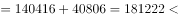
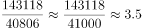
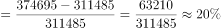
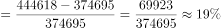
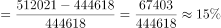
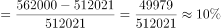

# 综合判断（选非题）：数据可得性判定+加和比较+倍数估算+增长率比较

考点：[[20-考点/资料分析/综合/综合判断（选非题）：数据可得性判定+加和比较+倍数估算+增长率比较|综合 / 综合判断（选非题）：数据可得性判定+加和比较+倍数估算+增长率比较]]
材料：[[15-材料/资料分析/186996 2015年我国全社会固定资产投资总量|186996 2015年我国全社会固定资产投资总量]]

**问法模型**：题干为'以下说法错误的是'（选非综合判断）→ 逐项用材料数据核验，既排查与数据矛盾项，也排查材料缺数据、无法判定的项

## 推理链
1. 第1步：题干要求找出错误说法，需逐项核验A、B、C、D；材料文字增速全部留空，涉及增速只能由图1柱值计算
2. 第2步：验证A——房地产开发投资仅有2015年饼图值95979亿元（占17.40%，不含农户口径），材料无2014年房地产开发投资额，'力度进一步加大'需跨年比较，无从判定，A说法错误
3. 第3步：验证B——西部+东北=140416+40806=181222亿元＜东部232107亿元，B说法正确
4. 第4步：验证C——中部÷东北=143118÷40806≈3.51，与'大约3.5倍'一致，C说法正确
5. 第5步：验证D——由图1算各年同比增速：2012年(374695-311485)/311485≈20.3%、2013年(446618-374695)/374695≈19.2%、2014年(512021-446618)/446618≈14.6%、2015年(562000-512021)/512021≈9.8%，2015年最小，D说法正确
6. 第6步：选非题选错误项，仅A无法由材料判定，与官方答案A一致

**最快解法**：⚡ 数据可得性判定+口算排除：先扫A——'进一步加大'需2014年房地产投资作基期，材料只有2015年95979亿元，直接锁定A为无法判定的错误说法；B口算140416+40806≈18.1万＜23.2万（东部232107）；C截位直除143118/40806≈3.5；D看图1柱高：增量63210→71923→65403→49979逐年缩而基数逐年增，增速逐年放缓，2015年最小，无需精算

## 易错点
- ⚠ 选非题方向做反：本题找'错误说法'，若按'找正确'习惯误选B/C/D
- ⚠ A项被饼图迷惑：以为有2015年房地产开发投资95979亿元即可判断'力度加大'，实则缺2014年基期值，趋势类说法无数据支撑即不成立
- ⚠ D项凭直觉不验证：需用图1相邻年份差值算增速（文字增速全留空，不得臆造），确认2012→2015增速约20.3%→19.2%→14.6%→9.8%逐年下降且2015年最小

## 母题抽象
> 🧩 当题干出现'以下说法错误/正确的是'时，逐项验证并优先抓'趋势/力度加大'类说法——材料缺基期数据即无法判定、直接判错；再用加和比较、倍数截位估算、相邻年份增速计算快速核验定量选项

**同类特征**：以下说法错误的是（选非）、四选项综合判断、'力度进一步加大'趋势判断、区域投资加和与倍数比较、2012-2015各年增长率比较、文字+柱状图+饼图交叉验证

## 相关题
- [[10-真题/资料分析/综合/1796564 综合判断题（选非型）—逐年增量与增长率趋势核对|1796564]]（广东 2016，相关度1）
- [[10-真题/资料分析/综合/5430330 综合判断题（跨图作差还原网上药店序列+同比增量比较+倍数判断）|5430330]]（浙江 2023，相关度1）

---

### 题干
根据所给材料，以下说法错误的是：

### 选项
- A. 2015年，我国房地产投资的力度进一步加大　✅
- B. 2015年，我国西部地区投资和东北地区投资之和小于东部地区投资
- C. 2015年，我国中部地区投资大约是东北地区投资的3.5倍
- D. 2012年-2015年，我国全社会固定资产投资增长率最小的是2015年

### 官方解析

A项：材料没有2014年房地产开发投资金额，所以不能判定投资的力度进一步加大，错误；

B项：“各区域看，东部地区投资232107亿元······西部地区投资140416亿元；东北地区投资40806亿元。”西部地区投资东北地区投资东部地区投资232107，正确；

C项：“中部地区投资143118亿元······东北地区投资40806亿元，”中部地区是东北地区的倍，正确；

D项：增长率比较：2012年增长率；2013年增长率；2014年增长率；2015年增长率，增长率最小的是2015年，正确。

本题为选非题，故正确答案为A。

### 给定材料

        我国2015年全年全社会固定资产投资562000亿元，固定资产投资（不含农户）551590亿元，增长。从各区域看，东部地区投资232107亿元，比上年增长；中部地区投资143118亿元，增长；西部地区投资140416亿元，增长；东北地区投资40806亿元，下降。

