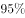
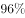

# 综合判断题（选非）——文字型调查材料多指标正误核对

考点：[[20-考点/资料分析/综合/综合判断题（选非）——文字型调查材料多指标正误核对|综合 / 综合判断题（选非）——文字型调查材料多指标正误核对]]
材料：[[15-材料/资料分析/187066 某年度某机构关于中国宠物主人消费行为|187066 某年度某机构关于中国宠物主人消费行为]]

**问法模型**：题干出现'下列判断错误的是'（选非题）→ 逐项回文定位占比与约数词（四成/三成/近一半/不足），用分类合计过半、互补与包含关系核对每项表述的量级与逻辑，选出材料无法支持的绝对化结论

## 推理链
1. 第1步：题干为选非题，需对A/B/C/D逐项回文核对；材料为10680份有效问卷的单一时点调查，文本中关键百分数空缺，核对只能依托'四成(40%)''三成(30%)''近一半(≈50%)''不足某值'等定性量级。
2. 第2步：核对A项——材料对训练状况只给出'自主训练或放任生长'这一合并状态的占比，其中'自主训练'本身就属于'接受过训练'，故接受过训练的占比=自主训练+专业训练，并非该合并占比之外的剩余一小块。
3. 第3步：据此，接受过训练的宠物占比并非某个很小的定值（自主训练部分最高可接近该合并占比，再叠加专业训练部分），有可能明显超过A项所称'只有（图中分数）接受过训练'，该绝对化数值无法由材料唯一推出，判断错误。
4. 第4步：核对B项——将宠物定义为'孩子''亲人''朋友'三类占比合计超过'宠物'一类（合计过半），可认定'绝大部分主人对宠物的定义超越了宠物本身'，表述正确。
5. 第5步：核对C项——月开销101至500元与501至1000元两档占比合计超过其余档位（过半），可认定月均消费101-1000元是宠物消费主流，表述正确。
6. 第6步：核对D项——对购物类O2O服务有选择意向者'不足某值'，即绝大多数被访者暂无选择意向，'市场有待培育'成立，表述正确。
7. 第7步：B、C、D均与材料相符，仅A项不能成立，本题为选非题，故选A。

**最快解法**：⚡ 定性排除法（选非题）：先扫含绝对化数值的选项——A项'只有×的宠物接受过训练'无法由'自主训练或放任生长'合并占比推出（自主训练亦属受训，受训占比可能远超该值），直接锁定A为错误项；B、C用'三类/两档合计过半'验证，D用'不足'取反验证，均正确。

## 易错点
- ⚠ 口径陷阱：'自主训练或放任生长'是合并表述，不能把它整体当作'未受训练'，也不能用其补集当作'受过训练'——自主训练本身属于接受过训练，受训占比≠合并占比的补集。
- ⚠ 意愿≠事实：'近一半人希望爱宠得到专业训练'是意向数据，不等于实际接受专业训练的占比，不能拿它直接推算'已受训比例'，A项正是把绝对化数值建立在这种混淆上。
- ⚠ 选非题惯性陷阱：B/C/D均为正确表述，易顺手选成'正确项'；另注意本文本中绝大多数百分数为空格缺省，判断只能依'过半''不足''近一半'等定性口径，切勿凭经验脑补数值。

## 母题抽象
> 🧩 当题干出现'下列判断错误/正确的是'且材料为文字型占比调查时，逐项回文核对：看分类合计是否过半（判'主流/绝大部分'）、约数词方向（'不足'取反、'近一半'是约数）、并区分合并口径的包含关系；凡出现材料推不出的绝对化精确值（如'只有×%'）或混淆意愿与事实的选项，即为应选的错误项。

**同类特征**：下列判断错误的是、选非题、文字型调查材料综合判断、逐项定性核对占比、绝对化表述'只有'、约数词：四成/三成/近一半/不足

## 相关题
- [[10-真题/资料分析/综合/250219 综合分析选非题（图表数据可推断性判断）|250219]]（深圳市考 2008，相关度1）
- [[10-真题/资料分析/综合/10297333 综合分析选非题（同比增速逐年比较+年均增长量+比重百分点还原）|10297333]]（浙江 2025，相关度1）
- [[10-真题/资料分析/综合/14355349 综合分析-选非题（增长率计算比较+人均值计算）|14355349]]（浙江 2024，相关度1）
- [[10-真题/资料分析/综合/17097816 综合判断·选非题（增长率与增长量偷换）|17097816]]（山西 2024，相关度1）
- [[10-真题/资料分析/综合/2052088 综合分析-选非题（趋势判断+增速排序+增长量比较+增长率计算逐项核对）|2052088]]（吉林 2017，相关度1）

---

### 题干
根据问卷，下列判断错误的是：

### 选项
- A. 
只有的宠物接受过训练，专业训练消费潜力巨大
　✅
- B. 
绝大部分宠物主人对宠物的定义超越了宠物本身

- C. 
月均消费在101-1000元的是宠物消费的主流

- D. 
购物类O2O服务的市场还有待培育

### 官方解析

逐项分析如下：

A项：定位文字材料后半段，“在训练方面，的宠物处于自主训练或放任生长的状态”，则自主训练的宠物占比小于，但自主训练和专业训练都属于训练，所以接受过训练的宠物占比小于，有可能超过，故A项说法“只有的宠物接受过训练”与其不符，错误；

B项：定位材料前半段，对宠物的定义超越宠物本身，定义为“孩子”“亲人”“朋友”的比重分别占到、、，合计占比超过，可以认定为“绝大部分宠物主人”，正确；

C项：定位材料前半段，101至500元和501至1000元的消费人群占比分别为和，合计占比超过，可以认定为“主流”，正确；

D项：定位材料最后一句，对购物类O2O服务有选择意向的不足，说明有超过的人暂时没有选择意向，符合“市场有待培育”，正确。

本题为选非题，故正确答案为A。

### 给定材料

        某年度某机构关于中国宠物主人消费行为及倾向调查回收的10680份有效问卷显示：女性养宠者占，宠物主人为“80-90后”占。将宠物定义为“孩子”“亲人”“朋友”和“宠物”的分别为、、和。的人月开销在100元以内，的人开销在101至500元之间，而花费在501至1000元之间的达到，月消费1000元以上的人群达到。在购买物品方面，购买宠物食物的人数达到有效问卷总人数的，其次为药品、保健品，以及日用品、玩具、服饰五项，均接近。宠物主人外出时，四成“委托亲朋照顾”，三成“一起带走”，委托寄养还不到。在训练方面，的宠物处于自主训练或放任生长的状态，但近一半人希望爱宠得到专业训练。在购买渠道方面，的被访问者选择综合电商平台，选择线下综合商店或专卖店者为，选择宠物类垂直电商平台的占，但其复购率更高。值得注意的是，目前宠物主人对购物类O2O服务有选择意向的不足。

> [!warning] 疑点（官方解析可能有误，待人工复核）
> 官方解析逻辑本身无矛盾，但所给文本与解析中关键百分数均空格缺省（A项中的分数以图片公式呈现、具体值未能读取），本题正误判断只能依托'合计过半''不足''近一半'等定性口径复核，具体数值须以完整原卷为准。

<!-- CODEX-ANSWER-REVIEW:BEGIN -->
### 本次独立复核

**复核状态：** `resolved`（答案与解析已核定）

**计分答案：** A（可计分）

**复核解析：**

固定原图补回关键比例后，A把“自主训练或放任生长”的99%误读成“仅1%接受过训练”；自主训练本身也是训练，故A错误。B：将宠物定义为孩子、亲人或朋友的比例为54.5%+33.4%+7.7%=95.6%，属绝大多数；C：月均消费101—1000元占49.4%+25.0%=74.4%，是消费主流；D：购物类O2O意向不足4%，说明市场仍待培育。唯一错误项为A。

**相关信息：**

资料分析—问卷文字与分类比例综合判断；“自主训练”和“放任生长”属于并列情形，不能把整组比例直接取补集当作接受过训练的比例。

**题源依据：** [固定版本原题](https://github.com/Mentat-Uran/kaogongzhentizhengliu/blob/84ab93d4b64b61d897bece8a1c0a5bab06b4feb2/10-%E7%9C%9F%E9%A2%98/%E8%B5%84%E6%96%99%E5%88%86%E6%9E%90/%E7%BB%BC%E5%90%88/2051092%20%E7%BB%BC%E5%90%88%E5%88%A4%E6%96%AD%E9%A2%98%EF%BC%88%E9%80%89%E9%9D%9E%EF%BC%89%E2%80%94%E2%80%94%E6%96%87%E5%AD%97%E5%9E%8B%E8%B0%83%E6%9F%A5%E6%9D%90%E6%96%99%E5%A4%9A%E6%8C%87%E6%A0%87%E6%AD%A3%E8%AF%AF%E6%A0%B8%E5%AF%B9.md)；固定内容 commit `84ab93d4b64b61d897bece8a1c0a5bab06b4feb2`，Markdown blob `2f1b139450b2fcc8d8cadf7820f8a642d1183fdc`。
<!-- CODEX-ANSWER-REVIEW:END -->
