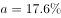
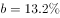
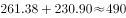
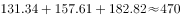
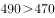

# 综合判断题（两期比重比较＋增速计数＋区间求和比较＋涨幅比较）

考点：[[20-考点/资料分析/综合/综合判断题（两期比重比较＋增速计数＋区间求和比较＋涨幅比较）|综合 / 综合判断题（两期比重比较＋增速计数＋区间求和比较＋涨幅比较）]]
材料：[[15-材料/资料分析/187072 某市2014年社会消费品零售总额（含|187072 某市2014年社会消费品零售总额（含]]

**问法模型**：题干为'能够从上述资料推出的是'的四选一综合判断 → 对A/B/C/D各配一个单点验证模型（两期比重差定性、逐年增速计数、两年之和vs前三年之和、涨幅快慢比较），优先做唯一可用纯图表数据完整验证的选项。

## 推理链
1. 第1步：从柱线图提取五年数据——2010年131.34亿元/18.45%、2011年157.61亿元/20.00%、2012年182.82亿元/16.00%、2013年230.90亿元/26.30%、2014年261.38亿元/13.20%。
2. 第2步：A项套两期比重规则——批发业增速（原卷数值）大于全市总额增速时比重上升，官方判定'部分增速＞整体增速→2014年比重高于上年'，A的'低于上年'说法错误。
3. 第3步：B项将五年增速与题干阈值逐一比对——慢于该值的有2010年18.45%、2012年16.00%、2014年13.20%共3年（2011年恰为20.00%不属'慢于'），非4年，B错误。
4. 第4步：C项做区间求和——2013+2014=230.90+261.38=492.28亿元，前三年（2010-2012年）=131.34+157.61+182.82=471.77亿元。
5. 第5步：492.28＞471.77（高出20.51亿元），C成立。
6. 第6步：D项按官方口径——2014年烟酒类价格涨幅慢于消费价格总水平涨幅，'快于'不成立，D错误；故正确答案为C。

**最快解法**：⚡ 考场最快解法：先锁定四项中唯一可纯用图表数据完成的C——截位加法：231+261≈492 与 131+158+183≈472，492＞472直接选C；其余快速排除：A用口诀'部分增速＞整体增速→比重上升'，B逐年比对增速标签得3年（2011年20.00%恰等于阈值不计入），D按官方数值烟酒涨幅＜总水平涨幅。

## 易错点
- ⚠ 双轴图量纲陷阱：柱为亿元、折线为%，不能凭图形高低直观比较——2014年总额261.38亿元为五年最高但增速13.20%为五年最低；B项须逐个读增速数据标签，不能凭折线走势近似判断。
- ⚠ '慢于'是严格小于：2011年增速恰为20.00%（等于阈值）不计入，忽略这一边界会把B错判为正确。
- ⚠ C项'前3年'指2010-2012年，勿误取2011-2013年或把2013年计入；A项两期比重方向易反：部分增速＞整体增速→本期比重高于上年，方向搞反会误选A。

## 母题抽象
> 🧩 当综合判断题出现'后两年之和与前三年之和比较'类选项时，直接对图表现期值做截位加法即可秒验；比重类选项用'部分增速vs整体增速'定性判方向，计数类选项须注意'慢于/快于'的严格边界及双轴图量纲。

**同类特征**：能够从上述资料推出的是、综合分析四选一、两年之和高于前三年之和、增速慢于某值的年份个数、占…比重低于上年水平、价格增速快于总水平增速

## 相关题
- [[10-真题/资料分析/综合/1797646 综合分析（比重变化判断+月均数+读图增速比较+现期比重估算）|1797646]]（山东 2016，相关度2）
- [[10-真题/资料分析/综合/13319330 综合分析（可推出判断），涉及增长n倍求基期量、年均增速时间口径、'四成以上'方向词甄别、增长倍数比较|13319330]]（江苏 2025，相关度1）
- [[10-真题/资料分析/综合/2051138 综合判断（顺差比较+基期回推+单价计算混合验证）|2051138]]（黑龙江 2017，相关度1）
- [[10-真题/资料分析/综合/2188892 综合分析推断题（无中生有排除+平均每机构场次验证）|2188892]]（甘肃 2018，相关度1）
- [[10-真题/资料分析/综合/2578808 综合分析题·逐项验证（核心为同比增长率比较，辅以计数-比重判断与排名对应）|2578808]]（四川 2020，相关度1）

---

### 题干
关于该市社会消费品零售状况，能够从上述资料推出的是：

### 选项
- A. 
2014年批发业销售额占社会消费品零售总额比重低于上年水平

- B. 
2010到2014年间，社会消费品零售总额增速慢于的年份有4个

- C. 
2013到2014年社会消费品零售总额之和高于前3年之和
　✅
- D. 
2014年烟酒类消费品价格增速快于居民消费总水平增速

### 官方解析

A项，定位文字材料第一段，可知批发业销售额增长率，社会消费品零售总额增长率，根据两期比重差公式，因为，故比重上升，2014年比重高于上年水平，错误；

B项，定位图表，根据折线图和数据标签可知，2010年-2014年，只有2010、2012、2014这3年的增长率慢于，错误；

C项，定位图表，2013年和2014年的总额之和为亿元，前三年之和为亿元，，正确；

D项，定位文字材料第二段，可知2014年烟酒类消费品价格增速为，而居民消费总水平增速为，前者慢于后者，错误。

故正确答案为C。

### 给定材料

        2014年，某市全年实现社会消费品零售总额261.38亿元，比上年增长。按经营地统计，城镇消费品零售总额为178.6亿元，比上年增长，乡村消费品零售总额82.78亿元，比上年增长。按消费形态统计，批发业增长，零售业增长。

        全年消费价格总水平比上年增长。其中家庭设备用品及维修服务类累计下降；食品类、烟酒类、衣着类、医疗保健及个人用品类、交通与通信类、娱乐教育文化用品及服务类、居住类累计分别上升、、、、、、。

> [!warning] 疑点（官方解析可能有误，待人工复核）
> 所给文本中批发业/零售业增速、消费价格总水平及烟酒类涨幅、B项阈值公式均显示为空缺，A、B、D项无法用提供文本独立复算，判定以官方解析结论为准；C项仅凭图表数据即可完全验证且与官方答案一致，无矛盾。
