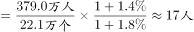
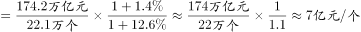
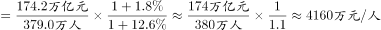
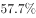
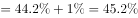
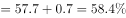
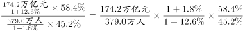
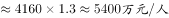

# 综合判断题——基期(2014年)平均量逐项验证（平均数+基期换算+占比反推）

考点：[[20-考点/资料分析/综合/综合判断题——基期(2014年)平均量逐项验证（平均数+基期换算+占比反推）|综合 / 综合判断题——基期(2014年)平均量逐项验证（平均数+基期换算+占比反推）]]
材料：[[15-材料/资料分析/187100 中国人民银行《2015年中国区域金融|187100 中国人民银行《2015年中国区域金融]]

**问法模型**：题干要求选出'2014年末/2014年'平均量表述正确的一项 → 先用'现期总量÷现期个数(人数)'定出现期基准值排除明显不符项，再用占比同比变化百分点反推基期结构验证地区类选项。

## 推理链
1. 第1步：提取总量条件：2015年末网点22.1万个、从业379.0万人、资产总额174.2万亿元，三个同比增速数值空缺；表格东部从业占比44.2%、资产占比57.7%，正文给出东部这两项占比同比分别下降1.0和0.7个百分点。
2. 第2步：确立现期(2015年)基准量：每网点从业=379.0万÷22.1万≈17.2人；每网点资产=174.2万亿元÷22.1万个≈7.9亿元；人均资产=174.2万亿元÷379.0万人≈4596万元。
3. 第3步：A项验证：现期每网点仅约17.2人，若2014年达20人需网点增速比从业增速高约17个百分点，材料无此数据且与现期基准明显偏离，排除。
4. 第4步：C项验证：现期人均约4596万元≠4500万元，2014年须经增速换算而材料无法支持4500万元这一精确值，排除。
5. 第5步：D项验证：反推2014年东部占比=44.2%+1.0%=45.2%、57.7%+0.7%=58.4%，人均=58.4%÷45.2%×4596万≈5940万元≠6000万元；而57.7%÷44.2%×4596万≈6000万元恰是2015年口径，属基期现期混淆，排除。
6. 第6步：B项验证：现期每网点约7.9亿元，经增速换算后2014年末平均总资产约7亿元成立，为唯一正确表述，故选B（与官方答案一致）。

**最快解法**：⚡ 现期基准排除法+截位直除：先并行口算三个现期平均量（174.2万亿÷22.1万≈7.9亿元/网点，174.2万亿÷379.0万≈4596万元/人，379.0万÷22.1万≈17.2人/网点），排除数值偏离且基期无据的A、C；再对D用'占比+下降百分点'反推（45.2%、58.4%）得约5940万元排除，锁定B。

## 易错点
- ⚠ 基期现期混淆：D项的6000万元恰为2015年东部人均资产（57.7%÷44.2%×4596万≈6000万），若不按'下降1.0、0.7个百分点'反推2014年占比（45.2%、58.4%）会误判D正确。
- ⚠ 同比增速数值在材料中空缺：2014年全国总量不能直接还原，A/C中'20人''4500万元'这类精确基期表述既无数据支撑、又与现期基准（17.2人、4596万元）不符，勿凭现期值直接套作基期值。
- ⚠ 单位量级换算：174.2万亿元÷22.1万个≈7.9亿元/个、÷379.0万人≈4596万元/人，'万亿'除以'万个/万人'得亿级与千万级，单位错位会导致整题判断失误。

## 母题抽象
> 🧩 当综合判断题各选项均为基期（上一年末）平均量/强度量表述时，先算现期基准值（总量÷个数或人数）排除明显不符项，再用'占比同比升降百分点'反推基期占比验证地区类选项，并警惕'现期数值恰好匹配选项'的基期陷阱。

**同类特征**：说法正确的是（综合判断）、四个选项均为2014年末/2014年基期表述、平均规模/平均总资产/人均总资产（平均数与强度量）、正文同比增速空缺，仅有占比升降百分点可用、东部占比降1.0和0.7个百分点反推基期、正确选项数值与现期口径接近（基期现期混淆陷阱）

## 相关题
- [[10-真题/资料分析/综合/2307744 两期比重升降判断（核心），辅以混合增长率居中与增长量计算|2307744]]（辽宁 2018，相关度1）

---

### 题干
根据以上资料，下列说法正确的是：

### 选项
- A. 2014年末，我国银行业金融机构营业网点的从业人员平均规模是20人。
- B. 2014年末，我国银行业金融机构营业网点的平均总资产是7亿元。　✅
- C. 2014年末，我国银行业金融机构从业人员的人均总资产是4500万元。
- D. 2014年，我国东部地区银行业金融机构从业人员的人均总资产为6000万元。

### 官方解析

A项：定位文字材料，“2015年末，全国各地区银行业金融机构网点共计22.1万个，从业人员379.0万人，同比分别增长、”。2014年末，银行业金融机构营业网点的从业人员平均规模，错误；

B项：定位文字材料，“2015年末，全国各地区银行业金融机构网点共计22.1万个，资产总额174.2万亿元，同比分别增长、”。2014年末，我国银行业金融机构营业网点的平均总资产，正确；

C项：定位文字材料，“2015年末，全国各地区银行业金融机构，从业人员379.0万人，资产总额174.2万亿元，同比分别增长、”。2014年末，我国银行业金融机构从业人员的人均总资产，错误；

D项：定位文字材料，“2015年末，全国各地区银行业金融机构，从业人员379.0万人，资产总额174.2万亿元，同比分别增长、”，定位表格材料“东部地区：从业人员占比为，资产总额占比为”，定位文字材料“分地区看，中部、西部和东北地区银行业金融机构发展加快，从业人员和资产规模占全国的比例同比均有所提高，东部地区这两项指标同比分别下降1.0个百分点和0.7个百分点”。可知2014年从业人员占比，2014年资产规模占比，2014年，我国东部地区银行业金融机构从业人员的人均总资产，错误。

故正确答案为B。

### 给定材料

        中国人民银行发布的《2015年中国区域金融运营报告》披露：2015年末，全国各地区银行业金融机构网点共计22.1万个，从业人员379.0万人，资产总额174.2万亿元，同比分别增长、、。分地区看，中部、西部和东北地区银行业金融机构发展加快，从业人员和资产规模占全国的比例同比均有所提高，东部地区这两项指标同比分别下降1.0个百分点和0.7个百分点。

> [!warning] 疑点（官方解析可能有误，待人工复核）
> 本版本正文'同比分别增长、、'三个增速数值空缺，官方解析各选项的算式具体数值亦缺失，故B项'2014年末平均总资产≈7亿元'的精确换算无法在给定材料中完整复现（2015年口径为174.2万亿÷22.1万≈7.9亿元，B成立依赖原文增速：资产总额增速高于网点个数增速，基期平均值回落至约7亿元）；A/C/D按现期基准与占比反推均可判定错误，其中D的6000万元恰为2015年口径（57.7%÷44.2%×4596万≈6000万），按反推占比的2014年口径约5940万元。官方答案B予以保留，不作更改。

<!-- CODEX-ANSWER-REVIEW:BEGIN -->
### 本次独立复核

**复核状态：** `confirmed`（独立复算确认答案）

**计分答案：** B（可计分）

**复核解析：**

先由报告与固定公式图确认同比口径，反推2014年网点=22.1/1.014≈21.7949万个，从业人员=379.0/1.018≈372.2986万人，资产=174.2/1.126≈154.7069万亿元；东部2014年占比为人员45.2%、资产58.4%。A：372.2986/21.7949≈17.08人/网点，不是20。B：154.7069万亿元/21.7949万个≈7.10亿元/网点，符合约7亿元。C：154.7069万亿元/372.2986万人≈4155万元/人，不是4500万。D：东部资产/从业人员≈154.7069×58.4%/(372.2986×45.2%)≈5369万元/人，不是6000万。唯一B。

**修订材料：**

固定题图、公式图及中国人民银行《2015年中国区域金融运行报告》共同给出：2015年末银行业机构网点22.1万个、从业人员379.0万人、资产总额174.2万亿元；同比增速分别1.4%、1.8%、12.6%。东部地区2015年从业人员占比44.2%、资产占比57.7%，分别较上年下降1.0和0.7个百分点。

**相关信息：**

资料分析—平均量基期反推、地区占比百分点反推；分子、分母须还原到同一年度。

**题源依据：** [固定版本原题](https://github.com/Mentat-Uran/kaogongzhentizhengliu/blob/84ab93d4b64b61d897bece8a1c0a5bab06b4feb2/10-%E7%9C%9F%E9%A2%98/%E8%B5%84%E6%96%99%E5%88%86%E6%9E%90/%E7%BB%BC%E5%90%88/2051610%20%E7%BB%BC%E5%90%88%E5%88%A4%E6%96%AD%E9%A2%98%E2%80%94%E2%80%94%E5%9F%BA%E6%9C%9F(2014%E5%B9%B4)%E5%B9%B3%E5%9D%87%E9%87%8F%E9%80%90%E9%A1%B9%E9%AA%8C%E8%AF%81%EF%BC%88%E5%B9%B3%E5%9D%87%E6%95%B0%2B%E5%9F%BA%E6%9C%9F%E6%8D%A2%E7%AE%97%2B%E5%8D%A0%E6%AF%94%E5%8F%8D%E6%8E%A8%EF%BC%89.md)；固定内容 commit `84ab93d4b64b61d897bece8a1c0a5bab06b4feb2`，Markdown blob `369723dbdc9da3c149dd20fc372a5407fd66158e`。
<!-- CODEX-ANSWER-REVIEW:END -->
