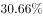
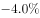
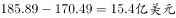
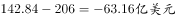
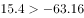
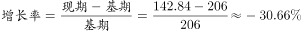

# 综合分析-选非题（趋势判断+增速排序+增长量比较+增长率计算逐项核对）

考点：[[20-考点/资料分析/综合/综合分析-选非题（趋势判断+增速排序+增长量比较+增长率计算逐项核对）|综合 / 综合分析-选非题（趋势判断+增速排序+增长量比较+增长率计算逐项核对）]]
材料：[[15-材料/资料分析/187292 某省对外贸易情况：图1给出2011-|187292 某省对外贸易情况：图1给出2011-]]

**问法模型**：题干为'以下说法错误的一项是'的选非综合题 → 对A~D逐项与材料数据核对，找出唯一与材料矛盾的说法

## 推理链
1. 第1步：读图1进出口总额：2011-2015年为170.49→185.89→190.96→206→142.84亿美元，2011-2014逐年递增、2015年下降，A项'先增后减'正确
2. 第2步：查表2出口分项增速：国有企业-20.2%、外商投资企业-4.0%、集体企业-12.1%、私营企业-5.1%，带符号比较-4.0%最大，出口增速最快的是外商投资企业而非私营企业，B项错误
3. 第3步：核对C项，图1进口额=总额-出口额：2012年进口=185.89-59.83=126.06亿美元，2011年进口=170.49-49.98=120.51亿美元，2012年进口净增长=126.06-120.51=+5.55亿美元
4. 第4步：2015年进口=142.84-46.54=96.30亿美元，2014年进口=206-57.78=148.22亿美元，2015年进口净增长=96.30-148.22=-51.92亿美元，因5.55>-51.92，C项正确
5. 第5步：核对D项：2015年进口同比增长率=(96.30-148.22)/148.22=-51.92/148.22≈-35.0%，为负增长率，与D项描述相符，D项正确
6. 第6步：本题为选非题，唯一错误说法为B项，故正确答案为B

**最快解法**：⚡ 选非题先做'纯查表定性'项：B项只需对表2四个出口增速带符号排序，-4.0%＞-5.1%＞-12.1%＞-20.2%，最快为外商投资企业，直接锁定B错误即可收卷；A项看柱子高低（170.49→206→142.84），无需计算C、D

## 易错点
- ⚠ '增速最快'须带符号比较：-4.0%＞-5.1%，勿因私营企业出口绝对量(185970万美元)最大或忽略负号而误判B正确；也不可用集体企业进口增速46.5%来评判（B项限定'出口总值'口径）
- ⚠ 图1进口额未直接标注，须用总额-出口额换算：如2014年进口=206-57.78=148.22，切勿把柱内总额标注（206、142.84）直接当进口额
- ⚠ 净增长（增长量）可正可负：2015年进口净增长为-51.92亿美元，与2012年+5.55亿美元直接比大小即可；选非题要求选'错误'项，勿惯性选正确项

## 母题抽象
> 🧩 当题干出现'以下说法错误（正确）的是'时，按'先查表定性排序、后动笔计算'顺序逐项核对，增速比较必须带符号，净增长/差额注意正负号，锁定与材料唯一矛盾项

**同类特征**：以下说法错误的一项、选非题、四个选项跨两张图表、增速最快（负数排序）、进口额净增长比较、同比增长率计算

## 相关题
- [[10-真题/资料分析/综合/250219 综合分析选非题（图表数据可推断性判断）|250219]]（深圳市考 2008，相关度1）
- [[10-真题/资料分析/综合/10297333 综合分析选非题（同比增速逐年比较+年均增长量+比重百分点还原）|10297333]]（浙江 2025，相关度1）
- [[10-真题/资料分析/综合/14355349 综合分析-选非题（增长率计算比较+人均值计算）|14355349]]（浙江 2024，相关度1）
- [[10-真题/资料分析/综合/17097816 综合判断·选非题（增长率与增长量偷换）|17097816]]（山西 2024，相关度1）
- [[10-真题/资料分析/综合/2255865 综合分析（选非题）——比重判断+平均数比较+大小比较逐项核验|2255865]]（江西 2016，相关度1）

---

### 题干
根据材料，以下说法错误的一项是：

### 选项
- A. 
2011-2015年，该省的进出口贸易总额的变化趋势是先增后减

- B. 
2016年该省私营企业出口总值增速最快
　✅
- C. 
2012年该省的进口额净增长大于2015年该省的进口额净增长

- D. 
2015年该省进口额的同比增长率为-

### 官方解析

A项：观察图形材料可以看出，2011年-2014年该省的进出口贸易总额为递增趋势，2015年为减少趋势，正确；

B项：结合表格材料，2016年该省出口总值中外商投资增速（）最快，错误；

C项：2012年该省进口额为185.89亿美元，大于2011年进口额170.49亿美元，故2012年进口额的净增长为；2015年该省进口额为142.84亿美元，小于2014年进口额206亿美元，故2015年进口额的净增长为，，正确；

D项：结合表格材料，2015年该省进口额为142.84亿美元，2014年进口额为206亿美元。，正确。

本题为选非题，故正确答案为B。

### 给定材料

下面是某省的对外贸易进出口总额的部分数据资料，请根据图表回答下述问题：

> [!warning] 疑点（官方解析可能有误，待人工复核）
> 官方解析C项文字表述有笔误：'2012年该省进口额为185.89亿美元'实际应为进口额126.06亿美元（185.89为进出口总额），系解析公式图缺失导致的行文混乱，但结论（2012年净增长5.55＞2015年净增长-51.92，C项正确）无误，不影响答案B

<!-- CODEX-ANSWER-REVIEW:BEGIN -->
### 本次独立复核

**复核状态：** `confirmed`（独立复算确认答案）

**计分答案：** B（可计分）

**复核解析：**

原图配合原表复核：贸易总额2011—2014上升、2015下降；进口2012增量185.89−170.49=15.40亿美元，2015增量142.84−206=−63.16亿美元，前者更大；私营企业并非出口增速最快，表中外商投资企业增速最高，故选非B。

**相关信息：**

独立复核：资料分析综合判断；以题源统计表/图及精确口径独立复算。缺少关键比例或单位冲突时不猜测。

**题源依据：** [固定版本原题](https://github.com/Mentat-Uran/kaogongzhentizhengliu/blob/84ab93d4b64b61d897bece8a1c0a5bab06b4feb2/10-%E7%9C%9F%E9%A2%98/%E8%B5%84%E6%96%99%E5%88%86%E6%9E%90/%E7%BB%BC%E5%90%88/2052088%20%E7%BB%BC%E5%90%88%E5%88%86%E6%9E%90-%E9%80%89%E9%9D%9E%E9%A2%98%EF%BC%88%E8%B6%8B%E5%8A%BF%E5%88%A4%E6%96%AD%2B%E5%A2%9E%E9%80%9F%E6%8E%92%E5%BA%8F%2B%E5%A2%9E%E9%95%BF%E9%87%8F%E6%AF%94%E8%BE%83%2B%E5%A2%9E%E9%95%BF%E7%8E%87%E8%AE%A1%E7%AE%97%E9%80%90%E9%A1%B9%E6%A0%B8%E5%AF%B9%EF%BC%89.md)；固定内容 commit `84ab93d4b64b61d897bece8a1c0a5bab06b4feb2`，Markdown blob `af296ee77d37c7f87284f7ccaba70159a8b961dd`。
<!-- CODEX-ANSWER-REVIEW:END -->
