# 综合判断（选非）：两期比重联动求部分增速＋增长量比较

考点：[[20-考点/资料分析/综合/综合判断（选非）：两期比重联动求部分增速＋增长量比较|综合 / 综合判断（选非）：两期比重联动求部分增速＋增长量比较]]
材料：[[15-材料/资料分析/187410 2016年我国电信业务收入（1189|187410 2016年我国电信业务收入（1189]]

**问法模型**：题干为'下列说法中不正确的是'综合判断 → 对四个选项分别套用'部分量=总量×占比、部分增速=(1+总量增速)×(现期占比/基期占比)−1、增长量=现期−基期'逐一验算，锁定唯一错误项

## 推理链
1. 第1步：读图得2016年移动数据占比36.4%、非话音占比75.0%，2015年分别为26.9%、69.5%；本副本文字中两个增速数值空缺，按导读要求以完整原卷数值代入：2016年电信业务收入11893亿元、同比增长5.6%（比上年回升7.6个百分点），电信业务总量35948亿元、同比增长54.5%（比上年提高25.5个百分点）
2. 第2步：基期换算：2015年电信业务收入=11893/1.056≈11262亿元（由'回升7.6个百分点'知2015年收入增速=5.6%−7.6%=−2%，为负增长，仅作口径印证）
3. 第3步：求部分量与部分增速：移动数据2016年=11893×36.4%≈4329亿元、2015年=11262×26.9%≈3030亿元，增速≈(4329−3030)/3030≈42.9%；非话音2016年=11893×75%≈8920亿元、2015年=11262×69.5%≈7827亿元，增速≈14.0%
4. 第4步：A项验证：42.9%÷14.0%≈3.07≈3倍，说法正确；B项验证：电信业务收入5.6%＜非话音14.0%＜移动数据42.9%，均正增长且由小到大，说法正确
5. 第5步：C项验证：移动数据增量≈4329−3030=1299亿元，电信业务收入增量≈11893−11262=631亿元，1299−631≈668亿元≈669亿元，说法正确
6. 第6步：D项验证：移动数据增速42.9%＜电信业务总量增速54.5%，'高于'说法错误；本题为选非题，故选D

**最快解法**：⚡ 比重联动速算（部分增速=(1+总量增速)×(现期占比/基期占比)−1）：移动数据增速≈1.056×36.4/26.9−1≈42.9%，与电信业务总量增速54.5%一比即知D错误，选非题可直接定D，无需先算A/B/C；A、B、C项再复用42.9%与14.0%顺带验证

## 易错点
- ⚠ '电信业务收入11893亿元'与'电信业务总量35948亿元'两个指标张冠李戴：D项比较对象是总量增速54.5%，若误拿收入增速5.6%比较会误判D为正确
- ⚠ 基期部分量陷阱：2015年部分量须用基期总量(11893/1.056≈11262亿元)×基期占比，不能用现期总量11893×基期占比；求部分增量更不能用'占比差×现期总量'的错解
- ⚠ 百分点≠百分比：'回升7.6/提高25.5个百分点'是增速差而非增速，且本副本两个增速数值空缺，须以原卷完整数值5.6%、54.5%代入，不能臆测；双轴图中折线读右轴0—40，误用左轴会错读36.4%的量级

## 母题抽象
> 🧩 当综合判断题出现'总量增速＋两年占比'的特征时，用部分增速=(1+总量增速)×(现期占比/基期占比)−1一行速算各部分增速，再与总量增速或彼此比较，优先验证所需数据最少的选项直接定答案

**同类特征**：'下列说法中不正确的是'选非式综合判断、部分增速与总量增速联动（占比比法）、两年占比×总量求部分量及同比增量、增长量差值比较（以亿元作答）、'回升/提高…个百分点'还原基期增速、双轴堆积柱形图＋折线（移动数据收入占比）

## 相关题
（暂无）

---

### 题干
根据以上资料，下列说法中不正确的是（  ）。

### 选项
- A. 2016年移动数据及互联网业务收入同比增速是当年非话音业务收入同比增速的3倍
- B. 2016年电信业务收入、非话音业务收入、移动数据及互联网业务收入均实现了同比正增长，且同比增速由小到大
- C. 2016年移动数据及互联网业务收入的同比增量比当年电信业务收入同比增量多669亿元
- D. 2016年移动数据及互联网业务收入的同比增速要高于电信业务总量的同比增速　✅

### 官方解析

A项：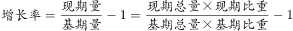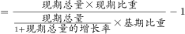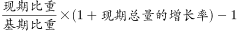，代入文字材料及统计图数据，2016年移动数据及互联网业务收入增速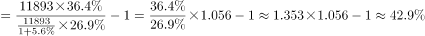，非话音业务收入同比增速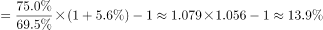，前者增速是后者的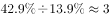倍，正确；

B项：定位文字材料，2016年电信业务收入同比增长，根据本题A项计算结果，非话音业务收入同比增长、移动数据及互联网业务收入同比增长，三者均同比正增长，且增速由小到大，正确；

C项：增长量现期量基期量现期总量现期比重基期总量基期比重现期总量现期比重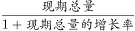基期比重，代入文字材料数据，2016年移动数据及互联网业务收入的同比增量为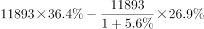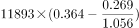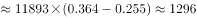亿元，增长量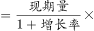增长率，电信业务收入同比增量为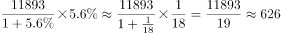亿元，前者同比增量比后者多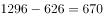亿元，与669亿元接近，正确；

D项：根据本题A项计算结果，2016年移动数据及互联网业务收入同比增长，定位文字材料，电信业务总量同比增长，前者增速低于后者，错误。

本题为选非题，故正确答案为D。

### 给定材料

        2016年电信业务收入完成11893亿元，同比增长，比上年回升7.6个百分点。电信业务总量完成35948亿元，同比增长，比上年提高25.5个百分点。2016年，电信业务收入结构继续向互联网接入和移动流量业务倾斜。非话音业务收入占比由上年的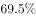提高至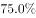；移动数据及互联网业务收入占电信业务收入的比重从上年的提高至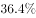。

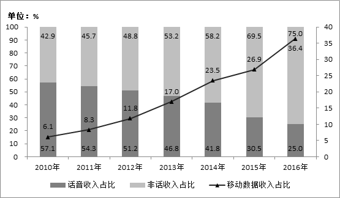

        2010-2016年话音业务和非话音业务收入占比变化情况

