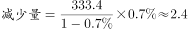
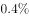
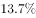

# 综合分析题（口径辨析+方向词核验+同比减少量计算的四选项正误判断）

考点：[[20-考点/资料分析/综合/综合分析题（口径辨析+方向词核验+同比减少量计算的四选项正误判断）|综合 / 综合分析题（口径辨析+方向词核验+同比减少量计算的四选项正误判断）]]
材料：[[15-材料/资料分析/187626 2015年5月及2015年1-5月全|187626 2015年5月及2015年1-5月全]]

**问法模型**：'下列说法正确的是'→对四个选项逐项验证：先辨时间口径（5月当月 vs 1-5月累计），再核同比方向词（提高/降低），最后对计算型选项用基期公式验算，排除三项错误锁定答案

## 推理链
1. 第1步：A项取第5段——2015年1-5月三级公立医院人均住院费用12536.8元、二级公立医院5320.6元，各附'当年价格'与'可比价格'两组同比涨幅；据官方解析，二级的两组涨幅均慢于三级，'二级增长快于三级'不成立，A错误
2. 第2步：B项取第1、3段——2015年5月基层医疗卫生机构诊疗人次3.6亿人次为'同比提高'，基层出院人数333.4万人为'同比降低'，两个指标一升一降，'诊疗人次和出院人数均有所降低'与材料矛盾，B错误
3. 第3步：C项——材料只给出2015年1-5月累计人均住院费用（三级12536.8元、二级5320.6元），没有5月当月费用数据，'5月当月高7216.2元'无法推出；且12536.8−5320.6=7216.2恰为1-5月累计差，C是用累计差冒充当月差的口径陷阱，C错误
4. 第4步：D项取第3段——2015年5月基层医疗卫生机构出院人数333.4万人，同比降低（降幅r，具体百分数以原卷为准）
5. 第5步：同比降低时基期=333.4/(1−r)，减少量=基期−现期=333.4×r/(1−r)，官方解析计算结果约2.4万人，与选项'约2.4万人'吻合，D正确
6. 第6步：综上A、B、C均错误，正确答案为D

**最快解法**：⚡ 综合判断'口径+方向词'快筛法：B项看方向词秒排（基层诊疗人次同比'提高'）；C项看口径秒排（材料无5月当月费用，12536.8−5320.6=7216.2恰是1-5月累计差被安到当月头上）；A项比较两组涨幅均慢排除；剩下D用同比降低公式验算：减少量=333.4×r/(1−r)≈2.4万人，选D

## 易错点
- ⚠ 当月与累计口径混淆：C项的7216.2元=12536.8−5320.6恰为2015年1-5月累计差，命题人把它安到'2015年5月当月'头上，而材料根本没有当月费用数据
- ⚠ 方向词以偏概全：B项基层出院人数确实'同比降低'，但基层诊疗人次3.6亿人次'同比提高'，'均有所降低'错在只看一半
- ⚠ '同比降低'求减少量的公式方向：应先还原基期333.4/(1−r)再作差（减少量=333.4×r/(1−r)），直接用333.4×r会偏小；且材料中'同比'与'环比'并存，勿混读两个方向词

## 母题抽象
> 🧩 当题干出现'下列说法正确的是'且四选项横跨材料不同段落时，先核时间口径（当月vs累计）与方向词（提高/降低）排除口误项，再对计算项用基期公式现期/(1±r)验证，'材料未给出的数据'本身就是错误项

**同类特征**：下列说法正确的是、综合分析四选项判断、同比提高/同比降低方向词、当月值与1-5月累计值混排、三级/二级公立医院人均住院费用、基层医疗卫生机构出院人数约2.4万人（'约'字估算）

## 相关题
- [[10-真题/资料分析/综合/2195856 综合判断题·增长倍数口径下的基期反推与定性表述可推性验证|2195856]]（黑龙江 2018，相关度1）
- [[10-真题/资料分析/综合/10204448 综合分析-逐项判断（历史极值确认、两期比重比较、多期累计求和、基期比重）|10204448]]（广东 2024，相关度1）
- [[10-真题/资料分析/综合/1772378 综合分析判断题（多选项直接查找与数据比较）|1772378]]（深圳市考 2016，相关度1）
- [[10-真题/资料分析/综合/2033342 综合分析题（增速逐年比较＋两期比重比较＋库存流量平衡式混合判断）|2033342]]（河南 2016，相关度1）
- [[10-真题/资料分析/综合/2261886 综合判断题（趋势方向判定+年均减贫人口+同比降幅+减贫任务超额度）|2261886]]（湖北 2017，相关度1）

---

### 题干
根据上述材料，下列说法正确的是（  ）

### 选项
- A. 2015年1-5月，全国二级公立医院人均住院费用增长快于三级公立医院
- B. 与上年同期相比，2015年5月基层医疗卫生机构诊疗人次和出院人数均有所降低
- C. 2015年5月，全国三级公立医院人均住院费用比二级公立医院高7216.2元
- D. 与上年同期相比，2015年5月基层医疗卫生机构出院人数减少了约2.4万人　✅

### 官方解析

本题属于综合分析，需结合每一个选项的描述与表格、材料中给出的具体数据判断其是否正确。

A项：由材料“2015年1-5月，全国三级公立医院人均住院费用与去年同期比较，按当年价格上涨，按可比价格上涨；二级公立医院人均住院费用按当年价格同比上涨，按可比价格同比上涨。”可得二级公立医院当年价格增长率和可比价格增长率均慢于三级公立医院，该项错误。

B项：由材料“2015年5月基层医疗卫生机构诊疗人次为3.6亿人次，同比提高”可得该项错误。

C项：材料只给出1-5月人均住院费用情况，未给出5月当月情况，故该项无法推出，错误。

D项：由材料“基层医疗卫生机构出院人数为333.4万人，同比降低”可得万人，该项正确。

故正确答案为D。

### 给定材料

        2015年5月，全国医疗卫生机构诊疗人次达6.4亿人次，同比提高，环比提高。其中，医院2.6亿人次，同比提高，环比降低；基层医疗卫生机构诊疗人次为3.6亿人次，同比提高，环比降低；其他机构0.2亿人次。医院中：公立医院2.3亿人次，同比提高，环比提高；民营医院0.3亿人次，同比提高，环比提高。基层医疗卫生机构中：社区卫生服务中心（站）0.6亿人次，同比提高，环比降低；乡镇卫生院0.8亿人次，同比提高，环比降低。

        2015年1-5月，全国医疗卫生机构总诊疗人次达31.1亿人次，同比提高。其中：医院12.2亿人次，同比提高；基层医疗卫生机构18.0亿人次，同比提高；其他机构10.1亿人次。医院中：公立医院10.8亿人次，同比提高；民营医院1.3亿人次，同比提高。基层医疗卫生机构中：社区卫生服务中心（站）2.7亿人次，同比提高；乡镇卫生院4.1亿人次，同比提高；村卫生室诊疗人次8.4亿人次。

        2015年5月份，全国医疗卫生机构出院人数达1738.4万人，同比提高，环比降低。其中：医院1330.2万人，同比提高，环比降低；基层医疗卫生机构出院人数为333.4万人，同比降低，环比降低；其他机构74.8万人。医院中：公立医院1156.5万人，同比提高，环比降低；民营医院173.7万人，同比提高，环比提高。

        2015年1-5月，全国三级公立医院次均门诊费用为276.5元，与去年同期比较，按当年价格上涨，按可比价格上涨；二级公立医院次均门诊费用为182.7元，按当年价格同比上涨，按可比价格同比上涨。

        2015年1-5月，全国三级公立医院人均住院费用为12536.8元，与去年同期比较，按当年价格上涨，按可比价格上涨；二级公立医院人均住院费用为5320.6元，按当年价格同比上涨，按可比价格同比上涨。

> [!warning] 疑点（官方解析可能有误，待人工复核）
> 提供的材料文本与官方解析中所有增速百分数（同比/环比、当年价格/可比价格涨幅）均显示为空缺，D项'减少约2.4万人'所依赖的同比降幅数值无法从当前文本直接读取（官方解析计算式亦被截断）；由333.4×r/(1−r)≈2.4万可反推r约0.7%量级，此为文本显示缺失而非官方解析逻辑错误，答案D维持不变
