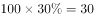
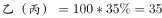
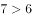
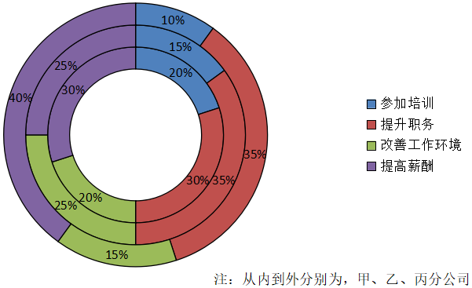

# 环形结构图占比读数＋按固定比例分配名额（比重×总人数÷5取整）的综合判断

考点：[[20-考点/资料分析/综合/环形结构图占比读数＋按固定比例分配名额（比重×总人数÷5取整）的综合判断|综合 / 环形结构图占比读数＋按固定比例分配名额（比重×总人数÷5取整）的综合判断]]
材料：[[15-材料/资料分析/187636 某总公司下属甲、乙、丙3个分公司职工|187636 某总公司下属甲、乙、丙3个分公司职工]]

**问法模型**：题干给出'各分公司职工人数相同＋每5位有意愿职工提升1位'的设定，选项用'一定/不一定/不可能'作判断 → 按'晋升人数=分公司总人数×提升职务意愿占比÷5（取整数，不满5人的余数不产生名额）'建模，赋值逐项验证

## 推理链
1. 第1步：由图注'从内到外分别为甲、乙、丙'读环：甲（内环）'提升职务'占30%，乙（中环）占35%，丙（外环）占35%；题干设定三公司职工人数相同，设各为N人
2. 第2步：规则：某分公司晋升人数=N×'提升职务'占比×1/5，且名额为整数、每满5名有意愿职工才产生1个晋升名额（余数不足5人不再晋升）
3. 第3步：验证A：设N=20，则甲有意愿20×30%=6人、乙丙各20×35%=7人；6人与7人均只够提升1人，故甲、乙、丙均晋升1人、相等，'甲不一定比乙丙少'成立，A正确
4. 第4步：验证B：设N=100，甲晋升100×30%÷5=6人，乙晋升100×35%÷5=7人，乙完全可能多于甲，'不可能多于'表述错误
5. 第5步：验证C：三公司各N人时，三人晋升之和=(30%+35%+35%)×N÷5=N/5（如N=100时合计20人），一定小于甲分公司职工总人数N，'将超过'错误
6. 第6步：验证D：乙、丙总人数相同且'提升职务'占比均为35%、晋升比例相同，两者晋升人数必然相同，'不一定相同'表述错误
7. 第7步：综上仅A说法正确，与官方答案A一致

**最快解法**：⚡ 赋值取整法：设每个分公司20人（数字小、便于取整），得甲有意愿6人、乙丙各7人，按'每5人提升1人'取整后三家均只晋升1人、相等，A的'不一定少'即刻成立；再用100人验证B（甲6人、乙7人）即锁定答案A

## 易错点
- ⚠ 环层归属看错：必须按注'从内到外为甲、乙、丙'定位，甲是内环（提升职务30%），若把中环/外环的35%当成甲的占比，后续全盘算错
- ⚠ 忽略晋升人数须为整数（每满5人才提升1人、余数作废）：若不取整会误认为甲(6%)必然少于乙丙(7%)而错判A；取整后6人与7人都只能产生1个名额，甲可以不少
- ⚠ 分母与比较对象混淆：图中各占比的分母是本分公司职工人数（本题已设三公司人数相同）；C项比较对象是'甲分公司职工总人数'而非三公司总人数，看错比较基准会误判C

## 母题抽象
> 🧩 当题干出现'结构占比图＋各总体规模相同＋按固定比例（每5人选1）分配整数名额'的特征时，设便于取整的总人数（如20或100），用'总数×占比÷分配基数并取整'逐项验证'一定/不一定/不可能'类表述

**同类特征**：环形结构图从内到外分层（甲乙丙）、各分公司职工人数相同、每5位有意愿的职工提升1位、选项含'一定/不一定/不可能'表述、综合判断选正确一项、占比×总人数÷5后取整数名额

## 相关题
（暂无）

---

### 题干
假设甲、乙、丙3个分公司的职工人数相同，总公司某年度计划对3个分公司中有意愿提升职务的职工进行职务提升，晋升比例为每5位有意愿的职工中提升1位，那么：

### 选项
- A. 甲分公司获得职务提升的职工人数不一定比乙、丙的少　✅
- B. 乙分公司获得职务提升的职工人数不可能多于甲分公司
- C. 甲、乙、丙3个分公司获得职务提升的职工人数之和将超过甲分公司职工总人数
- D. 乙、丙分公司获得职务提升的职工人数不一定相同

### 官方解析

本题属于综合分析，需结合每一个选项的描述与表格、材料中给出的具体数据判断其是否正确。

A项：设甲乙丙分公司各自的总人数为20，则，。均按照5人中提升1人的比例计算，则甲乙丙均提升1人，相等，故“不一定少”表述正确，该项正确。

B项：设甲乙分公司各自的总人数为100，则，。均按照5人中提升1人的比例计算，则甲分公司提升6人，乙提升7人，，故乙分公司获得职务提升的职工人数“不可能多于”甲分公司的表述错误，该项错误。

C项：甲乙丙三个分公司的人数均为，则，再按晋升比例每5人提升1人，则获得职务提升的职工人数一定小于，该项错误。

D项：乙丙分公司总人数相同，有意愿提升职务的比例相同，晋升比例也相同，故获得职务提升的人数一定相同，该项错误。

故正确答案为A。

### 给定材料

某总公司下属3个分公司职工意愿调查结构图

