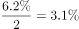

# 综合分析·选非题（正误判断）

考点：[[20-考点/资料分析/综合/综合分析·选非题（正误判断）|综合 / 综合分析·选非题（正误判断）]]
材料：[[15-材料/资料分析/187688 2012年A、B、C三国宏观经济与对|187688 2012年A、B、C三国宏观经济与对]]

**问法模型**：题干为'以下说法错误的是'的选非型综合分析 → 逐项将选项与材料方向词（同比增长/同比降低）、隐含可自算数据及官方给定数值对照，找出与材料矛盾的一项

## 推理链
1. 第1步：验证A项——第一段A国进口1916.5亿美元为'同比增长'（正增速）、出口1900亿美元为'同比降低'（负增速）、经济增速为正值且超过世界平均近1倍，进口增速在三者中最高，A项正确
2. 第2步：验证D项（可自算项优先）——B国顺差由608.9亿增至1072.7亿（扩大463.8亿），2011年进口=358.7+272.2=630.9亿美元，反推2011年出口=608.9+630.9=1239.8亿美元，2012年出口1431.4亿仅增191.6亿，而进口减少272.2亿>231.9亿（463.8的一半），占顺差扩大的272.2/463.8≈58.7%，'主要是进口大幅下降造成'成立，D项正确
3. 第3步：验证C项——日本对A国直接投资25亿美元（原文明确）；C国吸引外资总量126.6亿美元、日本占比数值原文空白，按官方解析计算，日本对C国投资额低于25亿美元，C项正确
4. 第4步：验证B项——A国经济增速超过世界平均水平近1倍（即A国≈2倍世界平均），官方解析给出世界平均增速与C国经济增速（本版材料数值空白），结论为C国经济增速快于世界平均增速
5. 第5步：B项称'C国经济增速慢于世界平均'，与材料事实方向恰好相反，为唯一错误说法；本题为选非题，故选B

**最快解法**：⚡ 先易后难排除法+隐含数据反推：A项凭'同比增长/同比降低'方向词直接排除；D项只需比较进口减少272.2亿与顺差增量463.8亿的一半231.9亿（272.2>231.9即'过半'，'主要'成立）；C项锁定日本对A国=25亿对照官方比重结论；B项抓'A国≈2倍世界平均'与C国增速比方向，矛盾即选B，全程几乎不用精确计算

## 易错点
- ⚠ 选非题惯性：需四个选项逐一验证，易把明显正确的A/C/D误选或漏验B
- ⚠ D项最大陷阱：'进口减少272.2亿'不能直接与顺差463.8亿比，须先用'2011出口=608.9+630.9=1239.8亿'反推出出口增量191.6亿（191.6+272.2=463.8恰好吻合），粗看极易漏掉这一隐含推导
- ⚠ C项量级迷惑：C国吸引外资总量126.6亿>25亿，不代表日本对C国投资超过25亿，关键看日本占比（原文空白，以官方解析结论为准）；B项判断依赖本版材料被隐去的世界平均与C国增速数值，切勿凭空编数，只能以'A国≈2倍世界平均'与官方结论对照方向

## 母题抽象
> 🧩 当题干出现'以下说法错误（正确）的是'且材料含多国多指标时，先用原文方向词（增长/降低）与可加减自算的隐含数据（如顺差+进口减少额反推基期出口）逐项排除，仅对依赖缺失数值的选项以给定数值比方向定矛盾

**同类特征**：以下说法错误的是（选非题）、三国对比文字型综合材料、同比增速方向判断（增长/降低）、贸易顺差扩大的归因分析、对外直接投资额跨国比较、经济增速与世界平均水平比较

## 相关题
- [[10-真题/资料分析/综合/2172873 综合分析判断题（选非题·逐项读图核对）|2172873]]（广州市考 2018，相关度1）
- [[10-真题/资料分析/综合/2045764 综合判断题（选非）：同比增速表述校验、比重反推与比值递增、现期大小比较|2045764]]（广州市考 2017，相关度1）

---

### 题干
以下说法错误的是（    ）。

### 选项
- A. 2012年，A国的进口增长速度快于经济和出口的增长速度
- B. 2012年，C国的经济增长速度要慢于世界经济增长速度　✅
- C. 2012年，日本对C国的直接投资额低于其对A国的直接投资额
- D. 2012年，B国贸易顺差的扩大主要是由于进口大幅下降造成的

### 官方解析

A项：定位第一段材料，A国进口同比增长，出口同比降低为，经济增长速度为，进口同比增长率最高，正确；

B项：定位第一段材料和第四段，世界经济增长速度为，C国的经济增速为。C国的经济增长速度要快于世界经济增长速度，错误；

C项：定位第一段材料和最后一段材料，2012年，日本对A国投资25亿美元，对C国投资额为，正确；

D项：定位材料第三段，B国的贸易顺差由上年的608.9亿美元，增长到2012年的1072.7亿美元，增长了，其中进口较上年减少272.2亿美元，占贸易顺差的，正确。

本题为选非题，故正确答案为B。

### 给定材料

       2012年，A国取得了的经济增长速度，超过世界平均水平近1倍。2012年，A国的进出口总额为3816.5亿美元，同比增长；其中出口1900亿美元，同比降低，进口1916.5亿美元，同比增长。

       2012年，A国吸引的外国直接投资接近200亿美元，全球排名第17位，较上年上升4位。来自A国的官方投资统计机构的数据显示，2012年吸引外资前五的行业分别是采矿业、金属机械及电子业、交通通信业、化工制药业和机动车及运输设备制造业；排名前五名的国家分别是新加坡(49亿美元)、日本（25亿美元）、韩国（19亿美元）、美国（12亿美元）和毛里求斯（11亿美元）。

       2012年，B国GDP为2828亿美元，经济增长速度比上年略有降低，但依然超过。2012年，B国的进出口总额1790.1亿美元，比上年降低了；其中进口358.7亿美元，同比降低，出口1431.4亿美元，同比增长。B国的贸易顺差由上年的608.9亿美元，增长到2012年的1072.7亿美元，增长了，其中进口较上年减少272.2亿美元，占贸易顺差的。一方面，B国不断采取措施，改善国内投资环境，吸引外资进入；另一方面，B国在电力、电信、交通运输、法律法规执行力、政治局势和安全等方面存在许多不足，因此，B国的外资流入表现出波动大且增长迅速的特征。2011年，B国外资净流入为89.2亿美元，比上一年增长，比2004年增长了；在2004—2011年，最高增长率达到了，最低的增长率为，波动幅度大。

       2012年，C国的经济增长达到。该国国际贸易的增速快于国内经济的增速，进出口总额为7857.3亿美元，同比增长，其中出口3859.3亿美元，同比增长，进口3998亿美元，同比增长。

       2012年，C国的对外投资和吸引外资呈现出两种截然不同的趋势。数据显示，2012年，C国对外投资额约为260亿美元，世界排名由上年的第28位上升到2012年的第15位。2012年，C国吸引外国直接投资126.6亿美元，同比减少，为近12年来最低。从投资来源国来看，来自美国的占，日本占，加拿大占，德国占，荷兰占。

