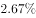
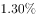
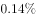
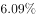
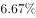
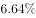
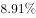
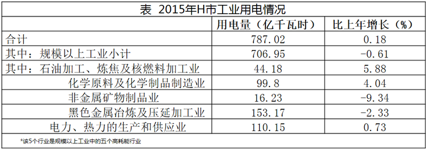

# 数据可得性判断（基期值-基期比率可求性，选非题）

考点：[[20-考点/资料分析/综合/数据可得性判断（基期值-基期比率可求性，选非题）|综合 / 数据可得性判断（基期值/基期比率可求性，选非题）]]
材料：[[15-材料/资料分析/187690 2015年H市全社会用电量（1405|187690 2015年H市全社会用电量（1405]]

**问法模型**：题干问'以下数据不能从材料中得到'（选非）→ 逐项列数据需求清单：凡2014年的值/比值/比重可用'2015现期值÷(1+增速)'或基期比重、线段法公式推出，凡'2014年自身的同比增长率'需2013年数据，材料只给一层增速则该项不可得

## 推理链
1. 第1步：四个选项所求数据均为2014年，而材料时间口径为'2015年现期值+2015年对2014年的增速'，需逐项判断能否经基期公式推出
2. 第2步：A项——文字段给出生活用电185.49亿千瓦时及整体、城镇居民、乡村居民各自增速，设2014年城镇为x、乡村为y，有x+y=185.49/(1+r总)且x(1+r城)+y(1+r乡)=185.49，两个方程两个未知数，线段法/方程组可解出x:y，A可求
3. 第3步：B项——化学原料及化学制品制造业99.8亿千瓦时（+4.04%，表1）、第二产业800.37亿千瓦时（增速文字段给出），套基期比重公式(99.8/1.0404)÷[800.37/(1+r二产)]，B可求
4. 第4步：C项——第三产业412.34亿千瓦时（+6.09%）只能求2014年基期值412.34/1.0609≈388.7亿千瓦时，但选项问的是'2014年对2013年的增长率'，需2013年数据或2014年增速，材料全篇未涉及2013年，C不可求
5. 第5步：D项——第二产业800.37、第三产业412.34的现期值与各自增速均给定，基期值800.37/(1+r二产)、412.34/1.0609分别可求，比值可求
6. 第6步：本题为选非题，A、B、D均可由材料算出，仅C不能得到，选C

**最快解法**：⚡ 可得性秒杀口诀'基期值可求、基期增速不可求'：材料只含一层增速（2015对2014），C问'2014年比上年（2013年）的增速'，跨了两个层级，材料无2013年数据，直接锁定C；A（线段法解双基期）、B（基期比重公式）、D（基期公式）只需验证公式所需'现期值+增速'齐全即排除，无需算出数值

## 易错点
- ⚠ C项最易误判：见第三产业412.34、+6.09%就想套基期公式，但选项要的是'2014年的增长率'而非'2014年的值'——基期公式只给基期值，增速需再上一期数据，'值'与'增速'一字之差，可求与不可求相反
- ⚠ 转载文字段中各分项增速显示为空缺，若据此会误以为A、B、D也缺增速而不可求；原始材料文字段中二产、三产、生活用电及城镇/乡村增速均齐全，须以原始材料为准，不得凭空补数
- ⚠ B项口径：化学原料99.8属规模以上工业（706.95）内的行业，但选项明确问'占第二产业'，分母必须用文字段的800.37，勿错用工业787.02或规模以上工业706.95

## 母题抽象
> 🧩 当题干出现'不能从材料中得到/以下可否计算'特征时，对每项列数据需求清单：现期值+增速→基期值必可求；比值/比重→分子分母两端的基期数据链都齐才可求；'某年同比上年的增长率'→需该年及其上一年的量，材料只给一层增速时该年向上追溯的增速不可求

**同类特征**：不能从材料中得到、选非题（数据可得性判断）、全部选项为基期（2014年）数据、同比上年的增长率、基期公式/基期比重/线段法、跨文字段与表1取数

## 相关题
- [[10-真题/资料分析/平均数/15419201 基期平均数（'每N个中有1个'型，分子分母均须倒推基期）|15419201]]（湖北 2025，相关度1）
- [[10-真题/资料分析/综合/2045762 数据可得性判断（选非题）|2045762]]（广州市考 2017，相关度1）

---

### 题干
以下数据不能从材料中得到的是：

### 选项
- A. 2014年，城镇居民和乡村居民用电量之比
- B. 2014年，化学原料及化学制品制造业用电量占第二产业用电量的比例
- C. 2014年，第三产业用电量同比上年的增长率　✅
- D. 2014年，第二产业用电量与第三产业用电量的比值

### 官方解析
根据选项所求数据均为2014年数据，而材料中数据为2015年，判断本题为基期计算问题。A项：定位文字材料，生活用电量比上年增长，其中，城镇居民用电量增长，乡村居民用电量增长。根据线段法，2014年，，A项可求，排除；
B项：定位文字第一段和表1数据，第二产业用电量800.37亿千瓦时，比上年增长；化学原料及化学制品制造业用电量为99.8亿千瓦时，比上年增长。现期量和增长率都有，根据基期比重公式，B项可求，排除；
C项：定位文字材料，第三产业用电量412.34亿千瓦时，比上年增长；关于第三产业并无其他数据，C项不可求，当选；
D项：定位文字材料，第二产业用电量800.37亿千瓦时，比上年增长；第三产业用电量412.34亿千瓦时，比上年增长；根据基期公式，2014年第二产业和第三产业都可以求出，D项可求，排除。
本题为选非题，故正确答案为C。

### 给定材料

       2015年，H市全社会用电量1405.55亿千瓦时，比上年增长。全年各产业和生活用电情况分别为：第一产业用电量7.35亿千瓦时，比上年增长；第二产业用电量800.37亿千瓦时，比上年增长；第三产业用电量412.34亿千瓦时，比上年增长；生活用电量由城镇居民用电量与乡村居民用电量构成，共计185.49亿千瓦时，比上年增长，其中，城镇居民用电量增长，乡村居民用电量增长。

