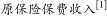
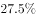

# 增长率计算比较+基期量计算+综合分析选非

考点：[[20-考点/资料分析/综合/增长率计算比较+基期量计算+综合分析选非|综合 / 增长率计算比较+基期量计算+综合分析选非]]

**问法模型**：选非题'下列说法不正确的是'，各选项围绕'年末余额+比年初增加额' → 先用增长率=增加量/（现期量-增加量）比较贷款与存款增速，再验证数量比较项，锁定互斥项

## 推理链
1. 第1步：从材料提取数据——2016年末本外币存款余额155.5万亿元、比年初增加15.7万亿元；本外币贷款余额112.1万亿元、增加12.7万亿元
2. 第2步：确定公式——增长率=增长量÷基期量，其中基期量（年初量）=现期量-增长量
3. 第3步：代入计算——贷款增长率=12.7/(112.1-12.7)=12.7/99.4≈12.8%；存款增长率=15.7/(155.5-15.7)=15.7/139.8≈11.2%，贷款增速高于存款，A正确、B错误
4. 第4步：验证C项——年末贷款112.1万亿元<存款155.5万亿元，正确
5. 第5步：验证D项——年初贷款=112.1-12.7=99.4万亿元（约99），年初存款=155.5-15.7=139.8万亿元（约140），99<140，正确
6. 第6步：本题为选非题，B项说法不正确，故正确答案为B

**最快解法**：⚡ 截位直除+矛盾选项优先法：A、B互为矛盾表述，只需比较12.7/99.4≈12.8%与15.7/139.8≈11.2%（或交叉相乘12.7×139.8≈1775>15.7×99.4≈1561），确定A对B错，即可秒选B，无需逐项验证C、D

## 易错点
- ⚠ 口径混淆：题干比较的是'全部金融机构本外币'口径，误用人民币口径数据（150.6万亿、106.6万亿）会得出错误比较结果
- ⚠ 基期与现期混淆：'比年初增加15.7万亿'是增长量，计算增长率须先减去增加量得年初基期量，勿直接用155.5万亿作分母
- ⚠ 选非题陷阱：要求选'不正确'项，A与B互为矛盾表述，认定一个即可快速锁定答案，勿惯性选成正确表述

## 母题抽象
> 🧩 当材料出现'年末余额X、比年初增加Y'且题目比较增长率时，用增长率=Y/(X-Y)分别计算再比大小；综合分析选非题中若两选项互为矛盾命题，验证其一即可快速定答案

**同类特征**：下列说法不正确的是、比年初增加、本外币各项存贷款余额、增长率高于/低于比较、年末与年初数量比较、综合分析选非题

## 相关题
- [[10-真题/资料分析/综合/2255865 综合分析（选非题）——比重判断+平均数比较+大小比较逐项核验|2255865]]（江西 2016，相关度1）
- [[10-真题/资料分析/综合/12019694 综合分析选非题（基期量+人均反推人口+比重临界判断）|12019694]]（广东 2026，相关度1）
- [[10-真题/资料分析/综合/2388070 综合分析—选非题（增速符号直读＋混合增长率居中＋文字段方向比对）|2388070]]（河北 2019，相关度1）

---

### 题干
根据上述资料，下列说法不正确的是（  ）。

### 选项
- A. 2016年末全部金融机构本外币贷款的增长率高于存款的增长率
- B. 2016年末全部金融机构本外币贷款的增长率低于存款的增长率　✅
- C. 2016年末全部金融机构本外币贷款的数量低于存款的数量
- D. 2016年初全部金融机构本外币贷款的数量低于存款的数量

### 官方解析
A项：2016年末全部金融机构本外币贷款的增长率为；2016年末全部金融机构本外币存款的增长率为前者高于后者，正确；
B项：由A项计算可得，2016年末全部金融机构本外币贷款的增长率高于存款的增长率，错误；
C项：2016年末全部金融机构本外币各项贷款余额112.1万亿元，存款余额为155.5万亿元，前者低于后者，正确；
D项：由A项计算可得，2016年初全部金融机构本外币各项贷款余额约为99万亿元；存款余额约为140万亿元，前者低于后者，正确。
本题为选非题，故正确答案为B。

### 给定材料

        根据中华人民共和国2016年国民经济和社会发展统计公报公布的数据显示，2016年末全部金融机构本外币各项存款余额155.5万亿元，比年初增加15.7万亿元，其中人民币各项存款余额150.6万亿元，增加14.9万亿元。全部金融机构本外币各项贷款余额112.1万亿元，增加12.7万亿元，其中人民币各项贷款余额106.6万亿元，增加12.6万亿元。

        金融机构境内住户人民币消费贷款余额250472亿元，增加60998亿元。其中，短期消费贷款余额49313亿元，增加8347亿元；中长期消费贷款余额201159亿元，增加52651亿元。

        全年保险公司30959亿元，比上年增加。其中，寿险业务原保险保费收入17442亿元，健康险和意外伤害险业务原保险保费收入4792亿元，财产险业务原保险保费收入8725亿元。支付各类赔款及给付10513亿元。其中寿险业务给付4603亿元，健康险和意外伤害险赔款及给付1184亿元，财产险业务赔款4726亿元。

注：[1]原保险保费收入是指保险企业确认的原保险合同保费收入。

