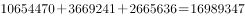
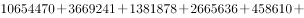
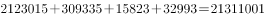
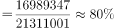
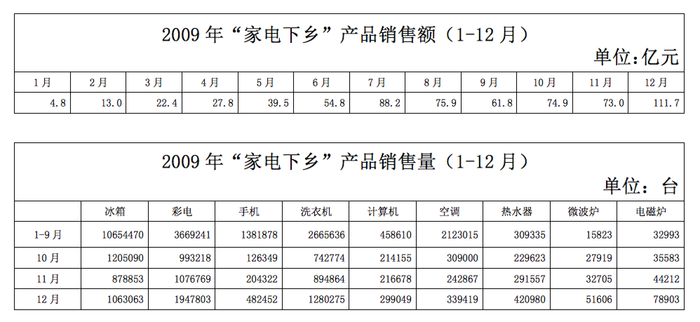

# 综合分析判断（波动幅度比较＋增长快慢＋逐月增长验证＋比重计算）

考点：[[20-考点/资料分析/综合/综合分析判断（波动幅度比较＋增长快慢＋逐月增长验证＋比重计算）|综合 / 综合分析判断（波动幅度比较＋增长快慢＋逐月增长验证＋比重计算）]]

**问法模型**：问'下列结论中可以推出的是'→ 综合分析题，对四个选项逐项验证，能找数据反例或明显矛盾的直接排除

## 推理链
1. 第1步：A项定位第二个统计表，观察冰箱10月、11月、12月销售量数据比较接近，波动未超过30%，为各家电产品中波动最小
2. 第2步：B项定位第二个统计表，2009年电磁炉10月销售量35583台、12月78903台，两个月间销量增长超过一倍，增长并不缓慢
3. 第3步：C项定位第一个统计表，2009年8月销售额75.9亿元＜7月销售额88.2亿元，出现环比下降，不满足'逐月增长'
4. 第4步：D项定位第二个统计表，1-9月销售量最大的三种产品为冰箱、彩电、洗衣机，三者销量之和÷各产品总销量之和＞75%
5. 第5步：B、C、D均被数据推翻，仅A项可以推出，故正确答案为A

**最快解法**：⚡ 排除法＋观察法：B项看电磁炉10月35583台→12月78903台（翻倍以上）直接排除'增长缓慢'；C项找反例8月75.9亿元＜7月88.2亿元排除；D项截位估算冰箱＋彩电＋洗衣机占比明显超过75%排除；剩余A项，观察10-12月各产品数据的接近程度即可确认冰箱波动最小

## 易错点
- ⚠ '波动最小'比较的是相对波动幅度（相邻月份数据的接近程度），而非绝对销量差值，高销量产品的绝对波动大不代表相对波动大
- ⚠ '逐月增长'只需找出一个环比下降的月份（8月＜7月）即可推翻，无需逐月验算全年
- ⚠ D项注意否定方向：实际占比大于75%，与选项'不足75%'相反，且三大产品须准确锁定为冰箱、彩电、洗衣机

## 母题抽象
> 🧩 当题干出现'下列结论中可以推出（正确）的是'的综合判断特征时，用逐项排除法：先处理能用反例（如环比下降月）或倍数关系明显矛盾的选项，剩余项回统计表观察数据波动幅度/接近程度验证

**同类特征**：可以推出的是、综合分析四选项、销售量波动最小、增长较为缓慢、逐月增长、占比不足75%

## 相关题
- [[10-真题/资料分析/综合/2050552 综合分析（基期计算＋增速趋势判断＋口径辨析）|2050552]]（吉林 2017，相关度1）
- [[10-真题/资料分析/综合/2434318 综合分析·逐项判断（平均数计算+最值口径+增长率比较+比重验证）|2434318]]（新疆 2019，相关度1）
- [[10-真题/资料分析/综合/4004851 综合判断题（基期量、比重、增长量、差值四考点逐项验证）|4004851]]（新疆 2021，相关度1）
- [[10-真题/判断推理/逻辑判断/2388037 日常结论-时间锚点推算|2388037]]（河北 2019，相关度1）
- [[10-真题/判断推理/逻辑判断/2452868 日常结论-可推出与不可推出（细节比对+绝对化表述排除）|2452868]]（河南 2019，相关度1）

---

### 题干
由以上数据，下列结论中可以推出的是：

### 选项
- A. 
10-12月“家电下乡”产品中，销售量波动最小的是冰箱
　✅
- B. 
10-12月热水器、电磁炉销售量增长较为缓慢

- C. 
2009 年“家电下乡”产品销售额逐月增长

- D. 
1-9月“家电下乡”产品中销售量最大的三种产品的销售量之和占比不足75%

### 官方解析

A项：定位第二个统计表，观察发现10-12月“家电下乡”产品中，冰箱10月、11月、12月的数据比较接近且波动没有超过30%，是所有家电中波动最小的，正确；

B项：定位第二个统计表可得；2009年10月份和12月份电磁炉销售量分别为35583台、78903台。根据公式：，增长并不缓慢，错误；

C项：定位第一个统计表可得：2009年1-12月“家电下乡”产品销售额。其中，8月销售额（75.9亿元）7月销售额（88.2亿元），非逐月增长，错误；

D项：定位第二个统计表可得：2009年1-9月各“家电下乡”产品的销售量。其中销售量最大的三种产品为冰箱、彩电、洗衣机，销售量之和为台；各产品总销量之和台。则1-9月“家电下乡”产品中销售量最大的三种产品销售量之和占总销售量的比重，占比大于75%，错误。

故正确答案为A。

### 给定材料

根据以下资料，完成各题。

> [!warning] 疑点（官方解析可能有误，待人工复核）
> 官方解析B项'根据公式：'之后公式内容缺失（应为增长率计算公式），但所引数据35583台→78903台已足以支撑'增长不缓慢'的结论；A项'波动没有超过30%'的30%为解析给出的观察性阈值，材料中未见明确标准，判定带一定主观性，但与官方答案一致，不影响作答

<!-- CODEX-ANSWER-REVIEW:BEGIN -->
### 本次独立复核

**复核状态：** `confirmed`（独立复算确认答案）

**计分答案：** A（可计分）

**复核解析：**

核对原图14983372f59a1f8.png的月度表。10—12月冰箱为1,205,090、878,853、1,063,063，极差/均值约31.1%；空调极差/均值约32.5%，其余品类差异更大（如电磁炉35,464/55,044约64.4%，热水器191,357/314,053约60.9%）。B电磁炉12月/10月=2.22；C 8月75.9<7月88.2；D前三大品类1—9月合计占比高于75%（由图表读数相加）。只有A可推出。

**相关信息：**

独立复核：资料分析综合判断。按题干定义逐项检验并保留单位/基期口径；仅在题干及本地原图足以复算时确认。

**题源依据：** [固定版本原题](https://github.com/Mentat-Uran/kaogongzhentizhengliu/blob/84ab93d4b64b61d897bece8a1c0a5bab06b4feb2/10-%E7%9C%9F%E9%A2%98/%E8%B5%84%E6%96%99%E5%88%86%E6%9E%90/%E7%BB%BC%E5%90%88/20701%20%E7%BB%BC%E5%90%88%E5%88%86%E6%9E%90%E5%88%A4%E6%96%AD%EF%BC%88%E6%B3%A2%E5%8A%A8%E5%B9%85%E5%BA%A6%E6%AF%94%E8%BE%83%EF%BC%8B%E5%A2%9E%E9%95%BF%E5%BF%AB%E6%85%A2%EF%BC%8B%E9%80%90%E6%9C%88%E5%A2%9E%E9%95%BF%E9%AA%8C%E8%AF%81%EF%BC%8B%E6%AF%94%E9%87%8D%E8%AE%A1%E7%AE%97%EF%BC%89.md)；固定内容 commit `84ab93d4b64b61d897bece8a1c0a5bab06b4feb2`，Markdown blob `20101f5b6de66371a1b53fdb0af06121841b061a`。
<!-- CODEX-ANSWER-REVIEW:END -->
