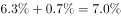
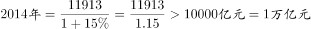

# 综合判断题（基期量估算+数据缺口排除）

考点：[[20-考点/资料分析/综合/综合判断题（基期量估算+数据缺口排除）|综合 / 综合判断题（基期量估算+数据缺口排除）]]
材料：[[15-材料/资料分析/189698 2015年全国纺织行业运行情况：规模|189698 2015年全国纺织行业运行情况：规模]]

**问法模型**：题干为'能够从上述资料中推出的是'的四选一综合判断→逐项核验：定量项（C）用基期量=现期/(1+增速)的临界反代验证，定性项（A/B/D）用'缺现期值或缺基数则无法推出'的口径排除

## 推理链
1. 第1步：题干要求四选一，先核验C项：材料第4段给出2015年500万元以上项目固定资产投资完成额11913亿元，同比正增长（增速为原卷数值）
2. 第2步：用基期量公式：2014年完成额=11913/(1+增速)；先做临界反代——若2014年恰为1万亿元（10000亿元），则2015年对应增速应为(11913−10000)/10000≈19.13%
3. 第3步：材料实际增速低于19.13%这一临界值（否则C不成立，而官方判定C正确），故11913/(1+增速)>10000亿元，即2014年完成额超过1万亿元，C成立
4. 第4步：核验A项：第1段'2015年增速比上年同期回落0.7个百分点'→2014年增速=2015年增速+0.7个百分点，按原卷数值回推结果与A所给数值不符，A错
5. 第5步：核验B项：材料仅有'企业亏损面比上年低0.1个百分点'（比重差），缺2015、2014两年企业总个数，无法比较扭亏为盈与盈转亏企业个数多少，B错
6. 第6步：核验D项：同比增量=现期×增速/(1+增速)，材料只给东、中、西部地区投资增速，未给三者现期完成额，无法比较增量大小，D错

**最快解法**：⚡ 临界反代法（阈值验证）：C项先算临界增速=1913/10000≈19.1%，材料实际增速必低于该值，故11913/(1+增速)>10000亿元=1万亿元，秒定C；A/B/D均为'缺数'项快速排除——A需用2015年增速+0.7个百分点核对、B缺两年企业总个数、D缺东中西部现期完成额

## 易错点
- ⚠ 增速与增量混淆：D项问'同比增量'，只有增速（%）而无现期值时增量=现期×增速/(1+增速)算不出，勿把'增速更高'误当'增量更高'
- ⚠ 比重差与绝对数混淆：亏损面'低0.1个百分点'是份额差，没有企业总数推不出亏损（盈亏转换）企业个数的变化（B项陷阱）
- ⚠ 时间方向回推与单位：'回落0.7个百分点'=2015年比2014年低0.7，故2014年增速=2015年增速+0.7，方向代反即错（A项）；C项11913亿元=1.1913万亿元，'超过1万亿'只需增速低于19.13%即成立，勿因看不到精确增速而误判'无法推出'

## 母题抽象
> 🧩 当综合判断题选项出现'上年（基期）量超过某整数大关'时，用临界反代：临界增速=(现期−大关)/大关，实际增速低于临界值即判定成立；其余选项若只给增速或比重而缺现期量、基数，一律判'无法推出'

**同类特征**：能够从上述资料中推出的是、基期量超过1万亿元（整数关口验证）、增速比上年同期回落N个百分点（差值回推）、亏损面比上年低0.1个百分点（比重差）、同比增量高于（缺现期值的增量比较）、综合判断四选一

## 相关题
- [[10-真题/资料分析/综合/4628161 综合判断题（基期量+比重+结构差额+平均数四模型逐项验证）|4628161]]（新疆 2021，相关度2）
- [[10-真题/资料分析/综合/2448411 综合判断题（两期平均数比较+区间累计求和+同比增量比较+增长量验算）|2448411]]（国考 2020，相关度2）
- [[10-真题/资料分析/综合/2448579 综合判断题（现期比重直验+增长量验证）|2448579]]（国考 2020，相关度2）
- [[10-真题/资料分析/综合/2097178 综合判断题（现期比重+比重比较+多期求和+趋势判断混合验证）|2097178]]（重庆 2017，相关度2）
- [[10-真题/资料分析/综合/2448546 综合判断题（翻番验证+单产最低比较+同比增速连续下降+比重与'两成'比较）|2448546]]（国考 2020，相关度2）

---

### 题干
能够从上述资料中推出的是：

### 选项
- A. 
2014年全国规模以上纺织企业工业增加值同比增长

- B. 
2015年全国扭亏为盈的纺织行业规模以上企业少于盈转亏的企业数量

- C. 
2014年全国纺织行业500万元以上项目固定资产投资完成额超过1万亿元
　✅
- D. 
2015年纺织行业中西部地区固定资产投资完成额同比增量高于东部地区

### 官方解析

A项：根据材料第一段“2015年，全国规模以上纺织企业工业增加值同比增长，增速比上年同期回落0.7个百分点”，可得2014年，全国规模以上纺织企业工业增加值同比增长，错误；

B项：由于文中只给出了“企业亏损面，比上年低0.1个百分点”，并未给出2015年和2014年的企业总个数，因此无法推断亏损的企业个数增加还是减少，所以无法推断出扭亏为盈和盈转亏的企业个数之间是否存在少于关系，错误；

C项：根据材料第四段“2015年，我国纺织行业500万元以上项目固定资产投资完成额11913亿元，同比增长”，可得，正确；

D项：由于文中只给出东、中、西部地区固定资产完成额的增长率，未给出三者的现期值，故无法判断增长量的大小，错误。

故正确答案为C。

### 给定材料

        2015年，全国规模以上纺织企业工业增加值同比增长，高于规模以上工业整体水平0.2个百分点，增速比上年同期回落0.7个百分点。其中，纺织业、服装服饰行业、化学纤维行业增加值同比分别增长、和。

        2015年，纺织行业规模以上企业累计实现主营业务收入70713亿元，同比增长；实现利润总额3860亿元，同比增长；企业亏损面(亏损企业占所有企业比重)，比上年低0.1个百分点。

        2015年，我国出口纺织品、服装2912亿美元，同比下降，按出口商品类型看，纺织品出口1153亿美元，同比下降；服装出口1759亿美元，同比下降。按出口对象看，对美国出口额同比增长，对欧盟出口额同比下降，对日本出口额同比下降，对东盟出口额同比下降。

        2015年，我国纺织行业500万元以上项目固定资产投资完成额11913亿元，同比增长。其中东部地区固定资产投资完成额同比增长，中部地区固定资产投资完成额同比增长，西部地区固定资产投资完成额同比增长。行业新开工项目数呈现增速提升势头，新开工项目16149项，同比增长。

