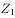
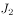
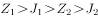

# 图+文跨来源取数与四个数值大小比较（折线图读数+环比降幅还原基期）

考点：[[20-考点/资料分析/综合/图+文跨来源取数与四个数值大小比较（折线图读数+环比降幅还原基期）|综合 / 图+文跨来源取数与四个数值大小比较（折线图读数+环比降幅还原基期）]]
材料：[[15-材料/资料分析/189702 2015年2季度J省消费者信心指数（|189702 2015年2季度J省消费者信心指数（]]

**问法模型**：题干设Z省2015年1、2季度信心指数为a、b，J省同期为c、d → 分别从折线图直读Z省两点、用'现期值+下降的百分点'加法还原J省基期，算出四个具体数值后按大小排序对照选项

## 推理链
1. 第1步：从文字材料第一段提取J省数据：2015年2季度消费者信心指数=101.1，环比下降4.6个百分点，即d=101.1
2. 第2步：用规则'基期值=现期值+下降幅度（个百分点用加法，不用百分比折算）'还原J省2015年1季度：c=101.1+4.6=105.7
3. 第3步：从折线图读黑色方块线（信心指数）：2015年1季度a=112.4、2015年2季度b=110.2（注意与预期线114.8、满意线区分线型）
4. 第4步：四数比较：a=112.4＞b=110.2＞c=105.7＞d=101.1，即a＞b＞c＞d
5. 第5步：与选项对照，B项表达式与该排序一致，故选B

**最快解法**：⚡ 直接取数法+加减还原：Z省两点从图直读112.4、110.2；J省现期101.1、Q1口算101.1+4.6=105.7；四数先比整数部分（112/110/105/101）即秒排出a＞b＞c＞d，对照选项锁定B

## 易错点
- ⚠ '环比下降4.6个百分点'误当百分比折算（如101.1×(1-4.6%)≈96.5），基期值方向与数值全错——百分点差值必须用加法101.1+4.6=105.7
- ⚠ 折线图三条线数值交叉重叠且同类数字重复（预期线114.8、满意线110.1与信心线112.4相邻），未先锁定'黑色方块=信心指数'线型易读错Z省两点
- ⚠ 口径混用：图中是Z省全省信心指数（110.2），文字中Z省城镇111.1、农村108.7不能替代全省值；J省与Z省是两个省份，切勿跨省拼数；题干变量符号在传递中缺失，需按'Z省2015年1、2季度''J省同期'自行对应取数

## 母题抽象
> 🧩 当题干出现'设甲地两期为a、b，乙地同期为c、d，比较大小'的特征时，图表数据直读、文字数据用'现期值±变化幅度（个百分点）'还原，算出四个具体数值后直接排序对照选项

**同类特征**：设Z省…值为a、b，J省同期同一指标为c、d、两省同期同指标比较、折线图读数取值、个百分点降幅还原基期、四个数值大小排序、图+文跨来源拼数据

## 相关题
（暂无）

---

### 题干

设Z省2015年1、2季度消费者信心指数值为、，J省同期同一指标为、，则：

### 选项
- A. 

- B. 

　✅
- C. 

- D. 

### 官方解析

由文字材料第一段可得，2015年2季度，J省消费者信心指数为101.1，环比下降4.6个百分点，则1季度J省消费者信心指数为101.1+4.6=105.7。由折线图可得，2015年1、2季度Z省消费者信心指数值分别、为112.4、110.2。故四项排序由大到小应分别为。

故正确答案为B。

### 给定材料

        2015年2季度，J省消费者信心指数（CCI）为101.1，环比、同比分别下降4.6个、10.7个百分点。分城乡看，城镇和农村消费者信心指数分别为101.6和100.1，环比分别下降5.2、3.8个百分点。

        从体现消费者对当前形势的满意程度看，2015年2季度，J省消费者满意指数（ICC）为96.9，从满意指数的构成看，消费者对当前就业满意指数为101.2，其中城乡指数分别为99.3、104.2，环比分别下降6.1个、3.3个百分点；对当前家庭收入的满意程度看，满意指数为99.5，其中城乡家庭收入满意指数分别为100.4、98.1，环比分别下降9.6个、3.1个百分点。

        从反映消费者对未来乐观程度的预期指数看，2015年2季度，J省消费者预期指数（ICS）为103.8，在持续两个季度小幅回升后，本季度有所回落，环比、同比分别下降4.1个、12.0个百分点。

        2015年2季度，Z省城乡消费者信心指数均呈下行态势，其中，城镇消费者信心指数为111.1，较一季度下降1.4个百分点；农村消费者信心指数为108.7，较一季度下降3.4个百分点。

> [!warning] 疑点（官方解析可能有误，待人工复核）
> 题干变量符号（a、b、c、d）及选项、官方解析中的排序表达式均为图片latex且在传递中缺失，仅能依据官方解析'四项排序由大到小'与计算结果（112.4＞110.2＞105.7＞101.1）推知B对应a＞b＞c＞d；此为题面传递缺省而非答案问题，不影响正确答案B

<!-- CODEX-ANSWER-REVIEW:BEGIN -->
### 本次独立复核

**复核状态：** `confirmed`（独立复算确认答案）

**计分答案：** B（可计分）

**复核解析：**

由原文及图15eade4db241e48.png读取Z省2015Q1/Q2消费者信心指数Z1=112.4、Z2=110.2；J省Q2=101.1且环比下降4.6，故J1=105.7。严格排序112.4>110.2>105.7>101.1，即Z1>Z2>J1>J2，对应公式图选项B。

**相关信息：**

独立复核：资料分析综合判断；以题源统计表/图及精确口径独立复算。缺少关键比例或单位冲突时不猜测。

**题源依据：** [固定版本原题](https://github.com/Mentat-Uran/kaogongzhentizhengliu/blob/84ab93d4b64b61d897bece8a1c0a5bab06b4feb2/10-%E7%9C%9F%E9%A2%98/%E8%B5%84%E6%96%99%E5%88%86%E6%9E%90/%E7%BB%BC%E5%90%88/2097266%20%E5%9B%BE%2B%E6%96%87%E8%B7%A8%E6%9D%A5%E6%BA%90%E5%8F%96%E6%95%B0%E4%B8%8E%E5%9B%9B%E4%B8%AA%E6%95%B0%E5%80%BC%E5%A4%A7%E5%B0%8F%E6%AF%94%E8%BE%83%EF%BC%88%E6%8A%98%E7%BA%BF%E5%9B%BE%E8%AF%BB%E6%95%B0%2B%E7%8E%AF%E6%AF%94%E9%99%8D%E5%B9%85%E8%BF%98%E5%8E%9F%E5%9F%BA%E6%9C%9F%EF%BC%89.md)；固定内容 commit `84ab93d4b64b61d897bece8a1c0a5bab06b4feb2`，Markdown blob `9bfe565ef824bd2fd2b3a68dc546f176d7e13b18`。
<!-- CODEX-ANSWER-REVIEW:END -->
