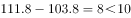
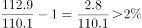

# 综合分析判断（折线图读数+环比变化比较+跨省图文拼数据）

考点：[[20-考点/资料分析/综合/综合分析判断（折线图读数+环比变化比较+跨省图文拼数据）|综合 / 综合分析判断（折线图读数+环比变化比较+跨省图文拼数据）]]
材料：[[15-材料/资料分析/189702 2015年2季度J省消费者信心指数（|189702 2015年2季度J省消费者信心指数（]]

**问法模型**：'能够从上述资料中推出的是'的四选一综合判断问法 → 逐项验证：A比较两省城乡环比降幅大小、B检查数据是否齐全、C图文对读作差、D比较折线图各季度环比变化与最高点是否同一季度

## 推理链
1. 第1步：A项取数——J省2015年2季度城镇信心指数101.6环比降5.2个、农村100.1环比降3.8个百分点（文字一段）；Z省城镇111.1较一季度降1.4个、农村108.7降3.4个百分点（文字四段）
2. 第2步：A项验证——J省城镇降幅5.2＞农村3.8成立，但Z省城镇降幅1.4＜农村3.4，'两省均大于'不成立，A错误
3. 第3步：B项验证——J省信心指数仅有现期101.1，还原出2015Q1=101.1+4.6=105.7、2014Q2=101.1+10.7=111.8，但2014年3、4季度数值材料未给，四个季度趋势无法判断，B推不出
4. 第4步：C项验证——J省预期指数103.8（文字第三段），Z省预期指数读图2015年2季度=111.8，差=111.8-103.8=8.0个百分点＜10，C错误
5. 第5步：D项取数——读图中信心指数线（黑色方块）2014Q1~2015Q2依次为109.4、109.1、110.1、112.9、112.4、110.2，2014Q3至2015Q2环比变化为+1.0、+2.8、-0.5、-2.2
6. 第6步：D项结论——指数最高值112.9在2014年4季度，环比升幅最大（+2.8，约+2.5%）也在2014年4季度，'最高'与'增速最快'为同一季度，D正确

**最快解法**：⚡ 逐项排除+目测读图：C项图文对读直接作差111.8-103.8=8.0＜10，秒杀排除；A项只看Z省'1.4＜3.4'一组即排除；B项发现J省2014年3、4季度数据缺失即排除；D项在图上找'最高点112.9'与'爬升最陡段（110.1→112.9升2.8）'，目测同在2014年4季度即选D，全程无需精确计算

## 易错点
- ⚠ '个百分点'是差值不是百分比：C项'相差10个百分点以上'就是两值直接作差=8.0，切勿用百分比增减率计算；同理全部基期还原须用加法（101.1+4.6=105.7）
- ⚠ 折线图三条线区间交叉、数字重复（预期指数114.8连续两季、信心指数110.1与满意指数2014Q4同值）：读数必须先锁定图例'黑色方块=信心指数'再取值，否则C、D都会取错线
- ⚠ 口径陷阱：图是Z省全省信心指数（110.2），文字是Z省分城乡（111.1/108.7），两套数不能混用；A项勿把J省'城镇降幅大'的规律套用到Z省

## 母题抽象
> 🧩 当综合判断题出现'变化趋势相同/相差N个百分点/最高的季度也是增速最快的季度'时，先用'数据是否齐全'排除无从计算的选项（B类），再用'图文对读作差'秒杀差值判断项（C类），最后锁定'最高点与最大升幅是否同点'的目测比较项（D类）

**同类特征**：能够从上述资料中推出的是、环比下降的数值均大于、变化趋势相同、相差10个百分点以上、环比增速最快的季度、J省与Z省图文跨源拼数据

## 相关题
- [[10-真题/资料分析/综合/19283943 综合分析判断题（倍数比较+求和判断+隐含平均每场座位数反推）|19283943]]（国考 2025，相关度1）
- [[10-真题/资料分析/综合/1796162 综合判断（月均计算、平均运输距离、比重对比、增长量比较逐项验证）|1796162]]（贵州 2016，相关度1）
- [[10-真题/资料分析/综合/2133504 综合判断题（现期比重+现期平均数多项验证，一对三错）|2133504]]（国考 2018，相关度1）
- [[10-真题/资料分析/综合/2263131 综合分析四选一（变化趋势比较+最值年份定位+两期增幅比较+倍数全称判断）|2263131]]（四川 2016，相关度1）
- [[10-真题/资料分析/综合/2444706 综合判断题（增长量+比重+倍数逐项验证）|2444706]]（四川 2019，相关度1）

---

### 题干
能够从上述资料中推出的是：

### 选项
- A. 2015年2季度，J省、Z省城镇消费者信心指数环比下降的数值均大于农村消费者信心指数
- B. 2014年3季度至2015年2季度，J省、Z省消费者信心指数变化趋势相同
- C. 2015年2季度，J省、Z省消费者预期指数值相差10个百分点以上
- D. 2014年3季度至2015年2季度，Z省消费者信心指数最高的季度也是该指数环比增速最快的季度　✅

### 官方解析

A项：定位文字材料第四段，“2015年2季度，Z省……城镇消费者信心指数为111.1，较一季度下降1.4个百分点；农村消费者信心指数为108.7，较一季度下降3.4个百分点”，城镇消费者信心指数环比下降数值小于农村，错误；

B项：材料仅提供了2015年1季度与2季度J省消费者信心指数值，2014年3季度与4季度未知，故选项说法无法得出，错误；

C项：定位文字材料第三段可得，2015年2季度，J省消费者预期指数（ICS）为103.8，定位统计图可得，2015年2季度，Z省消费者预期指数为111.8，二者相差个百分点，错误；

D项：定位统计图，比较2014年3季度至2015年2季度各季度Z省消费者信心指数的环比增速，2015年1、2季度环比降低，增速为负值，2014年3季度环比增速为，2014年4季度环比增速为，则2014年4季度环比增速最大，Z省消费者信心指数最高的季度是2014年4季度，与指数环比增速最快的是同一季度，正确。

故正确答案为D。

注释：中国消费者信心指数由消费者满意指数和消费者预期指数加权平均取得。满意指数是指消费者对当前就业形势、当前家庭收入情况和购买时机的判断，预期指数是指消费者对未来6个月就业形势和家庭收入情况的预期。上述指数的取值均在“0~200”之间。“100”为“乐观”和“悲观”的临界值。当信心指数大于100，表明消费者趋于乐观；小于100，表明消费者趋于悲观。

### 给定材料

        2015年2季度，J省消费者信心指数（CCI）为101.1，环比、同比分别下降4.6个、10.7个百分点。分城乡看，城镇和农村消费者信心指数分别为101.6和100.1，环比分别下降5.2、3.8个百分点。

        从体现消费者对当前形势的满意程度看，2015年2季度，J省消费者满意指数（ICC）为96.9，从满意指数的构成看，消费者对当前就业满意指数为101.2，其中城乡指数分别为99.3、104.2，环比分别下降6.1个、3.3个百分点；对当前家庭收入的满意程度看，满意指数为99.5，其中城乡家庭收入满意指数分别为100.4、98.1，环比分别下降9.6个、3.1个百分点。

        从反映消费者对未来乐观程度的预期指数看，2015年2季度，J省消费者预期指数（ICS）为103.8，在持续两个季度小幅回升后，本季度有所回落，环比、同比分别下降4.1个、12.0个百分点。

        2015年2季度，Z省城乡消费者信心指数均呈下行态势，其中，城镇消费者信心指数为111.1，较一季度下降1.4个百分点；农村消费者信心指数为108.7，较一季度下降3.4个百分点。

> [!warning] 疑点（官方解析可能有误，待人工复核）
> 官方解析中C项'二者相差个百分点'与D项'环比增速为'后的数值在传递中缺失，按材料补全应为：C项差=8.0个百分点；D项2014Q3~2015Q2环比增速约为+0.92%、+2.54%、-0.44%、-1.96%（若严格按'增速=变化量÷基期值'计算，因各期基数接近，排序与按变化量比较一致），均不影响答案D的判定

<!-- CODEX-ANSWER-REVIEW:BEGIN -->
### 本次独立复核

**复核状态：** `confirmed`（独立复算确认答案）

**计分答案：** D（可计分）

**复核解析：**

原图15eade4db241e48.png显示Z省信心指数2014Q3=112.6、Q4=114.8、2015Q1=114.8、Q2=111.8；Q4/Q3−1≈1.96%，高于Q1增速0及Q2负增速，且Q4与Q1并列最高。选项D的“最高季度也是环比增速最快季度”成立（Q4为增速唯一最高者）。A与文字所给下降1.4<3.4矛盾；C图读J/Z预期指数相差<10。

**相关信息：**

独立复核：资料分析综合判断；以题源统计表/图及精确口径独立复算。缺少关键比例或单位冲突时不猜测。

**题源依据：** [固定版本原题](https://github.com/Mentat-Uran/kaogongzhentizhengliu/blob/84ab93d4b64b61d897bece8a1c0a5bab06b4feb2/10-%E7%9C%9F%E9%A2%98/%E8%B5%84%E6%96%99%E5%88%86%E6%9E%90/%E7%BB%BC%E5%90%88/2097270%20%E7%BB%BC%E5%90%88%E5%88%86%E6%9E%90%E5%88%A4%E6%96%AD%EF%BC%88%E6%8A%98%E7%BA%BF%E5%9B%BE%E8%AF%BB%E6%95%B0%2B%E7%8E%AF%E6%AF%94%E5%8F%98%E5%8C%96%E6%AF%94%E8%BE%83%2B%E8%B7%A8%E7%9C%81%E5%9B%BE%E6%96%87%E6%8B%BC%E6%95%B0%E6%8D%AE%EF%BC%89.md)；固定内容 commit `84ab93d4b64b61d897bece8a1c0a5bab06b4feb2`，Markdown blob `d29e8b543bb99fa957b506923cf1347c59a4868c`。
<!-- CODEX-ANSWER-REVIEW:END -->
