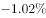
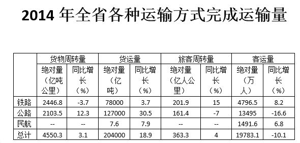

# 综合判断（比重判断+增速正负排除+增长量阈值比较）

考点：[[20-考点/资料分析/综合/综合判断（比重判断+增速正负排除+增长量阈值比较）|综合 / 综合判断（比重判断+增速正负排除+增长量阈值比较）]]
材料：[[15-材料/资料分析/189704 某省2014年交通运输状况：文字段给|189704 某省2014年交通运输状况：文字段给]]

**问法模型**：“关于2014年……下列说法正确的是”综合判断收口题→对四个选项按“增速正负→比重截位→增长量公式”逐项验证排除

## 推理链
1. 第1步：A项从文字段提取2014年末高速公路4237公里、公路总里程172167公里，比重=4237÷172167≈2.46%（因172167÷40=4304>4237，故不足2.5%），小于选项所给比重，A错误
2. 第2步：B项读表“客运量—同比增长%”列，铁路+8.2%、公路-16.6%、民航+6.8%，公路客运量同比下降，“三种运输方式客运量和货运量均高于上年”不成立（货运量三项均正增，但客运量一项负增即否决），B错误
3. 第3步：C项读表公路货运量127000、货运总量204000，比重=127÷204≈62.3%，为6成多、不足7成，C错误
4. 第4步：D项读表货运总量204000亿吨、同比增长18.9%，增长量=现期×r÷(1+r)=204000×18.9%÷1.189≈32400亿吨
5. 第5步：单位换算32400亿吨≈3.24万亿吨>3万亿吨，D正确，故选D

**最快解法**：⚡ 综合判断先易后难：B项一眼看公路客运量增速-16.6%<0直接排除；A项用“172167÷40=4304>4237”知比重不足1/40（≈2.5%）排除；C项截位直除127÷204≈62%排除；D项百化分18.9%≈1/5.3，增长量≈现期/(5.3+1)=204000÷6.3≈3.2万亿吨>3万亿吨，锁定D

## 易错点
- ⚠ D项单位换算陷阱：204000亿吨=20.4万亿吨，须把增长量32400亿吨换算成约3.24万亿吨再与“3万亿吨”比较，漏掉÷10^4换算会误判
- ⚠ D项公式陷阱：增长量=现期×r/(1+r)，误用现期×r（204000×18.9%≈3.9万亿吨）或直接拿增速18.9%当增长量与阈值比对
- ⚠ B项混合增速陷阱：总计客运量增速-10.1%为负、铁路+8.2%与民航+6.8%为正，不能拿总计增速代替逐项判断，须逐行核对分量，且民航'–'缺项不能当0或负增长处理；C项分母必须用总计204000（货运量总计≠分量之和205007.6，不能自行加总替代）

## 母题抽象
> 🧩 当题干出现“下列说法正确的是”综合判断时，按“增速正负一票否决→比重截位直除→增长量=现期×r/(1+r)与阈值比较”顺序逐项排除，涉及增长量阈值时用百化分（r≈1/n则增长量≈现期/(n+1)）并先统一单位

**同类特征**：“关于2014年……下列说法正确的是”（综合判断收口题）、四选项跨文字段+表格取数、“三种运输方式……均高于上年”全称命题，找负增速一票否决、“占货运总量的7成多”比重成数判断、“增长超过3万亿吨”增长量阈值判断、亿吨/万亿吨单位换算

## 相关题
（暂无）

---

### 题干
关于2014年该省交通运输状况，下列说法正确的是：

### 选项
- A. 
高速公路里程占全省公路总里程比重超过

- B. 
三种运输方式的客运量和货运量均高于上年

- C. 
公路货运量占货运总量的7成多

- D. 
货运总量比上年增长超过3万亿吨
　✅

### 官方解析
A项：根据第一段“2014年末，某省公路里程172167公里，其中，高速公路4237公里”，可得2014年末，高速公路里程占全省公路里程的比重，小于，错误；
B项：由表格可知公路客运量2014年的增长率为，即比去年下降，选项说三种运输方式的客运量和货运量均高于上年，错误；
C项：根据表格可知，公路货运量为127000亿吨，货运总量为204000亿吨，故公路货运量占货运总量的比重，不足7成，错误；
D项：根据表格可知，2014年货运总量是204000亿吨，同比增长。，超过3万亿吨，正确。
故正确答案为D。

### 给定材料

        2014年末，某省公路里程172167公里，同比增长，其中，高速公路4237公里，同比增长。国家铁路正线延展里程和营业里程分别为15060公里和9351公里，分别同比增长和。地方铁路正线延展里程和营业里程分别为1805公里和1072公里，分别同比增长和。

> [!warning] 疑点（官方解析可能有误，待人工复核）
> 给定文字段中各“同比增长”百分数为空缺，官方解析中A项的比重阈值分数与D项引用的增速数字在文本中亦被省略；本题判定仅靠表格即可完整复现（D项用18.9%）。另表头“货运量（亿吨）”下数值达204000，量级远超常规“万吨”口径，若按万吨口径D项增长量仅约3.2亿吨、说法不成立；本笔记按材料导读“以图中标注亿吨为准”处理，计算结果（≈3.24万亿吨）与官方答案D一致，仅提示该单位标注口径异常。
