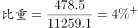
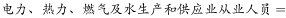
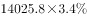
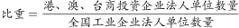
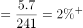
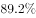

# 综合判断题（比重对照阈值＋占比求总量＋简单计数核对）

考点：[[20-考点/资料分析/综合/综合判断题（比重对照阈值＋占比求总量＋简单计数核对）|综合 / 综合判断题（比重对照阈值＋占比求总量＋简单计数核对）]]
材料：[[15-材料/资料分析/191712 2013年全国工业企业法人单位与从业|191712 2013年全国工业企业法人单位与从业]]

**问法模型**：题干为'下列说法正确的是'综合判断 → 逐项拆解：A/C为比重直除后与题干阈值比对，B为'全体×占比'推总量，D为逐行边界计数，四项小验证排除

## 推理链
1. 第1步（A项）：定位表格，内资企业从业人员11259.1万人、国有企业从业人员478.5万人，比重=478.5÷11259.1≈4.25%，实际比重超过题干'不足'的阈值，A错误
2. 第2步（B项）：定位文字段，全国从业人员14025.8万人，乘以电力、热力、燃气及水生产和供应业的从业占比（该占比高于400÷14025.8≈2.85%），结果超过400万人，B正确
3. 第3步（C项）：定位表格，港、澳、台商投资企业法人单位5.7万个÷全国工业企业法人单位241万个≈2.37%，实际比重超过题干'不足'的阈值，C错误
4. 第4步（D项）：内资企业8个子类中法人单位少于6万个的有国有2.0、集体4.0、股份合作2.4、联营0.5、股份有限公司3.0，共5种；有限责任32.1、私营176.0、其他9.3均不小于6万，并非7种，D错误
5. 第5步：四项中仅B成立，对照官方答案选B

**最快解法**：⚡ 综合判断按'先纯计数、再截位直除'顺序：D项秒数内资单位数<6万的类型仅5种（2.0/4.0/2.4/0.5/3.0）先排除；A项478.5÷11259≈4.25%、C项5.7÷241≈2.4%用截位直除对照题干阈值分别排除；最后验证B项14025.8×电力热力从业占比（>2.85%）>400万人成立，锁定B

## 易错点
- ⚠ A项分母口径陷阱：'占全国内资企业从业人员'的分母是11259.1万人，不是全国14025.8万人，拿错分母会算成约3.4%导致误判
- ⚠ D项计数陷阱：'少于6万'需逐行核对8个子类，易把'其他企业9.3万'误当小于6万、或漏掉'股份有限公司3.0万'，数成6/7种即错，实际仅5种
- ⚠ B项找数与乘数陷阱：电力热力燃气及水的从业占比只在文字段（表格无占比列），且须乘从业人员14025.8万人而非法人单位241万个；'400万人'与'万人'口径一致，勿做多余换算

## 母题抽象
> 🧩 当综合判断题出现'占……比重不足/超过×%''总量超过N''少于N的有几类'特征时，逐项拆成比重=分量÷对应分母直除对照阈值、总量=全体×占比、边界计数三类小模型，优先做纯计数项与表格比重项，最后验证文字段项。

**同类特征**：下列说法正确的是、占……比重不足/超过（阈值判断）、从业人员超过400万人、法人单位个数少于6万的有几种、文字段与表格混合定位、电力、热力、燃气及水生产和供应业

## 相关题
- [[10-真题/资料分析/综合/2195856 综合判断题·增长倍数口径下的基期反推与定性表述可推性验证|2195856]]（黑龙江 2018，相关度1）
- [[10-真题/资料分析/综合/10204448 综合分析-逐项判断（历史极值确认、两期比重比较、多期累计求和、基期比重）|10204448]]（广东 2024，相关度1）
- [[10-真题/资料分析/综合/1772378 综合分析判断题（多选项直接查找与数据比较）|1772378]]（深圳市考 2016，相关度1）
- [[10-真题/资料分析/综合/2033342 综合分析题（增速逐年比较＋两期比重比较＋库存流量平衡式混合判断）|2033342]]（河南 2016，相关度1）
- [[10-真题/资料分析/综合/2060624 综合分析题（口径辨析+方向词核验+同比减少量计算的四选项正误判断）|2060624]]（深圳市考 2017，相关度1）

---

### 题干
关于2013年全国工业企业情况，下列说法正确的是：

### 选项
- A. 
国有企业从业人员占全国内资企业从业人员的比重不足

- B. 
电力、热力、燃气及水生产和供应业从业人员超过400万人
　✅
- C. 
港、澳、台商投资企业法人单位数量占全国工业企业法人单位的比重不足

- D. 
内资企业中企业法人单位个数少于6万的有7种类型

### 官方解析

A项：定位表格，2013年国有企业从业人员数为478.5万人，内资企业从业人员数为11259.1万人，故国有企业从业人员数占内资企业从业人员数的，超过，错误；

B项：定位文字材料，全国从业人员14025.8万人，电力、热力、燃气及水生产和供应业占，所以 ，超过400万人，正确；

C项：定位表格，港、澳、台商投资企业法人单位数量为5.7万个，全国工业企业法人单位数量为241万个，所以港、澳、台商投资企业法人单位数量占全国工业企业法人单位的，超过，错误；

D项：定位表格，内资企业少于6万的有：国有企业（2.0万个）、集体企业（4.0万个）、股份合作企业（2.4万个）、联营企业（0.5万个）、股份有限公司（3.0万个），共有5种类型，错误。

故正确答案为B。

### 给定材料

<b>      三、根据所给资料，回答111~115题。</b>

      2013年，全国共有工业企业法人单位241万个，从业人员14025.8万人，分别比2008年增长和。

      2013年，在工业企业法人单位中，采矿业8.9万个，比2008年下降；制造业225.2万个；电力、热力、燃气及水生产和供应业6.9万个，比2008年下降。在工业企业法人单位从业人员中，采矿业占，制造业占，电力、热力、燃气及水生产和供应业占。

> [!warning] 疑点（官方解析可能有误，待人工复核）
> 材料原文中各增长率与行业占比数值为空白，选项A/C的阈值公式为无法读取的乱码图片，官方解析中相应数值亦未显示（如'占……的，超过……'留白），无法直接核对具体阈值与占比；本题按解析结论反推校验（A实际比重≈4.25%超过阈值、C实际比重≈2.37%超过阈值、B占比高于400÷14025.8≈2.85%），判断结论与官方答案B一致，具体数值需以完整原卷补齐。

<!-- CODEX-ANSWER-REVIEW:BEGIN -->
### 本次独立复核

**复核状态：** `resolved`（答案与解析已核定）

**计分答案：** B（可计分）

**复核解析：**

1. 第1步（A项）：定位表格，内资企业从业人员11259.1万人、国有企业从业人员478.5万人，比重=478.5÷11259.1≈4.25%，实际比重超过题干'不足'的阈值，A错误
2. 第2步（B项）：定位文字段，全国从业人员14025.8万人，乘以电力、热力、燃气及水生产和供应业的从业占比（该占比高于400÷14025.8≈2.85%），结果超过400万人，B正确
3. 第3步（C项）：定位表格，港、澳、台商投资企业法人单位5.7万个÷全国工业企业法人单位241万个≈2.37%，实际比重超过题干'不足'的阈值，C错误
4. 第4步（D项）：内资企业8个子类中法人单位少于6万个的有国有2.0、集体4.0、股份合作2.4、联营0.5、股份有限公司3.0，共5种；有限责任32.1、私营176.0、其他9.3均不小于6万，并非7种，D错误
5. 第5步：四项中仅B成立，对照官方答案选B

**最快解法**：⚡ 综合判断按'先纯计数、再截位直除'顺序：D项秒数内资单位数<6万的类型仅5种（2.0/4.0/2.4/0.5/3.0）先排除；A项478.5÷11259≈4.25%、C项5.7÷241≈2.4%用截位直除对照题干阈值分别排除；最后验证B项14025.8×电力热力从业占比（>2.85%）>400万人成立，锁定B

**相关信息：**

考点：综合判断题（比重对照阈值＋占比求总量＋简单计数核对）。来源：2017年河南省公务员录用考试《行测》题（网友回忆版）；2017年。> 🧩 当综合判断题出现'占……比重不足/超过×%''总量超过N''少于N的有几类'特征时，逐项拆成比重=分量÷对应分母直除对照阈值、总量=全体×占比、边界计数三类小模型，优先做纯计数项与表格比重项，最后验证文字段项。

**同类特征**：下列说法正确的是、占……比重不足/超过（阈值判断）、从业人员超过400万人、法人单位个数少于6万的有几种、文字段与表格混合定位、电力、热力、燃气及水生产和供应业

**题源依据：** [固定版本原题](https://github.com/Mentat-Uran/kaogongzhentizhengliu/blob/84ab93d4b64b61d897bece8a1c0a5bab06b4feb2/10-%E7%9C%9F%E9%A2%98/%E8%B5%84%E6%96%99%E5%88%86%E6%9E%90/%E7%BB%BC%E5%90%88/2136498%20%E7%BB%BC%E5%90%88%E5%88%A4%E6%96%AD%E9%A2%98%EF%BC%88%E6%AF%94%E9%87%8D%E5%AF%B9%E7%85%A7%E9%98%88%E5%80%BC%EF%BC%8B%E5%8D%A0%E6%AF%94%E6%B1%82%E6%80%BB%E9%87%8F%EF%BC%8B%E7%AE%80%E5%8D%95%E8%AE%A1%E6%95%B0%E6%A0%B8%E5%AF%B9%EF%BC%89.md)；固定内容 commit `84ab93d4b64b61d897bece8a1c0a5bab06b4feb2`，Markdown blob `8c232f27b3818250c1bc0f497b7d950b57feb5f8`。
<!-- CODEX-ANSWER-REVIEW:END -->
