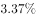
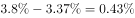
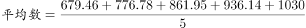
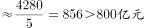
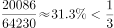
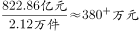

# 综合分析·选非题（比重差值+五年年均值+占比判定+平均每件金额混合验证）

考点：[[20-考点/资料分析/综合/综合分析·选非题（比重差值+五年年均值+占比判定+平均每件金额混合验证）|综合 / 综合分析·选非题（比重差值+五年年均值+占比判定+平均每件金额混合验证）]]
材料：[[15-材料/资料分析/191714 2016年S市科技创新年度情况：以2|191714 2016年S市科技创新年度情况：以2]]

**问法模型**：题干为'下列说法不正确的是'（选非综合分析）→ 对A~D逐项验算（比重差、年均支出、授权占比、单件均额），锁定唯一错误表述

## 推理链
1. 第1步：A项从统计图折线读数：2016年R&D占GDP比重3.80%、2012年3.37%，差值=3.80%-3.37%=0.43个百分点，A正确
2. 第2步：B项取图中柱形2012~2016年R&D支出679.46、776.78、861.95、936.14、1030.00，合计=4284.33亿元，年均=4284.33÷5≈856.9亿元>800亿元，B正确
3. 第3步：C项取文字材料：2016年专利授权量64230件，其中发明专利授权20086件，反算64230÷3=21410件，而20086<21410，即占比20086÷64230≈31.3%，不足三分之一，C'三分之一以上'说法错误
4. 第4步：D项取文字材料：合同金额822.86亿元、合同2.12万件，单件均额=822.86亿元÷2.12万件≈388万元/件<400万元，'不超过400万元'正确
5. 第5步：本题为选非题，C为不正确说法，故正确答案为C

**最快解法**：⚡ 秒杀口算：优先验最易判的C项——用'分母÷3与分子比'，64230÷3=21410>20086，发明专利授权占比不足1/3，C错误，直接锁定答案；如需复核：A=3.80-3.37=0.43个百分点；B=(679.46+776.78+861.95+936.14+1030.00)÷5≈857亿元；D=822.86亿元÷2.12万件≈388万元/件

## 易错点
- ⚠ '申请'与'授权'口径混用：必须用发明专利授权20086比专利授权64230；若误拿发明专利申请54339件（54339/119937≈45%）或与授权64230件混比，会误判C为正确
- ⚠ '三分之一以上'判定陷阱：不必真除20086÷64230，反算64230÷3=21410与20086比较即可，节省时间且避免除法出错
- ⚠ D项单位换算陷阱：亿元→万元、万件→件，822.86亿元÷2.12万件≈388万元/件，漏做'亿/万'换算会差10⁴倍；另A项比重差只能表述为'0.43个百分点'，勿与增长率%混淆

## 母题抽象
> 🧩 当题干出现'下列说法不正确的是'时，先扫选项找可口算的比重/倍数表述（如'几分之一以上'），用'分母÷N与分子比较'秒杀锁定错误项，其余选项再用差值、均值、单位换算逐一复核。

**同类特征**：选非题（不正确的是）、跨图表四选项综合验证、比重差以百分点表述、五年年均值超阈值、占比与三分之一比较、平均每件金额涉及亿元/万件换算

## 相关题
- [[10-真题/资料分析/综合/2261977 综合判断选非题（现期比重+两期比重趋势+跨期增长率混合验证）|2261977]]（广东 2019，相关度1）
- [[10-真题/资料分析/综合/2374723 综合分析选非题（柱状图单调性直读＋增速关系换算＋表1逐项比较＋差值定性判断）|2374723]]（广东 2019，相关度1）
- [[10-真题/资料分析/综合/2776161 综合分析选非题·大小排序比较（占比大小与客源国名次）|2776161]]（浙江 2021，相关度1）
- [[10-真题/资料分析/综合/19452627 综合分析选非题（比重+部分值+平均数+倍数混合验证）|19452627]]（上海 2026，相关度1）
- [[10-真题/资料分析/综合/18643960 综合分析·选非题（文字+图表逐项验证）|18643960]]（浙江 2026，相关度1）

---

### 题干
根据上述资料，下列说法不正确的是：

### 选项
- A. 2016年研究与试验发展经费支出占生产总值的比重比2012年高0.43个百分点
- B. 2012-2016年，年均研究与试验发展经费支出超过800亿元
- C. 2016年，发明专利授权量占专利授权量的三分之一以上　✅
- D. 2016年，平均每件经认定登记的各类技术交易合同金额不超过400万元

### 官方解析

A项：定位图形材料，2016年和2012年研究与试验发展经费支出占生产总值的比重分别为、，则2016年比2012年的占比高，即高0.43个百分点，正确；

B项：定位表格柱状图，2012-2016年研究与试验发展经费支出的，正确；

C项：定位文字材料第二段“全年专利授权量为64230件，增长，其中，发明专利授权量为20086件，增长”，则发明专利授权量占专利授权量的比例为，错误；

D项：定位文字材料第二段“全年经认定登记的各类技术交易合同2.12万件，比上年下降；合同金额822.86亿元，增长”，则平均每件经认定登记的各类技术交易合同金额为，没超过400万元，正确。

本题为选非题，故正确答案为C。

### 给定材料

      <b>  一、根据所给资料，回答101～105题。</b>

      <b>  </b>2016年S市全年用于研究与试验发展（R&amp;D）经费支出总额为1030.00亿元，占S市生产总值的比重为。

        全年受理专利申请119937件，比上年增长，其中，受理发明专利申请54339件，增长。全年专利授权量为64230件，增长，其中，发明专利授权量为20086件，增长。全年PCT国际专利受理量为1560件，比上年增长。至年末，全市有效发明专利达85049件。年内全市新认定高新技术企业2306家。年内认定高新技术成果转化项目469项，其中，电子信息、生物医药、新材料等重点领域项目占。至年末，共认定高新技术成果转化项目10969项。全年经认定登记的各类技术交易合同2.12万件，比上年下降；合同金额822.86亿元，增长。

> [!warning] 疑点（官方解析可能有误，待人工复核）
> 官方解析中各处百分数因原卷文字增速留空而缺失，但A、B、C、D四项判定均只依赖图中标注数值及件数、金额，不依赖缺失的增速数字，结论C无实质矛盾

<!-- CODEX-ANSWER-REVIEW:BEGIN -->
### 本次独立复核

**复核状态：** `confirmed`（独立复算确认答案）

**计分答案：** C（可计分）

**复核解析：**

题源文字给2016发明专利授权20086件、全部专利授权64230件；20086/64230≈31.27%，小于1/3。题目问“不正确”，故C为错项。合同平均金额822.86亿元/2.12万件≈387.2万元，不超过400；其余A/B由题图R&D系列核验为真。

**相关信息：**

独立复核：资料分析综合判断；题图数据按单位与比较对象重新计算。

**题源依据：** [固定版本原题](https://github.com/Mentat-Uran/kaogongzhentizhengliu/blob/84ab93d4b64b61d897bece8a1c0a5bab06b4feb2/10-%E7%9C%9F%E9%A2%98/%E8%B5%84%E6%96%99%E5%88%86%E6%9E%90/%E7%BB%BC%E5%90%88/2136632%20%E7%BB%BC%E5%90%88%E5%88%86%E6%9E%90%C2%B7%E9%80%89%E9%9D%9E%E9%A2%98%EF%BC%88%E6%AF%94%E9%87%8D%E5%B7%AE%E5%80%BC%2B%E4%BA%94%E5%B9%B4%E5%B9%B4%E5%9D%87%E5%80%BC%2B%E5%8D%A0%E6%AF%94%E5%88%A4%E5%AE%9A%2B%E5%B9%B3%E5%9D%87%E6%AF%8F%E4%BB%B6%E9%87%91%E9%A2%9D%E6%B7%B7%E5%90%88%E9%AA%8C%E8%AF%81%EF%BC%89.md)；固定内容 commit `84ab93d4b64b61d897bece8a1c0a5bab06b4feb2`，Markdown blob `c5f84ae4ed3b0cc3a94ac99a3200fe12a9b97491`。
<!-- CODEX-ANSWER-REVIEW:END -->
