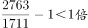
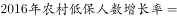
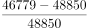
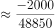

# 综合判断题（倍数表述判断+逐年趋势判断+降幅'成数'判断+极值比较）

考点：[[20-考点/资料分析/综合/综合判断题（倍数表述判断+逐年趋势判断+降幅'成数'判断+极值比较）|综合 / 综合判断题（倍数表述判断+逐年趋势判断+降幅'成数'判断+极值比较）]]
材料：[[15-材料/资料分析/191724 2007~2016年B市城乡低保（城|191724 2007~2016年B市城乡低保（城]]

**问法模型**：'能够从上述资料中推出的是'→四个选项各对应一个独立小验证：倍数关系、逐年趋势、同比降幅、10年极值，逐一证伪/证实后锁定唯一正确项

## 推理链
1. 第1步：A项——文字段提取2016年集中五保供养1711人、分散五保供养2763人；'多一倍'要求2763-1711≥1711（即2763≥1711×2=3422），实际仅多1052人（约多61.5%），不足一倍，A错误
2. 第2步：B项——表格'城市低保人数'列2008年145075人、2009年147142人，出现不降反升，一个反例即推翻'2007～2016年逐年下降'，B错误
3. 第3步：C项——表格'农村低保人数'列2015年48850人（基期）、2016年46779人（现期），减少48850-46779=2071人；截位直除2071/48850首位商0（约4.2%），不足一成，C错误
4. 第4步：D项——表格'城市低保户数'列扫描10年：72679/72839/74609/71454/63960/60954/58457/52109/50130/48802，2009年74609户为最大，其余年份均低于它，D成立
5. 第5步：A、B、C均被数据证伪，D经全列比对成立，对照选项锁定正确答案为D

**最快解法**：⚡ 综合题逐项独立击破：A项口算倍数（1711×2=3422>2763，'多一倍'不成立）；B项找反例即否（2009年147142＞2008年145075）；C项截位直除首位商（2071/48850≈4%，首位商0，不足一成）；D项扫列找最大值（74609唯一最大）。考场建议先验D这类极值判断（一眼可比），再回头排除A/C/B

## 易错点
- ⚠ '多一倍'表述陷阱：2763比1711确实'多'，但多出的1052人不足1711人，只是'多六成多'而非'多一倍'；把'多一倍'误读成'比…多'会误选A
- ⚠ C项降幅分母须用基期2015年48850人，勿用现期46779做分母；且'一成'=10%，实际仅约4.2%，首位商0即可快速排除
- ⚠ 查数串列陷阱：D项须按'城市低保户数'列定位，2009年在'城市低保人数'列恰为最大值147142人，人数（人）与户数（户）单位、口径不同，必须按列取数；B项同理须盯紧'低保人数'列而非'户数'列

## 母题抽象
> 🧩 当题干出现'能够从上述资料中推出的是'且选项含'多一倍/逐年/一成/最多年份'等特征时，逐项独立验证：倍数表述先算基准×2比对，趋势判断找到一个上升反例即否，降幅用基期做分母截位直除看首位商，极值判断直接扫列比大小

**同类特征**：能够从上述资料中推出的是、多一倍（倍数关系表述）、逐年下降（趋势判断找反例）、减少了一成以上（'成'的降幅）、最多的年份是（极值定位）、文字段+统计表跨列联动验证

## 相关题
- [[10-真题/资料分析/综合/19283943 综合分析判断题（倍数比较+求和判断+隐含平均每场座位数反推）|19283943]]（国考 2025，相关度1）
- [[10-真题/资料分析/综合/1796162 综合判断（月均计算、平均运输距离、比重对比、增长量比较逐项验证）|1796162]]（贵州 2016，相关度1）
- [[10-真题/资料分析/综合/2133504 综合判断题（现期比重+现期平均数多项验证，一对三错）|2133504]]（国考 2018，相关度1）
- [[10-真题/资料分析/综合/2444706 综合判断题（增长量+比重+倍数逐项验证）|2444706]]（四川 2019，相关度1）
- [[10-真题/资料分析/综合/2571728 综合分析逐项判断（等差递推求和＋单位换算＋比值估算）|2571728]]（山东 2020，相关度1）

---

### 题干
能够从上述资料中推出的是：

### 选项
- A. 2016年农村分散五保供养人数比集中五保供养人数多一倍
- B. 2007～2016年城市低保人数呈逐年下降趋势
- C. 2016年农村低保人数比上年减少了一成以上
- D. 2007～2016年间城市低保户数最多的年份是2009年　✅

### 官方解析

A项：定位文字材料第一段：“集中五保供养人数1711人，分散供养人数2763人”，所以分散五保供养人数比集中五保供养人数多，即不足一倍，错误；

B项：定位表格，2008年城市低保人数为145075人，2009年城市低保人数为147142人，所以2008-2009年人数上升，并不是逐年下降，错误；

C项：定位表格，2016年农村低保人数为46779人，2015年农村低保人数为48850人，所以，首位商不到1，所以减少不足一成，错误；

D项：定位表格，城市低保户数2009年为74609户，其余年份均低于74609户，所以2009年城市低保户数最多，正确。

故正确答案为D。

### 给定材料

       2016年B市有农村低保户数28925户，低保人数为46779人；全年累计支出农村低保资金38402.0万元。农村五保供养人数4474人，其中：集中五保供养人数1711人，分散供养人数2763人；全年累计支出农村五保供养资金5668.7万元，比上年增加支出596.3万元。

       2016年B市有城市低保户数48802户，低保人数为81882人；全年累计支出城市低保资金80215.8万元。

