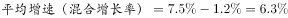
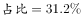
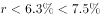
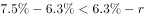
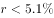
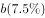
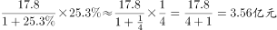
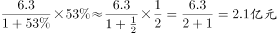

# 综合判断题（以两期比重升降判断为主，辅以混合增长率、占比求部分、同比增量比较）

考点：[[20-考点/资料分析/综合/综合判断题（以两期比重升降判断为主，辅以混合增长率、占比求部分、同比增量比较）|综合 / 综合判断题（以两期比重升降判断为主，辅以混合增长率、占比求部分、同比增量比较）]]
材料：[[15-材料/资料分析/191726 2015年1～11月北京市文化创意产|191726 2015年1～11月北京市文化创意产]]

**问法模型**：“能够从上述资料中推出的是”→四项逐一验证/证伪模型：定性规则优先（两期比重升降、混合增长率居中），能不算就不算，排除三项锁定答案。

## 推理链
1. 第1步：C项问上年同期比重与现期比重的高低，材料给出分子＝文化科技融合示范功能区3772.5亿元（同比增速a），分母＝20个功能区总收入7019.8亿元（同比增速b，且整体增速高于全市平均1.2个百分点）。
2. 第2步：两期比重比较规则：分子增速a＞分母增速b⇔比重上升⇔上年同期比重＜现期比重（比重差符号由a−b决定，无需算出具体比重）。
3. 第3步：由原始完整材料可知a＞b（示范功能区增速高于20区整体增速），故比重上升，上年同期比重低于现期比重，C项“低于”成立，C正确。
4. 第4步：A项：20个功能区增速＝全市平均增速＋1.2个百分点，全市收入＝功能区与“功能区之外”的混合，由“混合增长率居中且偏向基期值较大一方”，功能区之外部分增速必低于全市平均增速，与A项所给结论矛盾，A错误。
5. 第5步：B项：老字号＋主题公园合计收入＝7019.8×两区合计占20个功能区总收入的比重（占比见原始材料），代入计算结果并非300多亿元，B错误。
6. 第6步：D项：同比增量＝现期×r/(1+r)，数字内容服务17.8亿元的基数约为其他互联网服务6.3亿元的2.8倍，代入各自增速后数字内容服务增量更大，D项“多于”不成立，D错误。
7. 第7步：A、B、D均被证伪，仅C可从资料推出，故选C。

**最快解法**：⚡ 定性秒杀：C项属两期比重升降判断，只比分子增速a与分母增速b（材料中a＞b）→比重上升→上年同期比重低于现期比重，完全不算基期比重；A项用混合增长率居中（功能区之外增速＜全市平均）；B项用部分＝7019.8×占比估量级；D项用增量＝现期×r/(1+r)（17.8亿元vs6.3亿元基数差约2.8倍）排除，锁定C。

## 易错点
- ⚠ 两期比重方向记反：分子增速＞分母增速时比重上升、上年同期比重低于现期；若记反会把正确项C误判为错误
- ⚠ 混合增长率方向搞错：整体增速居中且偏向基期值大的一方；功能区高于全市平均1.2个百分点⇒“功能区之外”增速低于平均，不能反向理解
- ⚠ 增量比较只盯增速不看基数：其他互联网服务6.3亿元基数远小于17.8亿元，即便其增速更高，绝对增量仍可能更小，须用现期×r/(1+r)核算
- ⚠ 本版本材料所有增速百分数与占比数值空白，B、D的数值证伪及C项a＞b的依据均须对照原始完整试卷，严禁凭印象补数

## 母题抽象
> 🧩 当综合判断题出现“上年同期比重低于/高于现期比重”特征时，直接用两期比重升降定性规则（只比分子增速a与分母增速b）秒判，其余选项按“混合增长率居中、部分＝整体×占比、增量＝现期×r/(1+r)”逐项证伪。

**同类特征**：能够从上述资料中推出的是、上年同期比重低于现期比重、两期比重升降定性判断、混合增长率居中且偏向基期值大、同比收入增量比较、部分与整体倒推

## 相关题
- [[10-真题/资料分析/比重/2136874 现期比重——部分÷比重求整体（整体量倒推+区间型选项）|2136874]]（北京 2018，相关度1）
- [[10-真题/资料分析/综合/19283943 综合分析判断题（倍数比较+求和判断+隐含平均每场座位数反推）|19283943]]（国考 2025，相关度1）
- [[10-真题/资料分析/综合/1796162 综合判断（月均计算、平均运输距离、比重对比、增长量比较逐项验证）|1796162]]（贵州 2016，相关度1）
- [[10-真题/资料分析/综合/2133504 综合判断题（现期比重+现期平均数多项验证，一对三错）|2133504]]（国考 2018，相关度1）
- [[10-真题/资料分析/综合/2444706 综合判断题（增长量+比重+倍数逐项验证）|2444706]]（四川 2019，相关度1）

---

### 题干
关于2015年1～11月北京市文化创意产业收入，能够从上述资料中推出的是：

### 选项
- A. 
20个文化创意产业功能区之外的文化创意产业收入增速为

- B. 
北京老字号品牌文化推广功能区、主题公园功能区总收入为300多亿元

- C. 
上年同期文化科技融合示范功能区收入占20个功能区比重低于
　✅
- D. 
其他互联网服务行业同比收入增量多于数字内容服务行业

### 官方解析

A项：由材料第一段“20个文化创意产业功能区实现收入同比增长，高于全市文化创意产业收入平均增速1.2个百分点，占全市文化创意产业收入的比重为”可得全市文化创意产业收入，20个文化创意产业功能区之外的文化创意产业。根据“混合增长率居中且偏向基期值较大的”结论可得，，且，，错误；

B项：由材料第一段可得“北京市20个文化创意产业功能区实现收入7019.8亿元”，由材料第二段可得“北京老字号品牌文化推广功能区、主题公园功能区收入合计占20个功能区总收入的”则，错误；

C项：由材料第一段可得“20个文化创意产业功能区实现收入同比增长，······文化科技融合示范功能区实现收入3772.5亿元，同比增长，占20个功能区总收入的”，根据两期比重公式，比重分子增长率，比重上升，故上年同期比重小于今年，正确；

D项：由材料第三段可得“数字内容服务和其他互联网服务行业分别实现收入17.8亿元和6.3亿元，同比分别增长和”，数字内容服务增量：，其他互联网服务业增量：，数字内容服务增量更大，错误。

故正确答案为C。

### 给定材料

<b>二、根据下列统计资料回答问题</b>

       2015年1～11月，北京市20个文化创意产业功能区实现收入7019.8亿元，同比增长，高于全市文化创意产业收入平均增速1.2个百分点，占全市文化创意产业收入的比重为。其中文化科技融合示范功能区实现收入3772.5亿元，同比增长，占20个功能区总收入的；文化金融融合功能区实现收入436.5亿元，同比增长，占20个功能区总收入的。

       传媒影视板块中，CBD-定福庄国际传媒产业走廊功能区、新媒体产业功能区、影视产业功能区分别增长、和，三个功能区收入合计占20个功能区总收入的；文化休闲板块中，北京老字号品牌文化推广功能区、主题公园功能区分别增长和1.5倍，两个功能区收入合计占20个功能区总收入的。

        2015年1～11月，规模以上互联网信息服务行业实现收入856.5亿元，同比增长，高于全市文化创意产业平均增速15.2个百分点；数字内容服务和其他互联网服务行业分别实现收入17.8亿元和6.3亿元，同比分别增长和；全市重点互联网出版单位实现收入373.2亿元，同比增长。

> [!warning] 疑点（官方解析可能有误，待人工复核）
> 本版本材料全部同比增速百分数与占比数值空白，官方解析中的关键公式亦随图片缺失而不完整；C项“分子增速＞分母增速”的判定及A/B/D的数值证伪均依赖原始完整材料数值方可落地，本笔记按官方解析结论（C正确、A/B/D错误）如实标注，未补任何具体百分数。

<!-- CODEX-ANSWER-REVIEW:BEGIN -->
### 本次独立复核

**复核状态：** `resolved`（答案与解析已核定）

**计分答案：** C（可计分）

**复核解析：**

恢复题源公式图：20个文化创意产业功能区收入7019.8亿元、同比增长7.5%、占全市68.8%；北京市全市同比增长6.3%。A：上期功能区占比=68.8%×1.063÷1.075≈68.03%，上期功能区外占比≈31.97%；外部增速=(6.3%−68.03%×7.5%)÷31.97%≈3.75%，低于A项5.1%。B：两休闲功能区合计收入=7019.8×3%=210.6亿元，低于300亿元。C：文化科技融合示范功能区增速7.8%高于功能区整体7.5%，该部分占比上升，故上年同期占比低于现期53.7%，C正确。D：文化艺术服务收入增量=17.8×25.3%÷1.253≈3.59亿元；其他互联网服务增量=6.3×53%÷1.53≈2.18亿元，前者更高，D错。故选C。

**相关信息：**

资料分析—两期比重变化、混合增长率、基期增量。北京市统计局全市表公布收入10198.0亿元、同比增长6.3%；20个功能区细项由固定题源公式图恢复，来源是网友回忆版，不是北京官方发布的试卷。

**题源依据：** [固定版本原题](https://github.com/Mentat-Uran/kaogongzhentizhengliu/blob/84ab93d4b64b61d897bece8a1c0a5bab06b4feb2/10-%E7%9C%9F%E9%A2%98/%E8%B5%84%E6%96%99%E5%88%86%E6%9E%90/%E7%BB%BC%E5%90%88/2136914%20%E7%BB%BC%E5%90%88%E5%88%A4%E6%96%AD%E9%A2%98%EF%BC%88%E4%BB%A5%E4%B8%A4%E6%9C%9F%E6%AF%94%E9%87%8D%E5%8D%87%E9%99%8D%E5%88%A4%E6%96%AD%E4%B8%BA%E4%B8%BB%EF%BC%8C%E8%BE%85%E4%BB%A5%E6%B7%B7%E5%90%88%E5%A2%9E%E9%95%BF%E7%8E%87%E3%80%81%E5%8D%A0%E6%AF%94%E6%B1%82%E9%83%A8%E5%88%86%E3%80%81%E5%90%8C%E6%AF%94%E5%A2%9E%E9%87%8F%E6%AF%94%E8%BE%83%EF%BC%89.md)；固定内容 commit `84ab93d4b64b61d897bece8a1c0a5bab06b4feb2`，Markdown blob `3d1bcdabdbfe43bb550a44be912c336f2892afc3`。
<!-- CODEX-ANSWER-REVIEW:END -->
