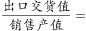
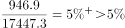
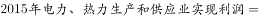
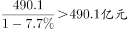
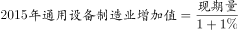
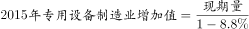
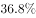
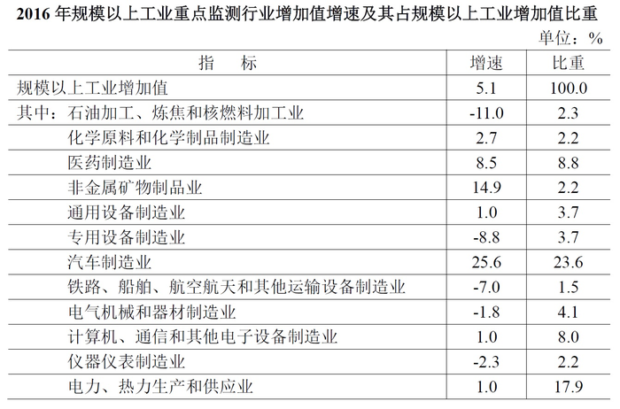

# 综合判断题（混合增速居中＋现期比重直除＋下降类基期值＋基期量比较）

考点：[[20-考点/资料分析/综合/综合判断题（混合增速居中＋现期比重直除＋下降类基期值＋基期量比较）|综合 / 综合判断题（混合增速居中＋现期比重直除＋下降类基期值＋基期量比较）]]
材料：[[15-材料/资料分析/191728 2016年某市工业经济运行情况：全市|191728 2016年某市工业经济运行情况：全市]]

**问法模型**：'能够从上述资料中推出的是'→四个选项各自独立验证的综合判断题：混合增速居中定性判A、部分÷整体直除对照阈值验B、下降基期=现期÷(1−降幅)验C、现期相同比1/(1+r)验D。

## 推理链
1. 第1步（A项）：全市工业=规模以上＋规模以下，全市工业增加值增速是两部分的混合增速，由混合增速居中，全市增速介于规上与规下之间；官方口径全市增速低于规上增速（表格确认规上增速5.1%），故规下增速＜全市增速＜5.1%，规下慢于规上，A错误
2. 第2步（B项）：从文字材料取2016年规上销售产值17447.3亿元、出口交货值946.9亿元，比重=946.9÷17447.3
3. 第3步：17447.3×5%≈872.4＜946.9，故比重＞5%；直除验证946.9÷17447.3≈5.4%，超过B项所设比重阈值（官方判定成立），B正确
4. 第4步（C项）：电力热力2016年利润490.1亿元且为'下降'，基期2015年=490.1÷(1−降幅)，因降幅＞0，基期恒大于490.1亿元，不可能是'450多亿元'，C错误
5. 第5步（D项）：表格中通用设备制造业比重3.7%、专用设备制造业比重3.7%，同一分母（规上工业增加值）下比重相等→2016年两者增加值相等，设为A
6. 第6步：2015年通用=A÷(1+1.0%)≈0.990A，2015年专用=A÷(1−8.8%)=A÷0.912≈1.096A，故2015年通用＜2015年专用，'通用不低于专用'不成立，D错误
7. 第7步：仅B项能从资料推出，故选B

**最快解法**：⚡ 先攻'一步直除'的B项锁定答案：946.9÷17447.3，用17447.3×5%≈872作参照（或截位直除）得约5.4%，超过阈值即选B；其余选项定性秒杀：A用混合增速居中（整体增速居中于规上、规下之间），C用'下降则基期=490.1÷(1−降幅)＞490.1'直接否定'450多亿'，D用比重相同→现期相等、只比1/(1+r)（专用1/0.912≈1.10＞通用1/1.01≈0.99）排大小。

## 易错点
- ⚠ C项符号陷阱：利润'下降'时基期=现期÷(1−降幅)，结果恒大于490.1亿元；若误用'÷(1+降幅)'会算出小于490.1的假基期（恰可能落入'450多'区间）而误选C
- ⚠ 跨源同名不同义：文字段的490.1/367.8/150.7/84.8/73.9等是'利润'（亿元＋利润增速），表格中的8.5/−8.8/3.7等是'增加值'的增速与比重；C项必须取文字利润、D项必须取表格增加值，拿错列即错
- ⚠ 分母与混合口径：B项比重分母是销售产值17447.3亿元（非增加值）；表格'比重'列分母是规上工业增加值（非全市工业增加值3884.9亿元）；A项须先确认全市增速低于规上5.1%再用居中原理推规下，不可默认规下更快

## 母题抽象
> 🧩 当综合判断题出现'整体=两部分混合增速''部分占整体比重超某分数''下降年份的基期值区间表述''两行业比重相同比较基期'四类表述时：混合用居中定性判断、比重用部分÷整体直除对照特殊分数阈值、下降类基期恒大于现期可秒杀区间表述、基期比较只比1/(1+r)的大小。

**同类特征**：能够从上述资料中推出的是、综合判断四选项独立验证、混合增速居中（全市=规上＋规下）、出口交货值占销售产值比重、下降年份基期利润区间（450多亿元）、比重相同→现期相等→比基期

## 相关题
- [[10-真题/资料分析/综合/5430282 综合判断题（给增量求增长率、基期量计算、月均计算、两期比重升降比较）|5430282]]（浙江 2023，相关度2）
- [[10-真题/资料分析/综合/19283943 综合分析判断题（倍数比较+求和判断+隐含平均每场座位数反推）|19283943]]（国考 2025，相关度1）
- [[10-真题/资料分析/综合/1796162 综合判断（月均计算、平均运输距离、比重对比、增长量比较逐项验证）|1796162]]（贵州 2016，相关度1）
- [[10-真题/资料分析/综合/2133504 综合判断题（现期比重+现期平均数多项验证，一对三错）|2133504]]（国考 2018，相关度1）
- [[10-真题/资料分析/综合/2444706 综合判断题（增长量+比重+倍数逐项验证）|2444706]]（四川 2019，相关度1）

---

### 题干
能够从上述资料中推出的是：

### 选项
- A. 
2016年该市规模以下工业增加值增速快于规模以上工业增加值增速

- B. 
2016年该市规模以上工业出口交货值占销售产值的比重超过
　✅
- C. 
2015年该市电力、热力生产和供应业实现利润450多亿元

- D. 
2015年该市通用设备制造业增加值不低于专用设备制造业增加值

### 官方解析

A项：根据文字材料可知该市工业增加值的增速为，而规模以上工业增加值增速为。该市工业分成规模以上工业和规模以下工业两个部分，因此该市工业增加值的增速是由规模以上工业增加值的增速和规模以下工业增加值的增速混合得到，根据混合增速居中，可知规模以下工业增加值的增速应小于，因此2016年规模以下工业增加值增速慢于规模以上工业增加值增速，A项错误；

B项：根据文字材料可知2016年规模以上工业实现销售产值17447.3亿元，出口交货值946.9亿元，比重为，B项正确；

C项：根据文字材料可知2016年电力、热力生产和供应业实现利润490.1亿元，下降，则，C项错误；

D项：根据表格材料可知2016年通用设备制造业增加值和专用设备制造业增加值所占的比重均为，故二者2016年的增加值相等。，，由于二者2016年增加值即现期量相同，所以2015年通用设备制造业增加值小于2015年专用设备制造业增加值，D项错误。

故正确答案为B。

### 给定材料

<b>三、根据下列统计资料回答问题 </b>

      2016年，某市全年实现工业增加值3884.9亿元，比上年增长。其中，规模以上工业增加值增长。在规模以上工业中，国有控股企业增加值增长；股份合作企业、外商及港澳台企业增加值分别增长和；高技术制造业、现代制造业、战略性新兴产业增加值分别增长、和。规模以上工业实现销售产值17447.3亿元，增长。其中，内销产值16500.4亿元，增长；出口交货值946.9亿元，下降。

       规模以上工业企业实现利润1549.3亿元，比上年下降。重点行业中，电力、热力生产和供应业实现利润490.1亿元，下降；汽车制造业实现利润367.8亿元，增长；医药制造业实现利润150.7亿元，增长；计算机、通信和其他电子设备制造业实现利润84.8亿元，增长；专用设备制造业实现利润73.9亿元，增长。

> [!warning] 疑点（官方解析可能有误，待人工复核）
> 非官方解析错误之记录：所给文本中文字段各增速百分数与官方解析中的数值均显示为空缺，B项阈值公式为图片（按官方结论与946.9÷17447.3≈5.4%推断为5%即1/20量级），验证须以原卷数值代入；不影响答案B的成立。

<!-- CODEX-ANSWER-REVIEW:BEGIN -->
### 本次独立复核

**复核状态：** `resolved`（答案与解析已核定）

**计分答案：** B（可计分）

**复核解析：**

1. 第1步（A项）：全市工业=规模以上＋规模以下，全市工业增加值增速是两部分的混合增速，由混合增速居中，全市增速介于规上与规下之间；官方口径全市增速低于规上增速（表格确认规上增速5.1%），故规下增速＜全市增速＜5.1%，规下慢于规上，A错误
2. 第2步（B项）：从文字材料取2016年规上销售产值17447.3亿元、出口交货值946.9亿元，比重=946.9÷17447.3
3. 第3步：17447.3×5%≈872.4＜946.9，故比重＞5%；直除验证946.9÷17447.3≈5.4%，超过B项所设比重阈值（官方判定成立），B正确
4. 第4步（C项）：电力热力2016年利润490.1亿元且为'下降'，基期2015年=490.1÷(1−降幅)，因降幅＞0，基期恒大于490.1亿元，不可能是'450多亿元'，C错误
5. 第5步（D项）：表格中通用设备制造业比重3.7%、专用设备制造业比重3.7%，同一分母（规上工业增加值）下比重相等→2016年两者增加值相等，设为A
6. 第6步：2015年通用=A÷(1+1.0%)≈0.990A，2015年专用=A÷(1−8.8%)=A÷0.912≈1.096A，故2015年通用＜2015年专用，'通用不低于专用'不成立，D错误
7. 第7步：仅B项能从资料推出，故选B

**最快解法**：⚡ 先攻'一步直除'的B项锁定答案：946.9÷17447.3，用17447.3×5%≈872作参照（或截位直除）得约5.4%，超过阈值即选B；其余选项定性秒杀：A用混合增速居中（整体增速居中于规上、规下之间），C用'下降则基期=490.1÷(1−降幅)＞490.1'直接否定'450多亿'，D用比重相同→现期相等、只比1/(1+r)（专用1/0.912≈1.10＞通用1/1.01≈0.99）排大小。

**相关信息：**

考点：综合判断题（混合增速居中＋现期比重直除＋下降类基期值＋基期量比较）。来源：2018年北京市公务员录用考试《行测》题（网友回忆版）；2018年。> 🧩 当综合判断题出现'整体=两部分混合增速''部分占整体比重超某分数''下降年份的基期值区间表述''两行业比重相同比较基期'四类表述时：混合用居中定性判断、比重用部分÷整体直除对照特殊分数阈值、下降类基期恒大于现期可秒杀区间表述、基期比较只比1/(1+r)的大小。

**同类特征**：能够从上述资料中推出的是、综合判断四选项独立验证、混合增速居中（全市=规上＋规下）、出口交货值占销售产值比重、下降年份基期利润区间（450多亿元）、比重相同→现期相等→比基期

**题源依据：** [固定版本原题](https://github.com/Mentat-Uran/kaogongzhentizhengliu/blob/84ab93d4b64b61d897bece8a1c0a5bab06b4feb2/10-%E7%9C%9F%E9%A2%98/%E8%B5%84%E6%96%99%E5%88%86%E6%9E%90/%E7%BB%BC%E5%90%88/2136920%20%E7%BB%BC%E5%90%88%E5%88%A4%E6%96%AD%E9%A2%98%EF%BC%88%E6%B7%B7%E5%90%88%E5%A2%9E%E9%80%9F%E5%B1%85%E4%B8%AD%EF%BC%8B%E7%8E%B0%E6%9C%9F%E6%AF%94%E9%87%8D%E7%9B%B4%E9%99%A4%EF%BC%8B%E4%B8%8B%E9%99%8D%E7%B1%BB%E5%9F%BA%E6%9C%9F%E5%80%BC%EF%BC%8B%E5%9F%BA%E6%9C%9F%E9%87%8F%E6%AF%94%E8%BE%83%EF%BC%89.md)；固定内容 commit `84ab93d4b64b61d897bece8a1c0a5bab06b4feb2`，Markdown blob `75321d4e62ad7f7c0eb9e74bbaee981071dcb21e`。
<!-- CODEX-ANSWER-REVIEW:END -->
