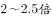

# 综合判断（比重单调性验证＋同年比重比求倍数＋增长率计算＋跨图总量×比重求倍数）

考点：[[20-考点/资料分析/综合/综合判断（比重单调性验证＋同年比重比求倍数＋增长率计算＋跨图总量×比重求倍数）|综合 / 综合判断（比重单调性验证＋同年比重比求倍数＋增长率计算＋跨图总量×比重求倍数）]]
材料：[[15-材料/资料分析/191736 2000～2011年世界发电量总量变|191736 2000～2011年世界发电量总量变]]

**问法模型**：'能够从上述资料中推出的是'的四选项综合判断 → 对A(逐年比重比≥2)、B(增长率阈值)、C(跨图倍数区间)、D(比重列单调性)逐项验证，锁定唯一正确项

## 推理链
1. 第1步：A项提取表格2000～2005年比重：燃煤38.90/38.66/38.93/40.15/39.59/39.88，天然气17.60/18.44/18.99/19.24/19.70/20.20；同年世界总发电量相同，发电量倍数=比重之比
2. 第2步：2005年39.88÷20.20：因20.20×2=40.40＞39.88，故不足2倍（此前年份如2004年39.59＞19.70×2=39.40勉强超2倍），'每年都超过2倍'不成立，A项错误
3. 第3步：B项从折线图取2004年17.50、2005年18.27万亿千瓦时，增长量0.77，增长率=0.77÷17.50≈4.4%，未达到图示阈值（5%），B项错误
4. 第4步：C项跨图拼合：2011年其他发电量=22.16×5.71%≈1.27万亿千瓦时，2000年=15.42×2.45%≈0.38万亿千瓦时，倍数≈1.27÷0.38≈3.35倍，超出选项所给倍数区间，C项错误
5. 第5步：D项纵扫表格石油列，2000～2010年比重依次为7.35→7.10→6.80→6.51→6.33→5.61→4.98→4.78→4.55→4.18→3.73，严格逐年下降，D项正确
6. 第6步：与选项对照，唯一能推出的是D

**最快解法**：⚡ 综合判断优先做零计算项：D项只需纵扫石油一列验证11个数字单调递减（7.35→…→3.73）即可锁定答案；其余项用口算排除——A项'比重×2比较法'（20.20×2=40.40＞39.88即2005年不足2倍）；B项截位直除0.77/17.5≈4.4%；C项倍数拆乘(22.16/15.42)×(5.71/2.45)≈1.44×2.33≈3.35

## 易错点
- ⚠ D项时间范围是2000～2010年、不含2011年：石油比重2011年为3.91%较2010年3.73%回升，若把范围看成到2011年就会误判D错误——末年是否纳入是本题最大陷阱
- ⚠ C项必须跨图拼合'总量×比重'，若只算比重倍数5.71/2.45≈2.33而漏乘总量因子22.16/15.42≈1.44，会得出约2.3倍的错误结论；且843.70亿与万亿量级差10^4的换算陷阱在本组第4题中同样警示单位口径
- ⚠ A项2005年39.88与2倍阈值40.40仅差0.52、2004年39.59与39.40仅差0.19，粗放心算易误判'每年超过2倍'成立；折线图纵轴从15起步视觉放大斜率，B项增长率不能目测陡峭程度，须用0.77/17.50计算

## 母题抽象
> 🧩 当题干出现'能够从上述资料中推出的是'时，先验证无需计算的纯数据性质选项（某列单调性、极值、范围），注意核对表述的时间范围是否含末年；倍数类表述用'同年总量相同→发电量倍数=比重倍数'、'跨年倍数=(总量比)×(比重比)'两个模型速算排除

**同类特征**：能够从上述资料中推出的是、逐年下降、超过……的2倍、增长……以上、跨图拼合（总量×比重）、时间范围不含末年

## 相关题
- [[10-真题/资料分析/综合/2444706 综合判断题（增长量+比重+倍数逐项验证）|2444706]]（四川 2019，相关度2）
- [[10-真题/资料分析/综合/2376546 综合判断（多陈述真伪验证＋差值倒推基期）|2376546]]（黑龙江 2019，相关度2）
- [[10-真题/资料分析/综合/19283943 综合分析判断题（倍数比较+求和判断+隐含平均每场座位数反推）|19283943]]（国考 2025，相关度1）
- [[10-真题/资料分析/综合/10297333 综合分析选非题（同比增速逐年比较+年均增长量+比重百分点还原）|10297333]]（浙江 2025，相关度1）
- [[10-真题/资料分析/综合/1796162 综合判断（月均计算、平均运输距离、比重对比、增长量比较逐项验证）|1796162]]（贵州 2016，相关度1）

---

### 题干
能够从上述资料中推出的是：

### 选项
- A. 
2000～2005年，每年燃煤发电量都超过天然气发电量的2倍

- B. 
2005年世界发电量较2004年增长了以上

- C. 
2011年其他发电量是2000年其他发电量的之间

- D. 
2000～2010年间，石油发电量占世界发电量比重逐年下降
　✅

### 官方解析
A项：定位折线图，2005年世界发电量为18.27万亿千瓦时。定位表格材料，2005年燃煤发电量占世界发电量的比重为，天然气发电量占世界发电量的比重为。则2005年燃煤发电量为天然气发电量的倍数为，错误；
B项：定位折线图，2004年世界发电量为17.50万亿千瓦时，2005年世界发电量为18.27万亿千瓦时。则2005年世界发电量较2004年增长率为，错误；
C项：定位折线图，2000、2011年世界发电量分别为15.42万亿千瓦时、 22.16万亿千瓦时。定位表格材料，2000、2011年其他发电量占世界发电量的比重分别为、，则2011年其他发电量与2000年其他发电量的倍数关系为，错误；
D项：定位表格材料倒数第二列，2000-2010年石油发电量占世界发电量的比重逐年下降（本题比较范围不包括2011年），正确。
故正确答案为D。

### 给定材料

<b>一、根据下列统计资料回答问题</b>

