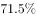
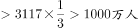
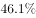
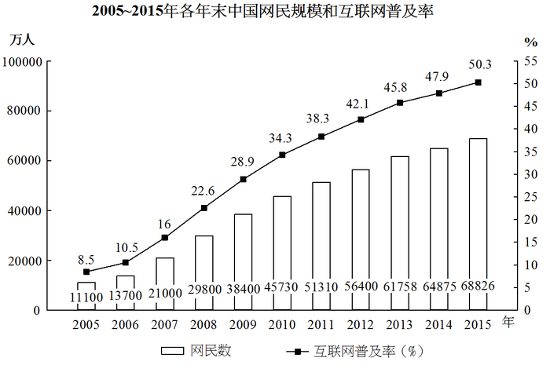

# 综合判断题（翻番验证＋时段增量＋百分点回推＋比重推算，逐项排除）

考点：[[20-考点/资料分析/综合/综合判断题（翻番验证＋时段增量＋百分点回推＋比重推算，逐项排除）|综合 / 综合判断题（翻番验证＋时段增量＋百分点回推＋比重推算，逐项排除）]]
材料：[[15-材料/资料分析/192255 2005～2015年各年末中国网民规|192255 2005～2015年各年末中国网民规]]

**问法模型**：'能够从上述资料中推出的是'→逐项验证式综合判断：番数用×2ⁿ检验、时段增量用末年−基年（基年取时段首年上一年末）、'占比较上年提升x个百分点'用减法回推、人数判断用新增流量×占比

## 推理链
1. 第1步：A项验证：由柱状图取2005年末网民11100万人、2015年末68826万人，'翻三番'意为增至2³=8倍，11100×8=88800万人，而68826万人仅约为11100万人的6.2倍（约2.6番），不到三番，A错误
2. 第2步：B项验证：'十二五'指2011～2015年，增量=2015年末−2010年末（基期为时段前一年末），即68826−45730
3. 第3步：计算B：68826−45730=23096万人≈2.31亿人，属'2亿多'，B正确，锁定答案
4. 第4步：C项验证：文字给定'2015年新增网民中使用手机上网占比较2014年末提升了7.4个百分点'，故2014年新增网民手机占比=2015年占比−7.4个百分点（须回推），选项数值未作此回推（与回推结果不符），C错误
5. 第5步：D项验证：由图2014年新增网民=64875−61758=3117万人；文字给定台式电脑占比'较2014年有所下降'，即2014年占比大于2015年占比，以原文占比计算，3117×该占比超过1000万人，'不到1000万人'不成立，D错误

**最快解法**：⚡ 先做B（纯读图作差）：68826−45730=23096万≈2.3亿，直接锁定'2亿多'为正确项；再用倍数速判排除A：68826÷11100≈6.2<8（三番=8倍）；C、D各用一次'−7.4个百分点'回推与'3117万×占比'量级估算即可复核

## 易错点
- ⚠ '翻三番'误当3倍：三番=2³=8倍，68826约为11100的6.2倍，介于两番（4倍）与三番（8倍）之间，易误判A正确
- ⚠ '十二五'基期误取2011年末：若用68826−51310=17516万（约1.75亿），会错判B为'不到2亿'；正确基期为2010年末45730万
- ⚠ C、D的方向与口径陷阱：'提升7.4个百分点'须用2015年占比作减法回推2014年，'较2014年下降'意味着2014年占比更大；且D须用新增流量3117万人（64875−61758）乘占比，勿误用存量64875万，也勿把新增总量3951万当2014年新增

## 母题抽象
> 🧩 当题干出现'能够从上述资料中推出的是'且选项混编番数、时段增量、百分点回推、占比×人数时，逐项套小模型：翻n番=×2ⁿ、时段增量=末年−上年末、上年占比=今年占比−提升的百分点、人数=新增流量×占比，量级对比选项表述即可排除

**同类特征**：能够从上述资料中推出的是、翻了三番、十二五（2011～2015年）期间新增、占比较2014年末提升7.4个百分点、较2014年有所下降、不到1000万人

## 相关题
- [[10-真题/资料分析/综合/19283943 综合分析判断题（倍数比较+求和判断+隐含平均每场座位数反推）|19283943]]（国考 2025，相关度1）
- [[10-真题/资料分析/综合/1796162 综合判断（月均计算、平均运输距离、比重对比、增长量比较逐项验证）|1796162]]（贵州 2016，相关度1）
- [[10-真题/资料分析/综合/2133504 综合判断题（现期比重+现期平均数多项验证，一对三错）|2133504]]（国考 2018，相关度1）
- [[10-真题/资料分析/综合/2444706 综合判断题（增长量+比重+倍数逐项验证）|2444706]]（四川 2019，相关度1）
- [[10-真题/资料分析/综合/2571728 综合分析逐项判断（等差递推求和＋单位换算＋比值估算）|2571728]]（山东 2020，相关度1）

---

### 题干
能够从上述资料中推出的是：

### 选项
- A. 
2015年末我国网民人数比2005年末翻了三番

- B. 
“十二五”（2011～2015年）期间中国新增2亿多网民
　✅
- C. 
2014年新增网民中，的人使用手机上网

- D. 
2014年新增网民中，不到1000万人使用台式电脑上网

### 官方解析

A项：定位柱形图，2005年末全国网民数为11100万人，2015年末全国网民数为68826万人，，不到3番，错误；

B项：定位柱形图，2010年末全国网民数为45730万人，2015年末全国网民数为68826万人，则“十二五”（2011~2015年）共增长，新增2亿多人，正确；

C项：定位文字材料第二段“2015年新增网民中，的人使用手机上网，占比较2014年末提升了7.4个百分点”可知，2014年新增网民中使用手机上网的人数占比为，错误；

D项：定位文字材料第二段“的人使用台式电脑上网，较2014年有所下降”可知，2014年使用台式电脑上网的人数占比应大于。由柱形图可知2014年新增网民数。其中，错误。

故正确答案为B。

### 给定材料

        2015年末，全国网民人数为68826万人，互联网普及率（网民人数占总人口数的比重）为。

        2015年新增网民中，低龄（19岁以下）、学生群体占比分别为、。2015年新增网民中，的人使用手机上网，占比较2014年末提升了7.4个百分点；的人使用台式电脑上网，较2014年有所下降。

