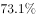

# 综合判断题：占比↔天数换算、口径包含关系构造上界、间隔增速(1+r)²、增量可求性逐项验证

考点：[[20-考点/资料分析/综合/综合判断题：占比↔天数换算、口径包含关系构造上界、间隔增速(1+r)²、增量可求性逐项验证|综合 / 综合判断题：占比↔天数换算、口径包含关系构造上界、间隔增速(1+r)²、增量可求性逐项验证]]
材料：[[15-材料/资料分析/192254 2015年7月空气质量月报对比：京津|192254 2015年7月空气质量月报对比：京津]]

**问法模型**：题干为'能够从上述资料中推出的是'的综合判断问法 → 对四个选项分别套用'占比×31天找临界值''重度污染⊆超标再叠加4.4个百分点比重差构造上界''(1+r)²与两倍的临界增速√2−1比较''缺基期浓度值则同比增量不可求'四类模型逐项验证。

## 推理链
1. 第1步：提取条件——2015年7月共31天；材料中完整给出的关键数值只有'京津冀平均重度污染天数占比比74城高4.4个百分点'；A、B、C验证所需的74城2015年7月达标占比a、京津冀PM2.5同比增速r在题面中均为空白缺失，须按原卷补齐后代入。
2. 第2步（A项）：平均达标天数=达标占比×31天，'超过25天'要求占比>25/31≈80.6%；官方解析代入原卷a值后判定达标天数未超过25天，A错误。
3. 第3步（B项口径规则）：重度污染天数只是超标天数的组成部分，故74城重度污染天数占比一定不超过74城超标占比=1−a。
4. 第4步（B项叠加比重差）：京津冀重度污染占比=74城重度占比+4.4个百分点，故一定小于(1−a)+4.4个百分点。
5. 第5步（B项换算验证）：京津冀13城平均重度污染天数<[(1−a)+4.4%]×31天，'少于11天'只需a>1−(11/31−4.4%)≈68.9%；代入原卷补齐的a值后，天数上限明显低于11天，'一定少于11天'成立，B正确。
6. 第6步（C项）：2017年7月相对2015年7月间隔两年，比值为(1+r)²；'超过两倍'要求r>√2−1≈41.4%；官方解析代入原卷r值算得间隔增速(1+r)²−1不足100%，C错误。
7. 第7步（D项）：同比增量=基期浓度×r，材料只给增速r（且四个增速数值空白）而未给PM2.5与PM10任何浓度水平值，两污染物增量均不可求、更无法比较高低，D错误。
8. 第8步：A、C、D均不能推出，仅B成立，与官方答案B一致。

**最快解法**：⚡ 选项秒杀法：先攻B——利用'重度污染⊆超标'，京津冀重度污染占比<74城超标占比+4.4个百分点，只要74城2015年7月达标占比>68.9%（由11/31≈35.5%−4.4%反推）即得天数一定<11天，代入原卷补齐值一步锁定B；再用临界值快速排他：A看25/31≈80.6%，C看√2−1≈41.4%，D查'材料无浓度基期值'直接判'无法推出'。

## 易错点
- ⚠ B项命门是口径包含关系：'重度污染'只是'超标'的一部分，须先给74城重度污染占比封顶（≤其超标占比1−a），再叠加4.4个百分点跨区域比重差；若把'重度污染占比'与'达标/超标占比'两套口径直接混算，或误以为比重差不能跨区域叠加，会误判B'推不出'。
- ⚠ 占比与天数必须换算且按31天计：A项临界占比=25/31≈80.6%，B项临界占比=11/31≈35.5%；忘乘天数、误按30天算，或把'达标占比下降6个百分点'错看成'超标占比下降'（实为超标占比上升6个百分点）都会误判。
- ⚠ C项时间跨度与D项数据完整性陷阱：2015→2017间隔两年必须用(1+r)²而非增速×2，临界增速为√2−1≈41.4%；D项'增速高'≠'同比增量大'，材料未给任何浓度水平值（基期/现期均无），增量根本不可求。

## 母题抽象
> 🧩 当题干出现'能够从上述资料中推出的是'且选项含'一定/必然'类绝对化表述时，用逐项验证法：占比与天数互换时乘当月实际天数找临界值；'一定少于N天'用子集口径（重度污染⊆超标）构造占比上界再×天数；隔n年翻倍用(1+r)^n对比临界增速√2−1；问同比增量先查材料是否给出基期量，缺则直接判'无法推出'。

**同类特征**：能够从上述资料中推出的是（综合判断四选一）、一定少于11天（绝对化表述+上界构造）、重度污染天数与超标/达标天数两套口径并存、比重差4.4个百分点换算成天数（×31天）、保持增速推两年后浓度（间隔增速(1+r)²与'两倍'比较）、同比增量比较但材料缺浓度基期值

## 相关题
- [[10-真题/资料分析/综合/10297091 综合判断题（增长量计算+两期比重比较+余量求比重+个数差求基期，逐项排除）|10297091]]（天津 2025，相关度1）
- [[10-真题/资料分析/综合/1746810 综合判断题（正确项核心为混合增长率居中比较单季增速，兼查两期平均数、比重、间隔倍数）|1746810]]（国考 2016，相关度1）
- [[10-真题/资料分析/综合/17900765 综合分析正误判断（混合比重居中＋两期比重结论＋累计差分求单季＋月平均计算）|17900765]]（江苏 2024，相关度1）
- [[10-真题/资料分析/综合/2133514 综合判断四选一（A基期数据链缺失判断、B跨段差值、C同比降幅比较、D两期比重升降比较）|2133514]]（国考 2018，相关度1）
- [[10-真题/资料分析/综合/2719414 综合判断题（两期作差＋混合增长率＋两期比重比较＋逆差计算）|2719414]]（国考 2021，相关度1）

---

### 题干
关于2015年7月空气质量状况，能够从上述资料中推出的是：

### 选项
- A. 全国74个城市当月平均达标天数超过25天
- B. 京津冀区域13个城市当月平均重度污染天数一定少于11天　✅
- C. 如保持当月同比增速，2017年7月京津冀区域PM2.5浓度将超过2015年7月的两倍
- D. 长三角区域25个城市当月PM2.5浓度同比增量高于PM10浓度同比增量

### 官方解析
A项：定位文字材料第一段，“而与上年同期相比，74个城市平均达标天数占比也由下降到”，则2015年7月达标天数有，错误；
B项：定位文字材料第一段，74个城市平均达标天数占比为，则不达标占比为，意味着74个城市重度污染天数占比一定小于。则京津冀区域平均重度污染天数占比一定小于，则当月重度污染天数小于天，正确；
C项：定位文字材料第二段，2015年7月京津冀区域PM2.5浓度同比上升，则2017年7月与2015年7月相比，间隔增速为，，错误；
D项：定位文字材料第二段，“长三角区域25个城市平均PM2.5和PM10浓度分别上升和”，但材料中没有PM2.5和PM10浓度当月或者去年同期具体数值，无法计算，错误。
故正确答案为B。

### 给定材料

        2015年7月，京津冀区域13个城市空气质量超标天数平均占当月总天数的，平均达标天数比上年同期下降6个百分点。与全国74个城市相比，京津冀区域平均重度污染天数占比高4.4个百分点。而与上年同期相比，74个城市平均达标天数占比也由下降到。

        与上年同期相比，2015年7月京津冀区域13个城市平均PM2.5和PM10浓度分别上升和，长三角区域25个城市平均PM2.5和PM10浓度分别上升和。

> [!warning] 疑点（官方解析可能有误，待人工复核）
> 所给题面与官方解析多处关键数值被截断为空白（74城2015年7月达标占比、京津冀及长三角四个PM2.5/PM10增速），解析中'由下降到''一定小于'等处断句残缺，A、B、C的数值复核需按原卷补齐后代入；解析判定方向与答案B无误，且B项成立只需74城2015年7月达标占比>68.9%，不影响结论。
