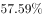
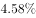
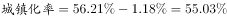
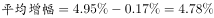

# 综合判断（说法正误计数）：基期城镇化率推算＋增幅之差推算＋年均增幅比较

考点：[[20-考点/资料分析/综合/综合判断（说法正误计数）：基期城镇化率推算＋增幅之差推算＋年均增幅比较|综合 / 综合判断（说法正误计数）：基期城镇化率推算＋增幅之差推算＋年均增幅比较]]
材料：[[15-材料/资料分析/192279 2012-2016年S省城镇化水平：|192279 2012-2016年S省城镇化水平：]]

**问法模型**：'下列说法中错误的有几个'→逐句独立验算模型：每句先定位数据、按'率差加减（百分点）'规则算出正确值，再与句中数值比对，最后数错误句数对照选项

## 推理链
1. 第1步：提取核心数据——2016年末城镇常住人口2069.63万人、常住总人口3681.61万人；城镇化率比2015年提高1.18个百分点、比2012年提高4.95个百分点、高于全国平均增幅0.17个百分点；与全国差距由1.31缩至1.14个百分点；E/F/G市年均提高1.56、1.62、1.53个百分点
2. 第2步：验句(1)——2016年城镇化率=2069.63÷3681.61≈56.2%，则2015年城镇化率=56.2%−1.18%≈55.0%（与图中2015年S省柱≈55.0%吻合），句(1)所给数值与≈55.0%不符→错误
3. 第3步：验句(2)——全国2012-2016年增幅=4.95−0.17=4.78个百分点（交叉验证：差距缩小量1.31−1.14=0.17=4.95−4.78；读图全国57.4%−52.6%≈4.8亦吻合），句(2)所给数值与4.78个百分点不符→错误
4. 第4步：验句(3)——比较三市年均提高幅度：G市1.53<E市1.56<F市1.62，最低应为G市而非E市→错误
5. 第5步：三句均错误，错误说法共3个，对照选项选D

**最快解法**：⚡ 逐句秒杀法：句(3)直接比大小1.53<1.56<1.62→最低是G市，句(3)错；句(2)用'4.95−0.17=4.78个百分点'核对句中数值（防止误用0.17或重复相减）→不符即错；句(1)先用截位直除还原2016年率2069.63/3681.61≈56.2%，再减1.18个百分点得≈55.0%→句中数值不符即错；三句全错选D

## 易错点
- ⚠ 基期现期混淆＋百分点运算：'提高1.18个百分点'是率差只能减不能乘除，2015年率必须先还原被挖空的2016年率（2069.63÷3681.61≈56.2%）再减1.18，误把56.2%当2015年率即中招；'较2015年末增加53.26万人'是增长量，求基期人口需做减法
- ⚠ 口径陷阱：材料中'全国平均增幅'即这一时期总增幅4.95−0.17=4.78个百分点（由差距1.31→1.14缩小0.17可交叉验证），勿误用0.17个百分点当增幅、或再减一次得4.61
- ⚠ 比较对象看错：'年均增长率1.56、1.62、1.53'单位实为个百分点，只需数值比大小，最低是G市1.53；勿被'E、F、G'的列举顺序或'均实现较快增长'表述带偏选成E市

## 母题抽象
> 🧩 当综合判断题出现'基期率=现期率−提高的百分点''两对象增幅之差=总增幅差'与'多值比大小找最低'的组合时，逐句独立验算并数错句数，全程守住'百分点只加减'与材料口径

**同类特征**：下列说法中错误的有（）个、2015年城镇化率（基期率需由现期率减1.18个百分点推算）、全国城镇化水平平均增幅（需4.95−0.17=4.78个百分点）、年均增长率最低的是（1.56/1.62/1.53比大小）、城镇化率数值被挖空须自行还原、百分点与百分比混用、错误句数计数

## 相关题
（暂无）

---

### 题干

根据上述资料，下列说法中<b>错误</b>的有（  ）个。

（1）2015年，S省城镇化率为

（2）2012-2016年间，全国城镇化水平平均增幅为

（3）2012-2016年间，S省城镇化水平较低的城市中，年均增长率最低的是E市

### 选项
- A. 0
- B. 1
- C. 2
- D. 3　✅

### 官方解析

（1）定位文字材料第一段“2016年······城镇化率达，比2015年提高1.18个百分点。” 2015年S省。错误；

（2）定位文字材料第一段“······与2012年相比，城镇化率提高了4.95个百分点，高于这一时期全国平均增幅0.17个百分点······”，可知全国城镇化水平，错误；

（3）定位文字材料第三段“2016年，全省11个市中城镇人口超过的市由2012年的5个增加为8个。城镇化水平较低的E市、F市、G市均实现了较快的增长，年均增长率分别达到1.56、1.62和1.53个百分点。” 年均增长率最低的是G市，错误。

则说法中错误的有3个。

故正确答案为D。

### 给定材料

        2012-2016年，S省城镇化水平快速提高。2016年末，S省常住人口3681.61万人，其中居住在城镇区域的常住人口2069.63万人，较2015年末增加53.26万人；城镇化率达，居全国第16位，比2015年提高1.18个百分点。

        与2012年相比，城镇化率提高了4.95个百分点，高于这一时期全国平均增幅0.17个百分点。与全国城镇化平均水平的差距由2012年的1.31个百分点缩小为1.14个百分点。

2016年，全省11个市中城镇人口超过的市由2012年的5个增加为8个。城镇化水平较低的E市、F市、G市均实现了较快的增长，年均增长率分别达到1.56、1.62和1.53个百分点，区域间城镇化水平差距进一步缩小，全省城镇化保持了较快的增长势头。

> [!warning] 疑点（官方解析可能有误，待人工复核）
> 题干三个分句的待判定数值及官方解析对应数值均被挖空，无法逐字核对原句表述；按官方'三句皆错'结论反推各句正确值应为：句(1)2015年城镇化率≈55.0%（56.2%−1.18%）、句(2)全国增幅4.78个百分点、句(3)最低为G市1.53；另注意材料中'平均增幅'口径实为这一时期总增幅（非除以4的年均值），做题须沿用材料口径
