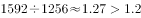
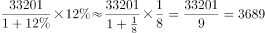
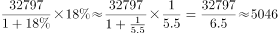
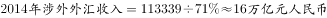

# 综合判断题·倍数关系验证与顺逆差符号辨析

考点：[[20-考点/资料分析/综合/综合判断题·倍数关系验证与顺逆差符号辨析|综合 / 综合判断题·倍数关系验证与顺逆差符号辨析]]
材料：[[15-材料/资料分析/193979 2014年中国银行结售汇（结汇-售汇|193979 2014年中国银行结售汇（结汇-售汇]]

**问法模型**：『下列说法正确的是』综合判断 → 逐项验证，先对可口算的倍数关系项（A）做同币种乘法比较，再用符号表述与量级换算快速排除C、D，最后处理需增速数据的B项

## 推理链
1. 第1步：从材料提取：2014年全年银行结售汇顺差7715亿元（等值1256亿美元）；一季度顺差1592亿美元（分季度数据仅给亿美元口径）
2. 第2步：规则：判断『一季度顺差是否超过全年顺差的1.2倍』，须统一为美元口径比较，即验证 1592 是否大于 1256×1.2
3. 第3步：计算：1256×1.2=1507.2亿美元，而1592>1507.2（等价于1592/1256≈1.27>1.2），A项成立
4. 第4步：排除B：涉外收入203855亿元、对外付款201375亿元，各自同比增速在给定文本中为空格，依官方解析结论，收入增长额小于付款增长额，B错误
5. 第5步：排除C：材料表述为『二季度降至290亿美元』——数值下降但符号未变，二季度仍为顺差290亿美元；转为逆差的是三季度（160亿美元），C项偷换『顺差/逆差』符号
6. 第6步：排除D：涉外收入203855亿元=20.3855万亿元<21万亿元（203855<210000），D项不成立
7. 第7步：结论：仅A正确，与官方答案一致

**最快解法**：⚡ 口算倍数法锁定A：全年顺差取美元口径1256亿美元，×1.2=1507.2亿美元<1592亿美元，一步即锁定答案；辅助秒杀——C项材料明写『转为逆差』发生在三季度，D项203855亿元不足21万亿元，均可直接排除

## 易错点
- ⚠ 『降至290亿美元』≠逆差：材料中只有『转为逆差』（三季度160亿美元）表示符号变负，二季度『降至』仅指数值下降仍为顺差，C项正是利用该表述设错
- ⚠ 币种口径混用：分季度顺差只给亿美元、全年顺差双口径并列，验证A必须用1256亿美元，若错用7715亿元与1592亿美元比较则量纲错误
- ⚠ D项量级陷阱：203855亿元≈20.39万亿元，与21万亿元相差约6000亿元，勿粗心进位误判为『超过21万亿』；另B项增速在文本中空缺，不能凭收入基数更大就臆断其增长额更大

## 母题抽象
> 🧩 当综合判断题出现『季度/当期值与全年值的倍数关系』且材料双币种并列时，先锁定同币种口径做乘法比较（全年值×倍数 vs 当期值），再用『降至/转为逆差』等符号变化词与单位量级换算排除表述偷换项

**同类特征**：下列说法正确的是（综合判断）、倍数比较（1.2倍）、顺差/逆差符号表述辨析（降至vs转为）、双币种并列需统一口径、亿元与万亿元量级换算、增长额大小比较

## 相关题
- [[10-真题/资料分析/综合/17900920 跨文字与表格拼合之两期总量比值计算（交易额=用户数×人均年消费额）|17900920]]（江苏 2024，相关度1）
- [[10-真题/资料分析/综合/2385119 综合判断题（进出口总额加总+增长量计算+趋势-倍数-增速逐项验证）|2385119]]（深圳市考 2019，相关度1）
- [[10-真题/资料分析/综合/2443054 综合判断题（混合增长率方向判断为主，辅以隔年基期两步折算、图表缺项可求性、无据归因排查）|2443054]]（辽宁 2019，相关度1）
- [[10-真题/资料分析/综合/1752634 综合判断题（混合比重居中定单月比重+折线图累计增速读图比较）|1752634]]（北京 2016，相关度1）
- [[10-真题/资料分析/综合/2187804 综合判断题（基期差值＋增长率比较＋部分差值＋混合居中多模型混合验证）|2187804]]（黑龙江 2018，相关度1）

---

### 题干
根据上文，下列说法正确的是（    ）。

### 选项
- A. 2014年一季度银行结售汇顺差比全年银行结售汇顺差的1.2倍还多　✅
- B. 2014年银行代客累计涉外收入增长额大于银行代客累计对外付款增长额
- C. 2014年二季度银行结售汇逆差为290亿美元
- D. 2014年涉外外汇收入超过21万亿元人民币

### 官方解析

A项：定位文字材料第一段，“2014年······累计结售汇顺差7715亿元人民币（等值1256亿美元）······一季度银行结售汇顺差1592亿美元”，，正确；

B项：定位文字材料第二段，2014年，银行代客累计涉外收入203855亿元人民币（等值33201亿美元），较上年增长，约同比增长亿美元；累计对外付款201375亿元人民币（等值32797亿美元），增长，约同比增长亿美元。收入小于付款，错误；

C项：定位文字材料第一段，“2014年，一季度银行结售汇顺差1592亿美元，二季度降至290亿美元”，即2014年二季度银行结售汇顺差为290亿美元，错误；

D项：定位文字材料，“2014年，银行代客累计结汇113339亿元人民币…衡量企业和个人结汇意愿的银行代客结汇占涉外外汇收入的比重（即结汇率）总体下降，······全年平均为”，则，错误。

故正确答案为A。

### 给定材料

        从银行结售汇数据看，2014年，银行累计结汇116422亿元人民币（等值18958亿美元），剔除汇率因素影响（下同），较上年增长，累计售汇108707亿元人民币（等值17702亿美元），增长，累计结售汇顺差7715亿元人民币（等值1256亿美元），下降。其中，银行代客累计结汇113339亿元人民币，累计售汇103742亿元人民币，累计结售汇顺差9597亿元人民币；银行自身累计结汇3084亿元人民币，累计售汇4965亿元人民币，累计结售汇逆差1882亿元人民币。一季度银行结售汇顺差1592亿美元，二季度降至290亿美元，三季度转为逆差160亿美元，四季度扩大为466亿美元。同期，银行代客累计远期结汇签约18442亿元人民币，累计远期售汇签约15015亿元人民币，累计远期净结汇3427亿元人民币，较上年下降。

        从银行代客涉外收付款数据看，2014年，银行代客累计涉外收入203855亿元人民币（等值33201亿美元），较上年增长，累计对外付款201375亿元人民币（等值32797亿美元），增长，累计涉外收付款顺差2480亿元人民币（等值404亿美元），下降。一、二季度累计涉外收付款顺差分别为455亿和407亿美元，三、四季度转为逆差200亿和258亿美元。衡量企业和个人结汇意愿的银行代客结汇占涉外外汇收入的比重（即结汇率）总体下降，由一季度的降至二、三季度的，四季度略有回升至，全年平均为，结汇率比上年回落了1个百分点；衡量购汇动机的银行代客售汇占涉外外汇支付的比重（即售汇率）逐季上升，由一季度的升至四季度的，全年为，售汇率比上年上升了6个百分点。

注：上述资料统计时，不同币种间价格换算采用当年平均汇率。

> [!warning] 疑点（官方解析可能有误，待人工复核）
> 官方解析B项的具体增速数值在给定文本与解析中均为空缺（『约同比增长 亿美元』后无数值），无法独立复核『收入增长额<付款增长额』的计算过程，但结论方向与材料口径一致；另D项官方用结汇率反推涉外收入，而材料已直接给出203855亿元，直接比较203855<210000即可，路径略绕但不影响结论

<!-- CODEX-ANSWER-REVIEW:BEGIN -->
### 本次独立复核

**复核状态：** `confirmed`（独立复算确认答案）

**计分答案：** A（可计分）

**复核解析：**

材料精确列出2014结售汇季度顺差：一季度1592亿美元、二季度290亿美元、三季度转逆差160亿美元、四季度逆差466亿美元。选项A关于季度顺逆差反转与数字相符。B涉外收入203855亿元高于付款201375亿元；C把一季度数误作二季度；D结汇率均值在文内给定且结汇率总体下降，题项断言不成立。

**相关信息：**

独立复核：资料分析综合判断；题图数据按单位与比较对象重新计算。

**题源依据：** [固定版本原题](https://github.com/Mentat-Uran/kaogongzhentizhengliu/blob/84ab93d4b64b61d897bece8a1c0a5bab06b4feb2/10-%E7%9C%9F%E9%A2%98/%E8%B5%84%E6%96%99%E5%88%86%E6%9E%90/%E7%BB%BC%E5%90%88/2166222%20%E7%BB%BC%E5%90%88%E5%88%A4%E6%96%AD%E9%A2%98%C2%B7%E5%80%8D%E6%95%B0%E5%85%B3%E7%B3%BB%E9%AA%8C%E8%AF%81%E4%B8%8E%E9%A1%BA%E9%80%86%E5%B7%AE%E7%AC%A6%E5%8F%B7%E8%BE%A8%E6%9E%90.md)；固定内容 commit `84ab93d4b64b61d897bece8a1c0a5bab06b4feb2`，Markdown blob `f21cc78675a1f1adbc42cbb193679472bb442f76`。
<!-- CODEX-ANSWER-REVIEW:END -->
