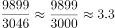
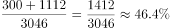
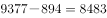
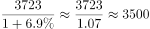
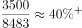
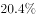

# 综合判断题（倍数计算+现期比重+基期比重的①②③正误组合判断）

考点：[[20-考点/资料分析/综合/综合判断题（倍数计算+现期比重+基期比重的①②③正误组合判断）|综合 / 综合判断题（倍数计算+现期比重+基期比重的①②③正误组合判断）]]
材料：[[15-材料/资料分析/194328 2012—2017年全国农村贫困人口|194328 2012—2017年全国农村贫困人口]]

**问法模型**：题干为'以下说法中错误的是'且分条给出倍数、占比、基期比重结论 → 逐条独立建模计算（9899/3046、(300+1112)/3046、3723/(1+增速)÷8483）并比对题干表述，再按错误项组合匹配选项。

## 推理链
1. 第1步：从材料提取数据——2012年末贫困人口9899万人、2017年末3046万人；东部300万人、中部1112万人；2017年贫困地区人均可支配收入9377元、比上年增加894元；2017年人均经营净收入3723元（其增速百分数在文本中缺失）
2. 第2步：验①用倍数模型：2012年末/2017年末=9899/3046
3. 第3步：截位直除得9899/3046≈3.25（因3046×3.25=9899.5），即约3.2倍而非3.8倍，①错误
4. 第4步：验②用现期比重模型：(300+1112)/3046=1412/3046≈46.4%，与官方判定一致，②正确
5. 第5步：验③先倒推基期——2016年人均可支配收入=9377−894=8483元，2016年人均经营净收入=3723/(1+增速)（增速须以试卷原图为准）
6. 第6步：基期比重=3723/(1+增速)÷8483，官方解析判定该比重未超过题干所给阈值，③错误
7. 第7步：说法错误的为①和③，对照选项组合选B。

**最快解法**：⚡ 逐条速算排除：①截位直除9899/3046≈3.2（3046×3.25≈9899.5），一眼否掉'3.8倍'；②加总后直除1412/3046≈46.4%；③基期比重公式法——先算9377−894=8483定分母，再用现期比重3723/9377≈39.7%锚定量级，代入原图增速即判'超过'不成立，锁定错误为①③→B。

## 易错点
- ⚠ ①倍数方向搞反：应为大年份2012末(9899)除以小年份2017末(3046)≈3.2倍，误倒算成3046/9899，或误把'比上年末减少1289万人'当增速参与计算
- ⚠ ②分母口径错：'占全国'分母必须是2017年末全国3046万人，勿误用2016年末倒推值4335万人，也别把分子1412当分母；另注意东中西之和应勾稽4335是2016年口径，2017年三区之和1412+西部1634=3046
- ⚠ ③基期倒推与加总口径：2016年人均可支配收入必须用9377−894=8483元，勿直接用现期9377元；经营净收入3723元是一产2826+二三产897的分项之和，勿误用2826或897；且经营净收入增速与题干阈值百分数在转录文本中缺失，须以试卷原图为准，不得凭空编造

## 母题抽象
> 🧩 当题干出现'以下说法中错误的是'且①②③混排倍数、现期比重、基期比重时，先用一步直除的条目（纯倍数、加总占比）快速定对错，基期条目按'现期±增减量'倒推基期值再套基期公式，最后将错误项组合对照选项作答。

**同类特征**：以下说法中错误的是、①②③组合选项(A.①和②/B.①和③/C.②和③/D.仅有③)、约为3.8倍、东、中部之和占全国……的比重、2016年……占……比重超过、纯文字长句嵌套数据、基期需倒推

## 相关题
（暂无）

---

### 题干

以下说法中错误的是（  ）。

①2012年末全国农村贫困人口约为2017年末的3.8倍；

②2017年东、中部地区农村贫困人口之和占全国农村贫困人口的；

③2016年贫困地区农村居民人均经营净收入占人均可支配收入的比重超过。

### 选项
- A. ①和②
- B. ①和③　✅
- C. ②和③
- D. 仅有③

### 官方解析

①定位文字材料第一段“截至2017年末，全国农村贫困人口从2012年末的9899万人减少至3046万人”，可得2012年末全国农村贫困人口约为2017年末的倍，错误；

②定位文字材料第一段可得“截至2017年末，全国农村贫困人口为3046万人”，第二段可得“分三大区域看，2017年东部地区农村贫困人口300万人；中部地区农村贫困人口1112万人”，代入公式：，故2017年东、中部地区农村贫困人口之和占全国农村贫困人口的，正确；

③定位文字材料第四段可得“2017年，贫困地区农村居民人均可支配收入9377元，比上年增加894元”，代入公式：，则2016年，贫困地区农村居民人均可支配收入为元。定位最后一段可得“2017年，贫困地区农村居民人均经营净收入3723元，增长”，代入公式：，则2016年，贫困地区农村居民人均经营净收入为元。2016年贫困地区农村居民人均经营净收入占人均可支配收入的比重约为，错误。

说法错误的为①和③。

故正确答案为B。

### 给定材料

        截至2017年末，全国农村贫困人口从2012年末的9899万人减少至3046万人，比上年末减少1289万人；贫困发生率从2012年的下降至，比上年末下降1.4个百分点。

        分三大区域看，2017年东、中、西部地区农村贫困人口全面减少。东部地区农村贫困人口300万人，比上年减少190万人；中部地区农村贫困人口1112万人，比上年减少482万人；西部地区农村贫困人口1634万人，比上年减少617万人。

        分省看，2017年各省农村贫困发生率普遍下降至以下。其中，农村贫困发生率降至及以下的省份有17个，包括北京、天津、河北、内蒙古、辽宁、吉林、黑龙江、上海、江苏、浙江、安徽、福建、江西、山东、湖北、广东、重庆。

        全国农村贫困监测调查显示，2017年，贫困地区农村居民人均可支配收入9377元，比上年增加894元。

        2017年贫困地区农村居民收入增速快于上年。其主要特点：一是粮食丰收，贫困地区农村居民出售农产品数量增加，粮食、肉羊等部分大宗农产品市场价格回升。农民家庭一产经营净收入人均2826元，增长，增速比上年提高0.5个百分点。二是随着产业扶贫、旅游扶贫、电商扶贫等深入推进，贫困地区二三产业加快发展，一二三产业融合发展取得可喜进展。农民家庭二三产业经营净收入人均897元，增长，增速比上年提高6.5个百分点。

        2017年贫困地区农村居民分项收入增速全面快于全国农村居民。贫困地区农村居民人均工资性收入3210元，比上年增长，增速比全国农村平均水平高2.3个百分点；人均经营净收入3723元，增长，增速比全国农村平均水平高0.9个百分点；人均财产净收入119元，增长，增速比全国农村平均水平高0.5个百分点；人均转移净收入2325元，增长，增速比全国农村平均水平高3.0个百分点。

> [!warning] 疑点（官方解析可能有误，待人工复核）
> 题干②③中的分数/百分数、2017年经营净收入增速以及官方解析中的具体计算结果在转录文本中均留空，③的正误无法仅凭现有文本独立复核，须以试卷原图数值为准；官方结论（①③错误、②正确，选B）与可得数据的验算（9899/3046≈3.25≠3.8、1412/3046≈46.4%）一致，与答案B无矛盾。

<!-- CODEX-ANSWER-REVIEW:BEGIN -->
### 本次独立复核

**复核状态：** `resolved`（答案与解析已核定）

**计分答案：** B（可计分）

**复核解析：**

1. ①：9899/3046≈3.25，并非3.8倍，错误。
2. ②：东、中部贫困人口合计300+1112=1412万人；1412/3046≈46.4%，与原题公式图给出的46.4%相符，正确。
3. ③：原公式图给出2017年经营净收入增速6.9%，故2016年经营净收入约3723/1.069≈3484元；2016年可支配收入=9377−894=8483元，二者比重约41.1%，未超过原题公式图给出的50%，错误。
4. 错误陈述为①和③，对应B。

**相关信息：**

考点：综合判断题（倍数计算+现期比重+基期比重的①②③正误组合判断）。来源：2018年广州市公务员录用考试 《行测》题（3月24日网友回忆版）；2018年。> 🧩 当题干出现'以下说法中错误的是'且①②③混排倍数、现期比重、基期比重时，先用一步直除的条目（纯倍数、加总占比）快速定对错，基期条目按'现期±增减量'倒推基期值再套基期公式，最后将错误项组合对照选项作答。

**同类特征**：以下说法中错误的是、①②③组合选项(A.①和②/B.①和③/C.②和③/D.仅有③)、约为3.8倍、东、中部之和占全国……的比重、2016年……占……比重超过、纯文字长句嵌套数据、基期需倒推

**题源依据：** [固定版本原题](https://github.com/Mentat-Uran/kaogongzhentizhengliu/blob/84ab93d4b64b61d897bece8a1c0a5bab06b4feb2/10-%E7%9C%9F%E9%A2%98/%E8%B5%84%E6%96%99%E5%88%86%E6%9E%90/%E7%BB%BC%E5%90%88/2172077%20%E7%BB%BC%E5%90%88%E5%88%A4%E6%96%AD%E9%A2%98%EF%BC%88%E5%80%8D%E6%95%B0%E8%AE%A1%E7%AE%97%2B%E7%8E%B0%E6%9C%9F%E6%AF%94%E9%87%8D%2B%E5%9F%BA%E6%9C%9F%E6%AF%94%E9%87%8D%E7%9A%84%E2%91%A0%E2%91%A1%E2%91%A2%E6%AD%A3%E8%AF%AF%E7%BB%84%E5%90%88%E5%88%A4%E6%96%AD%EF%BC%89.md)；固定内容 commit `84ab93d4b64b61d897bece8a1c0a5bab06b4feb2`，Markdown blob `81bf74f7c2071ad405855d4124aab432bfbba64e`。
<!-- CODEX-ANSWER-REVIEW:END -->
