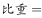
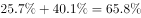
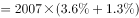
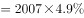
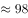
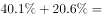
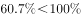
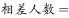
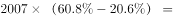
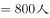

# 综合分析（选非）——比重跨扇区加总、占比×样本量2007求人数、两集合占比之和与100%比较的交集必然性判断

考点：[[20-考点/资料分析/综合/综合分析（选非）——比重跨扇区加总、占比×样本量2007求人数、两集合占比之和与100%比较的交集必然性判断|综合 / 综合分析（选非）——比重跨扇区加总、占比×样本量2007求人数、两集合占比之和与100%比较的交集必然性判断]]
材料：[[15-材料/资料分析/194344 某市统计局对2007名18岁以上常住|194344 某市统计局对2007名18岁以上常住]]

**问法模型**：「不能从上述资料推出的是」→四个独立命题逐项验算：能由占比加总或占比×2007直接核验的判真排除，含「有人/一定」必然性措辞的命题须比较两集合占比之和与100%（和＜100%推不出必然有交集）

## 推理链
1. 第1步：文字段给出样本总量2007人及共享意愿四分类（无条件愿意/有条件愿意/不愿意/不知道·不清楚，四个比重数值在给定文本中空缺）；图1存书量占比：50册及以下40.1%、51-100册25.7%、101-300册21.9%、301-500册6.7%、501册及以上5.6%；图2翻阅程度占比：全部翻阅40.1%、四分之三20.4%、一半左右22.9%、四分之一7.4%、一成左右3.6%、没有翻阅4.3%、不知道/不清楚1.3%
2. 第2步：A项用跨扇区加总：家庭存书不超过100册=50册及以下＋51-100册=40.1%+25.7%=65.8%＞50%，「有一半以上」成立，A可推出
3. 第3步：B项用占比×2007：被翻阅一成左右占3.6%，3.6%×2007≈72人；即便按官方口径并入「不知道/不清楚」1.3%，(3.6%+1.3%)×2007≈98人仍≤100人，B可推出
4. 第4步：C项用集合交集必然性：全部翻阅占40.1%（40.1%×2007≈805人），官方解析口径为「不愿意」占比与40.1%之和＜100%，占比之和小于整体时两集合可能完全没有交集，故「全部翻阅的受访市民中有人选择不愿意」无法确定，C不能推出
5. 第5步：D项用占比差×2007：无条件愿意与不愿意的占比之差（原卷文字数值）×2007，官方判定相差超过800人（即占比差＞800/2007≈39.9%），D可推出
6. 第6步：本题为选非题，A、B、D均能推出，唯一不能推出的是C，故正确答案为C

**最快解法**：⚡ 选非题逐项秒杀：A项图1前两档直加40.1%+25.7%=65.8%＞50%即排除；B项百化分3.6%≈1/28，2007÷28≈72人（加1.3%档也仅98人）≤100即排除；C项抓核心——40.1%＋「不愿意」占比＜100%⇒两集合可能无交集⇒「有人」推不出，锁定答案；D项占比差＞39.9%×2007＞800仅作复核

## 易错点
- ⚠ C项容斥逻辑反用：两集合占比之和＞100%才必然有交集（抽屉原理），之和＜100%只能说明「可能没有」；「有人/一定」类必然命题在占比和＜100%时推不出——这是本题唯一不能推出项的判定核心
- ⚠ 两图各有一个40.1%：图1是「50册及以下」的存书量占比，图2是「全部翻阅」的翻阅程度占比，口径完全不同；B项若误取图1的40.1%会得805人＞100人而误判该项为错
- ⚠ 选非方向＋数据空缺：题干问「不能推出」，勿把验算为真的A/B/D当选；文字段四个意愿比重在给定文本中为空缺（「分别是、、、」），C、D项核验必须回原卷文字取数，严禁拿图1/图2的百分比冒名顶替

## 母题抽象
> 🧩 当综合分析选非题出现「不能推出/无法判断」特征时，先用「占比加总、占比×样本量」逐项验算排除可计算项，最后对含「有人/一定」必然性措辞的选项用「两集合占比之和与100%比较」收口：和＞100%必相交可推出，和＜100%未必相交推不出

**同类特征**：不能从上述资料推出的是（选非题）、一次性截面调查、无年份时间轴、纯占比结构、样本总量2007人、占比×2007换算人数、「全部翻阅」与「不愿意共享」两集合交集必然性判断、跨文字段＋图1＋图2拼合取数、两图同名数值40.1%口径不同

## 相关题
（暂无）

---

### 题干
不能从上述资料推出的是：

### 选项
- A. 
有一半以上的受访市民家庭存书不超过100册

- B. 
家庭存书被翻阅左右的受访市民不超过100人

- C. 
家庭存书被全部翻阅的受访市民中有人选择“不愿意”共享家庭存书
　✅
- D. 
选择“无条件愿意”与选择“不愿意”共享家庭存书的受访市民相差800人以上

### 官方解析

A项：定位图1，受访市民家庭存书51—100册所占比重为，存书50册以下所占比重为。故受访市民家庭存书不超过100册的，多于一半，正确；

B项：定位文字材料和图2，某市统计局成功访问了18岁以上的常住市民2007人，家庭存书被翻阅一成左右的受访市民所占比重为，不知道/不清楚的占。一成即，故家庭存书被翻阅左右的人数总人数比重人100人，正确；

C项：定位图2和文字材料，存书被全部翻阅的受访市民所占比重为，选择“不愿意”共享家庭存书的受访市民所占比重为。二者之和为，二者之和小于整体，所以二者之间可能没有交集，故不能确定被全部翻阅的受访市民中有人选择“不愿意”共享家庭存书，错误；

D项：定位文字材料，某市统计局成功访问了18岁以上的常住市民2007人，关于家庭存书共享意愿问题，选择“无条件愿意”和“不愿意”的受访市民占受访市民所占比重为和。故选择“无条件愿意”与“不愿意”共享家庭存书的受访市民故，即相差超过800人，正确。

本题为选非题，故正确答案为C。

### 给定材料

        为了解市民家庭存书（不含教材教辅）阅读和共享意愿情况，某市统计局成功访问了18岁以上的常住市民2007人。调查显示，关于家庭存书共享意愿的问题，选择“无条件愿意”“有条件愿意”“不愿意”“不知道/不清楚”的受访市民所占比重分别是、、、。

> [!warning] 疑点（官方解析可能有误，待人工复核）
> 给定文本文字段中四个意愿比重数值空缺（「分别是、、、」），官方解析中相应数字亦因排版丢失，D项所需的两个意愿占比及C项中「不愿意」占比无法在本文本内做数值复核（B项可由图2核验：(3.6%+1.3%)×2007≈98≤100），只能依官方结论采信A/B/D可推出、C不能推出；此属文本数据缺失的口径问题，与答案C的判定逻辑（40.1%＋不愿意占比＜100%⇒可能无交集）无冲突，不影响答案

<!-- CODEX-ANSWER-REVIEW:BEGIN -->
### 本次独立复核

**复核状态：** `confirmed`（独立复算确认答案）

**计分答案：** C（可计分）

**复核解析：**

题图16256f1e38d79ac.jpg中不超过100册比例=40.1%+25.7%=65.8%>50%；“翻阅一成左右”为3.6%，2007×3.6%=72.3<100；“全部翻阅”40.1%与“不愿意共享”比例之和小于100%，可构造不相交人群，不能推出必有交集，故选非C；共享意愿差值按原文比例差超过800人。

**相关信息：**

独立复核：资料分析综合判断；题图数据按单位与比较对象重新计算。

**题源依据：** [固定版本原题](https://github.com/Mentat-Uran/kaogongzhentizhengliu/blob/84ab93d4b64b61d897bece8a1c0a5bab06b4feb2/10-%E7%9C%9F%E9%A2%98/%E8%B5%84%E6%96%99%E5%88%86%E6%9E%90/%E7%BB%BC%E5%90%88/2172297%20%E7%BB%BC%E5%90%88%E5%88%86%E6%9E%90%EF%BC%88%E9%80%89%E9%9D%9E%EF%BC%89%E2%80%94%E2%80%94%E6%AF%94%E9%87%8D%E8%B7%A8%E6%89%87%E5%8C%BA%E5%8A%A0%E6%80%BB%E3%80%81%E5%8D%A0%E6%AF%94%C3%97%E6%A0%B7%E6%9C%AC%E9%87%8F2007%E6%B1%82%E4%BA%BA%E6%95%B0%E3%80%81%E4%B8%A4%E9%9B%86%E5%90%88%E5%8D%A0%E6%AF%94%E4%B9%8B%E5%92%8C%E4%B8%8E100%25%E6%AF%94%E8%BE%83%E7%9A%84%E4%BA%A4%E9%9B%86%E5%BF%85%E7%84%B6%E6%80%A7%E5%88%A4%E6%96%AD.md)；固定内容 commit `84ab93d4b64b61d897bece8a1c0a5bab06b4feb2`，Markdown blob `e874214b6bfc23d85a258e768d5398ec1d41d06e`。
<!-- CODEX-ANSWER-REVIEW:END -->
