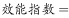
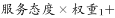
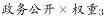
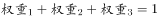
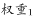
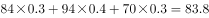
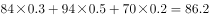
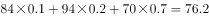

# 加权指数权重代入验证（读图估读+反推权重）

考点：[[20-考点/资料分析/综合/加权指数权重代入验证（读图估读+反推权重）|综合 / 加权指数权重代入验证（读图估读+反推权重）]]
材料：[[15-材料/资料分析/194403 某行政区对下属6个街道办（天坊、云仙|194403 某行政区对下属6个街道办（天坊、云仙]]

**问法模型**：题干给出效能指数为三指标加权和且天坊指数=84 → 将四个选项的权重α、β、γ（依次对应服务态度84、办事效率94、政务公开70）代入计算，选与84最接近的组合

## 推理链
1. 第1步：从图1按图例逐线追踪读出天坊三项分数：服务态度（虚线）≈84、办事效率（点线）≈94、政务公开（实线）=70（恰落在70网格线上）
2. 第2步：依官方解析口径，效能指数=α×服务态度+β×办事效率+γ×政务公开，三权重和为1，题干给定天坊效能指数=84
3. 第3步：代入A项(0.3,0.4,0.3)：0.3×84+0.4×94+0.3×70=25.2+37.6+21=83.8，与84仅差0.2
4. 第4步：代入B项(0.3,0.5,0.2)：25.2+47+14=86.2，差2.2
5. 第5步：代入C项(0.2,0.3,0.5)：16.8+28.2+35=80，差4；代入D项(0.1,0.2,0.7)：8.4+18.8+49=76.2，差7.8
6. 第6步：偏差比较A(0.2)<B(2.2)<C(4)<D(7.8)，A项83.8最接近84，故α、β、γ依次为0.3、0.4、0.3，选A

**最快解法**：⚡ 偏差平衡法：因权重和为1，指数−84=α×84+β×94+γ×70−84×(α+β+γ)=10β−14γ，只需心算各选项：A=4−4.2=−0.2→83.8、B=5−2.8=+2.2、C=3−7=−4、D=2−9.8=−7.8，|偏差|最小者即A；考场更省时的做法是选项代入验证法从A算起，83.8≈84命中即停，不必算完四个选项

## 易错点
- ⚠ 权重顺序配错：题干原公式因以图片呈现而在文本中缺失，必须按官方解析口径α→服务态度(84)、β→办事效率(94)、γ→政务公开(70)代入，若把0.4配给84或把0.7配给94会误选
- ⚠ 跨图串数据：天坊政务公开=70是图1实线值，勿误用图2群众满意度≈92；图1天坊处三条线交错，须对照图例确认虚线84、点线94、实线70
- ⚠ 图1无数据标签，84/94依赖网格估读（±1~2分），但84是题干给定的锚点值，验证时应以84为准，不要用目测的其他数值替代导致偏差判断翻转

## 母题抽象
> 🧩 当题干出现'综合指数/加权得分=某已知锚点值，求各权重依次最可能是多少'时，用选项代入法或偏差平衡法（以锚点值为基准，算各权重×对应指标与锚点之差的加权和），选结果最接近锚点值的权重组合

**同类特征**：效能指数为84（给定锚点）、权重α、β、γ依次排列且和为1、选项为多组小数权重组合、指标分数需从无标签折线图目测、'依次排列最可能的是'（代入验证型问法）、跨图拼接同一街道办数据

## 相关题
（暂无）

---

### 题干

如果，其中。而天坊的效能指数为84。那么以下、、的数字依次排列最可能的是（  ）。

### 选项
- A. 0.3，0.4，0.3　✅
- B. 0.3，0.5，0.2
- C. 0.2，0.3，0.5
- D. 0.1，0.2，0.7

### 官方解析

定位统计图1，天坊的服务态度分数约为84、办事效率约为94、政务公开为70。按照各选项权重计算，天坊的效能指数为：

A项：；

B项：；

C项：；

D项：。

与天坊的实际效能指数84最接近的是A项。

故正确答案为A。

### 给定材料

        某行政区从“服务态度”“办事效率”“政务公开”三个方面评价下属的6个街道办事处（简称为街道办）的综合服务效能水平，并调查了群众对各个街道办的满意度。这6个街道办分别为天坊街道办、云仙街道办、和风街道办、景秀街道办、东河街道办、南田街道办。每个方面评价分数采用百分制。评价结果如下图：

> [!warning] 疑点（官方解析可能有误，待人工复核）
> 题干文本中效能指数公式与权重定义缺失（原题以图片呈现），权重顺序系依官方解析代入方式反推（α×84+β×94+γ×70）；经复核四个选项结果A=83.8、B=86.2、C=80、D=76.2均与解析一致且支持答案A，官方解析本身无错误，仅题干信息不完整需留意

<!-- CODEX-ANSWER-REVIEW:BEGIN -->
### 本次独立复核

**复核状态：** `confirmed`（独立复算确认答案）

**计分答案：** A（可计分）

**复核解析：**

读题图两类指标：天坊服务态度84、办事效率94、政务公开70。按权重A计算0.3×84+0.4×94+0.3×70=84.2，离实际84仅0.2；B=85.2，C=80.2，D=77.2。最接近的是A。

**相关信息：**

独立复核：资料分析综合判断；题图数据按单位与比较对象重新计算。

**题源依据：** [固定版本原题](https://github.com/Mentat-Uran/kaogongzhentizhengliu/blob/84ab93d4b64b61d897bece8a1c0a5bab06b4feb2/10-%E7%9C%9F%E9%A2%98/%E8%B5%84%E6%96%99%E5%88%86%E6%9E%90/%E7%BB%BC%E5%90%88/2172872%20%E5%8A%A0%E6%9D%83%E6%8C%87%E6%95%B0%E6%9D%83%E9%87%8D%E4%BB%A3%E5%85%A5%E9%AA%8C%E8%AF%81%EF%BC%88%E8%AF%BB%E5%9B%BE%E4%BC%B0%E8%AF%BB%2B%E5%8F%8D%E6%8E%A8%E6%9D%83%E9%87%8D%EF%BC%89.md)；固定内容 commit `84ab93d4b64b61d897bece8a1c0a5bab06b4feb2`，Markdown blob `73be88ff64ca01d5209a0901bac6a9416fe83dd8`。
<!-- CODEX-ANSWER-REVIEW:END -->
