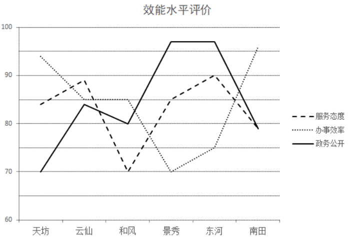
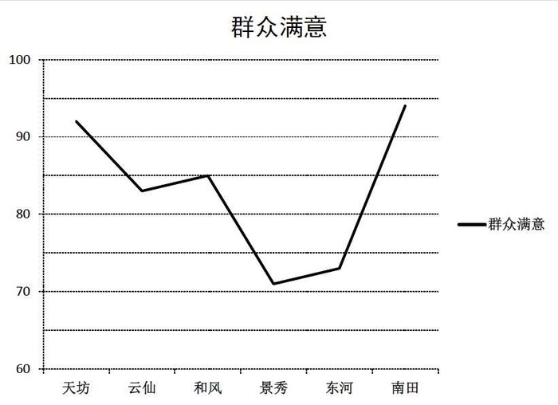

# 综合分析判断题（选非题·逐项读图核对）

考点：[[20-考点/资料分析/综合/综合分析判断题（选非题·逐项读图核对）|综合 / 综合分析判断题（选非题·逐项读图核对）]]
材料：[[15-材料/资料分析/194403 某行政区对下属6个街道办（天坊、云仙|194403 某行政区对下属6个街道办（天坊、云仙]]

**问法模型**：“以下说法错误的是”为选非题 → 逐项定位图1/图2对应数据点核对，锁定错误说法

## 推理链
1. 第1步：读图1《效能水平评价》三条线（虚线=服务态度、点线=办事效率、实线=政务公开）：云仙约89/85/84，和风约70/85/80
2. 第2步：A项核对图2《群众满意》：南田≈94＞天坊≈92＞和风≈85＞云仙≈83＞东河≈73＞景秀≈71，与选项排序一致，说法正确
3. 第3步：B项核对图1政务公开（实线）：景秀≈97与东河≈97两点同高，且高于其余4个街道办，为并列第一，说法正确
4. 第4步：C项核对图1南田：服务态度与政务公开两个数据点重合（均约79~80），即分数相同，说法正确
5. 第5步：D项核对图1办事效率（点线）：云仙与和风的数据点同在85分网格上，得分相同，并非云仙“均比”和风高，说法错误
6. 第6步：本题为选非题，故选D

**最快解法**：⚡ 选非题逐项排错＋数据点重合判等：D项只需对齐图1点线（办事效率）上云仙与和风两个点——两点同高（均约85）即得分相同，“均比…高”不成立，直接锁定D；无需逐一精读全部18个点

## 易错点
- ⚠ 三线交错易串线：D项考察的是办事效率（点线），若错追踪虚线或实线会误判云仙更高；云仙与和风在点线上两数据点同高，等高即等分，不能凭线段走向判断高低
- ⚠ 纵轴从60起步且无数据标签，云仙三项（约89/85/84）间距极小，须借助细分网格分辨，估读误差±1~2分内相近值应视为可能相等
- ⚠ 选非题思维定势：四项中三项为正确说法，易惯性选“说法正确”的项而漏掉题干要求的“错误”

## 母题抽象
> 🧩 当题干出现“以下说法错误的是”且各选项对应图中具体数据点时，先核“并列/相等/重合”类说法（等高点即等分，最易埋雷），再核排序类说法，逐项定位排除

**同类特征**：以下说法错误的是（选非题）、分数从高到低排序验证、并列第一、两数据点重合即分数相同、逐项跨图核对、三线交错读图

## 相关题
- [[10-真题/资料分析/综合/2062836 综合分析·选非题（正误判断）|2062836]]（广州市考 2016，相关度1）
- [[10-真题/资料分析/综合/2045764 综合判断题（选非）：同比增速表述校验、比重反推与比值递增、现期大小比较|2045764]]（广州市考 2017，相关度1）

---

### 题干
以下说法错误的是（  ）。

### 选项
- A. 街道办的“群众满意”分数从高到低排序分别是南田、天坊、和风、云仙、东河、景秀
- B. 在“政务公开”中分数并列第一的街道办是东河和景秀
- C. 南田街道办在“服务态度”和“政务公开”取得的分数相同
- D. 云仙街道办三个效能分数均比和风街道办的要高　✅

### 官方解析
A项：定位统计图2，“群众满意”分数从高到低排序为：南田天坊和风云仙东河景秀，正确；
B项：定位统计图1，“政务公开”中，景秀与东河分数相同，且高于其他4个街道办，为并列第一，正确；
C项：定位统计图1，南田街道办“服务态度”和“政务公开”的数据点重合，即分数相同，正确；
D项：定位统计图1，云仙、和风的办事效率得分均为85分，二者得分相同，错误。
本题为选非题，故正确答案为D。

### 给定材料

        某行政区从“服务态度”“办事效率”“政务公开”三个方面评价下属的6个街道办事处（简称为街道办）的综合服务效能水平，并调查了群众对各个街道办的满意度。这6个街道办分别为天坊街道办、云仙街道办、和风街道办、景秀街道办、东河街道办、南田街道办。每个方面评价分数采用百分制。评价结果如下图：

