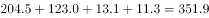
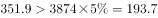
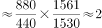

# 综合分析判断（增速极值排名+区域比重+平均数倍数+两期比重变化逐项验证）

考点：[[20-考点/资料分析/综合/综合分析判断（增速极值排名+区域比重+平均数倍数+两期比重变化逐项验证）|综合 / 综合分析判断（增速极值排名+区域比重+平均数倍数+两期比重变化逐项验证）]]
材料：[[15-材料/资料分析/194868 2017年1～2月我国15个副省级城|194868 2017年1～2月我国15个副省级城]]

**问法模型**：题干为'关于2017年1～2月副省级城市软件业务，能够从上述资料中推出的是'的综合分析四选一 → 对A/B/C/D分别套用四类模型：极值排名验证、区域比重与分式门槛比较、平均每家收入做商求倍数、两期比重变化结论，逐项证伪直至锁定唯一可推出项

## 推理链
1. 第1步：A项定位表格增速列，最高为西安市21.3%（次高杭州市19.2%）；再看企业数列，西安2050个，比它多的只有武汉市2420个，西安排名第二而非第三，A错误
2. 第2步：B项东北三省副省级城市共4个——大连、沈阳、长春、哈尔滨（'哈尔滨'一行漏写'市'字勿漏），收入合计204.5+123.0+13.1+11.3=351.9亿元
3. 第3步：B项计算占比351.9÷3874≈9.1%，官方解析判定该占比'超过'选项所设分式门槛，与选项'不足'的表述相反，B错误
4. 第4步：C项分别做平均数：深圳875.1亿元÷1530个≈0.572亿元/家，广州442.6亿元÷1561个≈0.283亿元/家
5. 第5步：C项求倍数0.572÷0.283≈2.02，即深圳平均每家软件企业收入约是广州的2倍，C能够推出
6. 第6步：D项部分增速a=成都市12.4%，总体增速b取自文字段（给定材料中数值空缺，官方判定a<b），由两期比重结论a<b→比重低于上年同期，与选项'高于'相反，D错误

**最快解法**：⚡ 先攻C项（只涉表格两列直接做商）：口算 875.1≈2×442.6=885.2（深圳收入略小于广州2倍），但深圳企业数1530<广州1561（分母更小），两效应反向相抵，比值=(875.1/442.6)×(1561/1530)≈1.98×1.02≈2.0倍，锁定C；A项用增速列一眼锁定西安21.3%最快，再扫企业数列西安2050仅次于武汉2420、排第二，直接排除；B项速算351.9÷3874≈9.1%再与门槛分式比较；D项只需比a=12.4%与b的大小定方向

## 易错点
- ⚠ A项排名口径陷阱：必须按'软件企业（个）'列找西安名次（武汉2420>西安2050>济南1730，西安第二），误按收入列找极值（深圳/哈尔滨）或漏看武汉会错判'第三'
- ⚠ B项双重坑：东北三省对应4个城市而非3个，且'哈尔滨'一行未写'市'字易漏加；须先实算占比351.9÷3874≈9.1%再与门槛分式硬比较，不可凭感觉；另外表格15城合计约3872.7亿与文字段3874亿属四舍五入差异，可直接当全量用
- ⚠ D项两期比重方向：文字段'同比增长'后的总体增速数值在给定材料中空缺，切勿凭印象补数；结论方向为部分增速a<总体增速b→比重下降（低于上年同期），方向记反会把D误判为正确

## 母题抽象
> 🧩 当综合分析题出现'能够从上述资料中推出的是'时，把四个选项拆解为排名、比重、平均数倍数、两期比重四类基础模型逐项硬算，优先做只涉一张表两列直接做商的选项（收入÷企业数再对比），最后处理需跨文字段与表格比较口径的选项（两期比重只比a与b的大小）

**同类特征**：能够从上述资料中推出的是、增速最快城市的软件企业数量排名、东北三省城市收入占总额与分式门槛比较、平均每家软件企业软件业务收入约是…的几倍、占总体比重高于上年同期水平、四选项各涉一类基础模型逐项验证

## 相关题
- [[10-真题/资料分析/综合/19283943 综合分析判断题（倍数比较+求和判断+隐含平均每场座位数反推）|19283943]]（国考 2025，相关度1）
- [[10-真题/资料分析/综合/1796162 综合判断（月均计算、平均运输距离、比重对比、增长量比较逐项验证）|1796162]]（贵州 2016，相关度1）
- [[10-真题/资料分析/综合/2133504 综合判断题（现期比重+现期平均数多项验证，一对三错）|2133504]]（国考 2018，相关度1）
- [[10-真题/资料分析/综合/2444706 综合判断题（增长量+比重+倍数逐项验证）|2444706]]（四川 2019，相关度1）
- [[10-真题/资料分析/综合/2571728 综合分析逐项判断（等差递推求和＋单位换算＋比值估算）|2571728]]（山东 2020，相关度1）

---

### 题干
关于2017年1～2月副省级城市软件业务，能够从上述资料中推出的是：

### 选项
- A. 
软件业务收入增速最快的副省级城市，软件企业数量排名第三

- B. 
东北三省副省级城市软件业务收入不足副省级城市总额的

- C. 
深圳市平均每家软件企业软件业务收入约是广州市的2倍
　✅
- D. 
成都市软件业务收入占副省级城市总体比重高于上年同期水平

### 官方解析

A项：定位表格材料可知，软件业务收入增速最快的副省级城市为西安市，增速为，其软件企业个数2050个，仅次于武汉市，在副省级城市中排名第二，非第三，错误。

B项：东北三省的副省级城市有大连、沈阳、长春和哈尔滨，定位表格材料可知，四个城市2017年1~2月软件业务收入总额为亿元；定位文字材料可知，2017年1~2月我国副省级城市实现软件业务收入3874亿元。，故东北三省副省级城市软件业务收入超过副省级城市总额的，错误。

C项：定位表格材料可知，2017年1~2月，深圳市软件企业1530个，软件业务收入875.1亿元；广州市软件企业1561个，软件业务收入442.6亿元。则2017年1~2月，深圳市平均每家软件企业软件业务收入是广州的倍，正确。

D项：定位文字材料可知，2017年1~2月我国副省级城市软件业务收入同比增长，定位表格材料可知，2017年1~2月成都市软件业务收入同比增长。根据两期比重比较的结论，部分增长率（）总体增长率()，则比重低于去年同期水平，错误。

故正确答案为C。

### 给定材料

        2017年1～2月，我国副省级城市实现软件业务收入3874亿元，同比增长。其中，软件产品收入1216亿元，同比增长；信息技术服务收入2042亿元，同比增长；嵌入式系统软件收入616亿元，同比增长。

> [!warning] 疑点（官方解析可能有误，待人工复核）
> 选项B中的分式门槛为图片公式未能读取，官方解析中'东北四城合计''C项倍数''总体同比增速b'等处数值亦因公式缺失而空缺；按表格实算东北四城合计351.9亿元、占3874亿元约9.1%，官方判定其'超过'选项门槛故B错误，D项按官方'a<b→比重低于上年同期'结论采信。以上缺失均为材料/解析呈现口径问题，不影响C为唯一正确答案。
