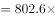
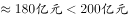

# 综合分析题（比重反推金额+混合比重居中而不中+部分与整体比较+基期值计算，逐项验证）

考点：[[20-考点/资料分析/综合/综合分析题（比重反推金额+混合比重居中而不中+部分与整体比较+基期值计算，逐项验证）|综合 / 综合分析题（比重反推金额+混合比重居中而不中+部分与整体比较+基期值计算，逐项验证）]]
材料：[[15-材料/资料分析/194870 2017年1～4月S市对欧盟进出口贸|194870 2017年1～4月S市对欧盟进出口贸]]

**问法模型**：题干问'能够从上述资料中推出的是'→ 对四选项分别套用：A项总值802.6×加工贸易占比与200亿元比较、B项混合比重'居中而不中'判出口/进口占全国比重高低、C项前3大国加总与总值一半(802.6÷2=401.3亿元)比较、D项基期=113.5÷(1+增速)与100亿元比较

## 推理链
1. 第1步：A项提取——第1段总值802.6亿元，第2段给出加工贸易占比（原版百分数）；若要超过200亿元，占比须大于200÷802.6≈24.9%，官方判定加工贸易总值未达200亿元，A错误
2. 第2步：B项提取——出口621.2亿元、进口181.4亿元，权重比约3.4:1，出口金额远大于进口；由混合比重'居中而不中'，总值占全国比重更靠近权重大的出口一端，故出口占全国比重＞进口占全国比重，B'出口占比低于进口占比'错误
3. 第3步：C项提取——第3段按金额排前3的贸易国为德国164.3、英国123、荷兰108.1，合计395.4亿元
4. 第4步：C项判定——总值一半为802.6÷2=401.3亿元，395.4<401.3（仅差5.9亿元），前3大贸易国不足总值一半，C错误
5. 第5步：D项提取——第3段对'一带一路'沿线欧盟国家现期113.5亿元、同比增长（原版增速r）
6. 第6步：D项代入——基期=113.5÷(1+r)，只要r<13.5%即有113.5÷(1+r)>100亿元，官方判定上年同期超过100亿元，D正确
7. 第7步：对照四项判定（错、错、错、对），锁定答案D

**最快解法**：⚡ 先攻数据最直接的D项：基期=113.5÷(1+r)与100亿元比较，只需核对原版增速是否小于13.5%（截位口算113.5/100=1.135作分母上限），成立即选D；若需排他验证，C项加总164.3+123+108.1=395.4与401.3差5.9亿元即可排除，A项以200÷802.6≈24.9%作占比门槛反推，B项用出口:进口≈3.4:1的权重定'靠近出口'方向排除

## 易错点
- ⚠ '前3大贸易国'是金额前三（德、英、荷，须把法国81.1、意大利61.4排除），且395.4与401.3仅差5.9亿元，必须精确加总、不可粗估，更不能误用五国合计537.9亿元当分子
- ⚠ B项混合比重：整体占比偏向的是金额权重大的一方（出口621.2远大于进口181.4），勿错用'对欧盟进出口总值占比'802.6亿元对应的全口径比重与'占全市'内部比重混同（同名不同径陷阱）
- ⚠ D项基期陷阱：'增长'为正增速，基期=现期÷(1+增速)是除法非乘法；正文增速与占比百分数空缺，定量判断须以原版材料补齐，不得凭空设数

## 母题抽象
> 🧩 当综合分析题出现'能够从上述资料中推出的是'且四个选项分属'比重反推金额、混合比重比较、部分与整体一半比较、基期值计算'时，优先验证公式最简、数据最直接的选项（基期=现期÷(1+r)对照整数关口），再用精确加总与门槛值(如总值÷2)排除其余

**同类特征**：综合分析·能够推出的是、混合比重居中而不中、前N大贸易国加总与整体比较、基期值=现期÷(1+增速)对照整数关、比重反推金额与门槛值比较、文字材料三段逐项定位

## 相关题
（暂无）

---

### 题干
关于2017年1～4月S市对欧盟贸易情况，能够从上述资料中推出的是：

### 选项
- A. 以加工贸易方式进出口总值超过200亿元
- B. 对欧盟出口总值占全国比重低于自欧盟进口总值占全国比重
- C. 对欧盟前3大贸易国进出口总值超过对欧盟进出口额的一半
- D. 上年同期对“一带一路”沿线欧盟国家进出口超过100亿元　✅

### 官方解析

A项：定位材料第一段可知，2017年1~4月S市对欧盟进出口总值为802.6亿元，定位材料第二段可知，2017年1~4月S市以加工贸易方式进出口总值占同期全市对欧盟进出口总值的，则2017年1~4月，S市以加工贸易方式进出口总值，错误；

B项：定位材料第一段可知，2017年1~4月S市对欧盟进出口总值占全国比重为，对欧盟出口总值占全国比重为，根据混合比重的结论“居中而不中”，可得进口总值占全国比重进出口总值占全国比重（）出口总值占全国比重（），错误；

C项：定位材料第一段可知，S市对欧盟进出口总值为802.6亿元，定位材料第三段，可得S市对欧盟前3大贸易国进出口总值分别为：德国（164.3亿元）、英国（123亿元）、荷兰（108.1亿元），，错误；

D项：定位材料第三段可知，2017年1~4月S市对“一带一路”沿线欧盟国家进出口113.5亿元，增长，则上年同期S市对“一带一路”沿线欧盟国家进出口额，正确。

故正确答案为D。

### 给定材料

        2017年1～4月，S市对欧盟进出口总值为802.6亿元人民币，比去年同期（下同）增长，占我国对欧盟进出口总值的。其中，对欧盟出口621.2亿元，增长，占我国对欧盟出口总值的；自欧盟进口181.4亿元，增长。

        1～4月，S市对欧盟以一般贸易方式进出口总值增长，占同期全市对欧盟进出口总值的；以加工贸易方式进出口总值下降，占同期全市对欧盟进出口总值的；以海关特殊监管方式进出口总值为139.3亿元，下降。

        1～4月，在欧盟前5大贸易国中，S市对德国进出口164.3亿元，增长；对英国进出口123亿元，增长；对荷兰进出口108.1亿元，增长；对意大利进出口61.4亿元，增长；对法国进出口81.1亿元，下降。同期，对“一带一路”沿线欧盟国家进出口113.5亿元，增长。

> [!warning] 疑点（官方解析可能有误，待人工复核）
> 本材料正文所有同比增速与占比百分数显示为空缺，官方解析中对应的加工贸易占比、出口/进口占全国比重、'一带一路'增速等具体数值亦随之缺失，A/B/D的定量结论（加工贸易未超200亿、出口占比高于进口占比、增速小于13.5%使基期超100亿）均只能按官方判定结论记录，实际解题须以原版材料补齐数值后方可复核。
