# 综合判断题（倍数验证+逐年比重比较+平均数数据完整性+逐年差值比较）

考点：[[20-考点/资料分析/综合/综合判断题（倍数验证+逐年比重比较+平均数数据完整性+逐年差值比较）|综合 / 综合判断题（倍数验证+逐年比重比较+平均数数据完整性+逐年差值比较）]]
材料：[[15-材料/资料分析/194911 广东省医疗卫生资源2009—2016|194911 广东省医疗卫生资源2009—2016]]

**问法模型**：题干为'下列说法正确的是'四选一综合判断 → 逐项匹配对应模型：倍数=现期÷基期、比重=逐年部分÷合计、平均数先核查数据年份是否齐全、差值=护士−医师逐年相减，排除三项取唯一正确项

## 推理链
1. 第1步：A项从图1读出2009年机构数4.43万个、2016年4.91万个，倍数=4.91÷4.43≈1.11倍≠1.5倍，A错误
2. 第2步：B项从图2逐年计算医院床位占比：2012年27.3/35.5≈76.9%、2013年29.4/37.8≈77.8%、2014年32/40.6≈78.8%、2015年34.5/43.6≈79.1%、2016年37.2/46.5=80.0%（46.5×0.8=37.2恰好整除）
3. 第3步：2016年占比恰好等于80%而非低于80%，'均低于80%'不成立，B错误
4. 第4步：C项判断平均卫生技术人员数需图1机构数与图3人员数拼接，但图3仅有2012—2016年数据，2009—2011年卫生技术人员数缺失，'均大于10'无法验证，C错误
5. 第5步：D项从图3逐年相减：2012年20−19.9=0.1、2013年21.8−21.1=0.7、2014年23.4−21.7=1.7、2015年25.4−22.9=2.5、2016年28.4−24.4=4.0万人，差值逐年扩大且2016年最大，D正确

**最快解法**：⚡ 综合判断的考场提速套路：A项截位直除4.91/4.43≈1.1秒杀排除；B项无需算满5年，只验末年37.2/46.5=0.8（46.5×8=372恰好整除）即推翻'均低于'；C项直接以'图3无2009—2011年数据'零计算排除；D项逐年心算差值0.1→0.7→1.7→2.5→4.0单调递增即可锁定

## 易错点
- ⚠ B项阈值陷阱：2016年医院床位占比恰好等于80%（37.2/46.5=0.8），'低于'不包含'等于'，若把等于当低于会误判B正确；且占比分母必须用床位合计（35.5~46.5），不能用医院+卫生院之和（2016年37.2+5.7=42.9），图2合计大于分项之和
- ⚠ C项数据完整性陷阱：'2009—2016年均大于10'要求8个年份全部可验证，图3只覆盖2012—2016年，凭2012年后数值都大于10的趋势默认成立会误判C正确
- ⚠ D项比的是差值不是比值：直接护士−医师逐年相减即可，勿算护士÷医师；同时注意A项基期为2009年4.43，勿用其他年份数据

## 母题抽象
> 🧩 当题干出现'下列说法正确的是'综合判断时，按'倍数（现期÷基期）→比重（逐年部分÷合计）→平均数（先核对各图年份覆盖是否齐全）→差值（逐年相减）'的顺序逐项最小化计算验证，优先利用'数值恰好等于阈值'和'所跨年份超出图表范围'两类零成本排除点

**同类特征**：下列说法正确的是、现期是基期的几倍、占比均低于某阈值、跨图拼接平均指标、两者相差最大的年份、判断年份超出图表覆盖范围

## 相关题
- [[10-真题/资料分析/综合/2195856 综合判断题·增长倍数口径下的基期反推与定性表述可推性验证|2195856]]（黑龙江 2018，相关度1）
- [[10-真题/资料分析/综合/10204448 综合分析-逐项判断（历史极值确认、两期比重比较、多期累计求和、基期比重）|10204448]]（广东 2024，相关度1）
- [[10-真题/资料分析/综合/1772378 综合分析判断题（多选项直接查找与数据比较）|1772378]]（深圳市考 2016，相关度1）
- [[10-真题/资料分析/综合/2033342 综合分析题（增速逐年比较＋两期比重比较＋库存流量平衡式混合判断）|2033342]]（河南 2016，相关度1）
- [[10-真题/资料分析/综合/2060624 综合分析题（口径辨析+方向词核验+同比减少量计算的四选项正误判断）|2060624]]（深圳市考 2017，相关度1）

---

### 题干
根据材料，下列说法正确的是（  ）。

### 选项
- A. 
2016年全省医疗卫生机构数量是2009年的1.5倍

- B. 
2012—2016年，医院床位数占全省医疗卫生机构床位数的比例均低于

- C. 
2009—2016年，全省医疗卫生机构的平均卫生技术人员数均大于10

- D. 
2012—2016年，全省医疗卫生机构中注册护士与执业（助理）医师人数相差最大的是2016年
　✅

### 官方解析

A项：定位统计图1中2009年全省医疗卫生机构数量为4.43万个，2016年为4.91万个，可得2016年全省医疗卫生机构数量是2009年的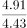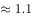倍，错误；

B项：定位统计图2中2012-2016年数据，可得

2012年医院床位数占全省医疗卫生机构床位数的比例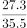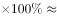；

2013年医院床位数占全省医疗卫生机构床位数的比例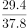；

2014年医院床位数占全省医疗卫生机构床位数的比例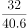；

2015年医院床位数占全省医疗卫生机构床位数的比例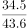；

2016年医院床位数占全省医疗卫生机构床位数的比例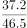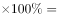。

由于2016年比例为，不满足2012-2016年医院床位数占全省医疗卫生机构床位数的比例均低于，错误；

C项：统计图3中没有提供2009-2011年卫生技术人员数量，故无法判断，错误；

D项：定位统计图3，2012年-2016年注册护士与执业（助理）医师人数相差分别为：2012年相差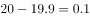万人、2013年相差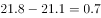万人、2014年相差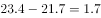万人、2015年相差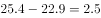万人、2016年相差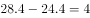万人。比较可知，2012-2016年，全省医疗卫生机构中注册护士与执业（助理）医师人数相差最大的是2016年，正确。

故正确答案为D。

### 给定材料

<b>根据下列资料，回答</b><b>96</b><b>～</b><b>100</b><b>题：</b>

        近年来，广东全省医疗卫生资源总量继续增加，医疗服务能力不断增强。截止2016年底，全省医疗卫生机构4.91万个，医疗卫生机构拥有床位46.5万张，其中：医院37.2万张，卫生院5.7万张。医疗卫生机构卫生技术人员66.8万人，其中：执业（助理）医师24.4万人，注册护士28.4万人，医护比1：1.16。

